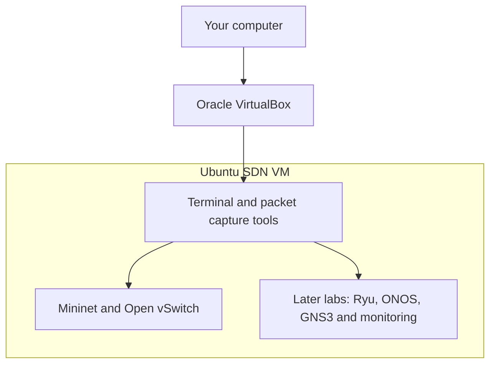
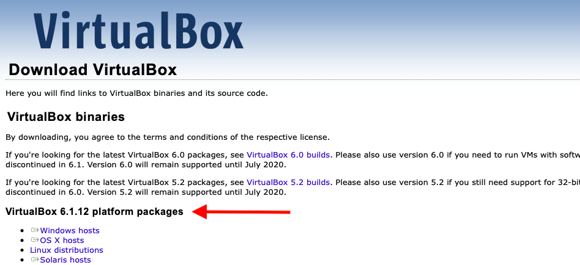
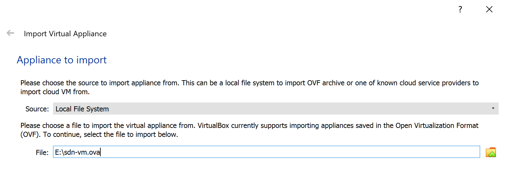
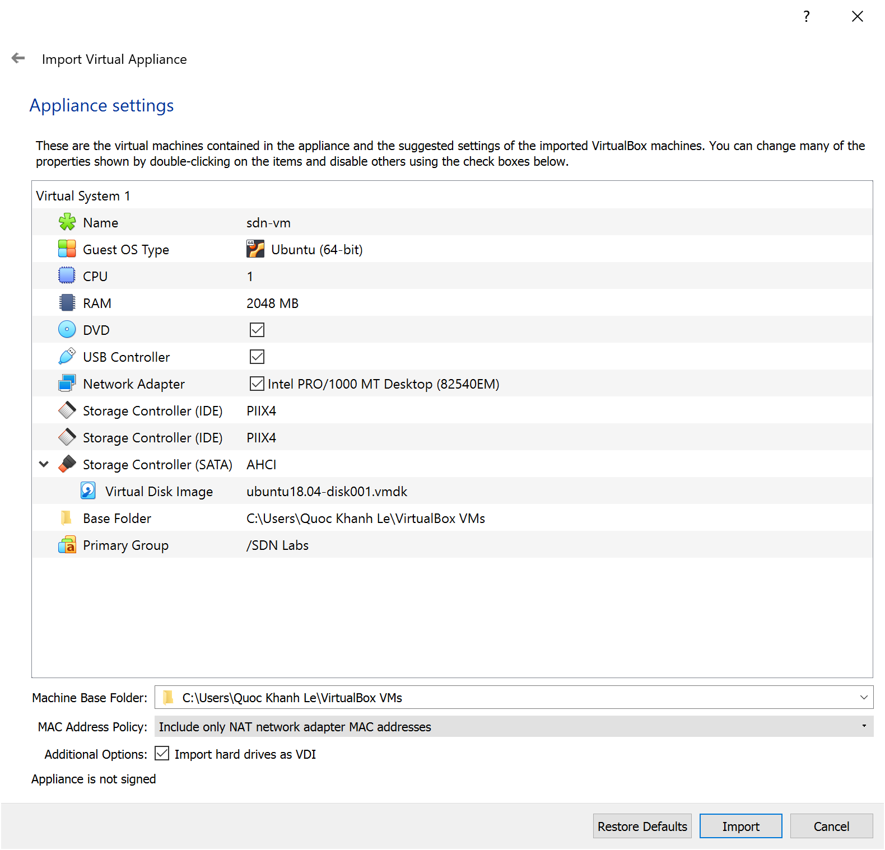

# 00 SDN Lab Setup

## Purpose

Prepare an Ubuntu virtual machine for this SDN learning series. The environment combines Linux networking, Mininet, Open vSwitch (OVS), packet capture tools, and, in later labs, Ryu, ONOS, GNS3, and monitoring software.

There are two ways to begin: import the supplied VM with the applications already installed, or build an introductory environment from Ubuntu. **The supplied VM is the preferred route for following the complete series**, because the controller and appliance versions in the original exercises were tested together.

Oracle VirtualBox runs the Ubuntu VM. Inside Ubuntu, the exercises use open-source SDN tools to explore forwarding, controller behaviour, overlays, and automation. This is a practical SDN learning environment, not a specification of Oracle's production data centre network.

## Environment Layout



The computer running VirtualBox is the **host**. Ubuntu is the **guest VM**. Mininet's emulated hosts are processes inside Ubuntu; they are not additional VirtualBox VMs. GNS3 devices are another layer of lab nodes inside the Ubuntu environment.

## 1 Check Requirements and Choose an Installation Route

| Item | Introductory baseline | Suggested allocation for later labs |
| --- | --- | --- |
| CPU architecture | Intel/AMD x86-64 host for the supplied x86 VM | Same architecture |
| VM CPU | 1 vCPU, matching the original handout | 2–4 vCPUs when available |
| VM RAM | 2 GB for Linux and small Mininet exercises | 8 GB or more for controllers and several GNS3 nodes |
| VM disk | Original image baseline: 20 GB | 40 GB or more for appliances, captures, and projects |
| Host storage | Space for both the downloaded appliance and imported disk | Additional space for snapshots and exports |
| Display | Ubuntu desktop or a working graphical session | Needed for GNS3, xterm, and Wireshark GUI exercises |
| Permissions | An Ubuntu account with sudo access | Same |
| Internet | Needed for initial downloads and any missing packages | Also needed for optional images and updates |

These are learning-environment allocations, not guarantees for every topology. Leave enough RAM and CPU for the host operating system. Confirm the architecture of the published VM before importing it. An ARM Ubuntu installation is not a drop-in replacement for an x86 appliance; consult [VirtualBox's supported host/guest combinations](https://docs.oracle.com/en/virtualization/virtualbox/7.2/user/Introduction.html).

### Verification

On your computer, identify the CPU architecture and available resources using its system information screen. In an existing Ubuntu VM:

```bash
uname -m
nproc
free -h
df -h /
cat /etc/os-release
```

For the supplied x86 image, expect `x86_64`. Record the actual Ubuntu release rather than assuming it matches a screenshot.

## 2 Install Oracle VirtualBox

1. Download the installer for your host operating system from [VirtualBox Downloads](https://www.virtualbox.org/wiki/Downloads).
2. Install VirtualBox using the platform installer.
3. Open VirtualBox Manager.
4. Confirm that hardware virtualization is available to VirtualBox. If the host reports a virtualization error, resolve it before importing the lab VM.

### Verification

VirtualBox Manager should open without an installation error. Check **Help → About** and note its version. Menu labels can vary between releases; the [VirtualBox VM guide](https://docs.oracle.com/en/virtualization/virtualbox/7.2/user/working-with-vms.html) describes the supported workflows.


**VirtualBox download-page example**



*This historical page illustrates choosing the host platform; use the current download link in this step.*

## 3 Option A Import the Supplied VM

### Download the lab appliance

The preconfigured Ubuntu SDN VM has all required applications installed and can be reused across all ten labs and the project. Import it to avoid installing the application stack from scratch.

[Download the preconfigured Ubuntu SDN VM](https://liveswinburneeduau-my.sharepoint.com/:u:/g/personal/braminzad_swin_edu_au/IQAv_m6WfxYaTKZT4O6OhvkvAarseiSla89Hp5I4QfgqrNw?e=bmsMpi)

The VM image is hosted on SharePoint and is not bundled with these README files. Use the VM’s accompanying information for its filename, checksum if provided, resource requirements, and login credentials.

### Import and configure it

1. Download the appliance to your computer and verify its published checksum, if supplied.
2. In VirtualBox Manager, select **Import Appliance** and choose the downloaded `.ova` file.
3. Review the VM name, destination directory, CPU, RAM, and virtual disk settings.
4. Import the appliance. Do not attach an Ubuntu installation ISO over its existing operating system.
5. With the VM powered off, inspect **Settings → Network**. For these first labs, one enabled adapter using **NAT**, with the virtual cable connected, is sufficient for outbound internet access. Retain additional image-specific adapters if the image documentation requires them.
6. Start the VM and log in using the credentials supplied with that image. The original handout's image used username `sdn` and password `sdn`; a republished image may change them.
7. Open an Ubuntu terminal.

The following images are reference screenshots extracted from the original lab handout. They show an older VirtualBox interface and original resource allocation; use the actual image requirements when importing your copy.





### Verification

Inside Ubuntu:

```bash
whoami
hostname
cat /etc/os-release
uname -m
sudo -v
ip -br addr
ip route
getent hosts mininet.org
```

Expect a logged-in user, an identifiable Ubuntu release, working sudo access, an active VM network interface, a default route, and DNS results. These VM interfaces are separate from the `h1-eth0` interfaces that Mininet creates later.

If DNS works, verify outbound HTTPS:

```bash
curl -I https://mininet.org
```

A successful HTTP response confirms that the VM can reach that site. A failed ICMP ping alone does not establish that internet access is unavailable.

After importing, continue to step 5. Do not run the fresh-install instructions over a working preconfigured image.

## 4 Option B Build an Introductory Ubuntu Environment

This alternative prepares **Labs 01–03**. Ryu, ONOS, GNS3 appliances, and monitoring dependencies are additional requirements for the later labs. A fresh Ubuntu installation is not automatically equivalent to the supplied full-series VM.

### Create Ubuntu in VirtualBox

1. Download an x86-64 Ubuntu Desktop LTS ISO from [Ubuntu Desktop Downloads](https://ubuntu.com/download/desktop). Ubuntu 24.04 LTS is a suitable starting point for the package-based introductory path.
2. Create a new Linux/Ubuntu VM, using at least the introductory resources in step 1. A desktop installation will be more comfortable with 4 GB RAM and 2 vCPUs.
3. Attach the ISO and install Ubuntu to the new virtual disk.
4. Boot the installed system, open a terminal, and complete the networking verification in step 3.

### Install the introductory tools

Run inside the fresh Ubuntu VM:

```bash
sudo apt update
sudo apt install -y software-properties-common
sudo add-apt-repository -y universe
sudo apt update
sudo apt install -y mininet openvswitch-switch openvswitch-testcontroller \
  iproute2 iputils-ping net-tools bridge-utils iperf iperf3 \
  tcpdump wireshark tshark xterm nano less tmux git curl wget \
  lsof dnsutils telnet python3
sudo systemctl enable --now openvswitch-switch
```

The Wireshark package may ask whether non-root users should capture packets. The labs can capture with `sudo tcpdump` and open the resulting file as an ordinary user, so non-root live capture permission is optional. If iperf3 asks to run as a service, a permanent service is unnecessary for these exercises.

Mininet's [installation guide](https://mininet.org/download/) documents package and source installation alternatives. Use one installation method in a given VM; mixing distro and source copies can cause Python import and executable-version mismatches.

### Verification

```bash
mn --version
sudo ovs-vsctl --version
sudo ovs-vsctl show
command -v ovs-testcontroller
iperf --version
iperf3 --version
tcpdump --version
wireshark --version
tmux -V
```

Every command should succeed. `ovs-vsctl show` should reach the OVS database, even if there are no bridges yet. `ovs-testcontroller` is a learning-switch controller for tests; it is not the Ryu or ONOS controller used later.

## 5 Check the Installed Application Inventory

On the preconfigured VM, inventory the tools before installing or upgrading anything:

```bash
for tool in mn ovs-vsctl ovs-ofctl ip iperf iperf3 tcpdump \
  wireshark tshark xterm tmux python3 ryu-manager gns3 gns3server docker; do
  if command -v "$tool" >/dev/null 2>&1; then
    printf '%-14s %s\n' "$tool" "$(command -v "$tool")"
  else
    printf '%-14s MISSING\n' "$tool"
  fi
done

ls -ld /opt/onos 2>/dev/null
ls -ld "$HOME/Downloads/ryu" 2>/dev/null
ip -br addr show virbr0
```

### Verification

For the first two labs, the Linux utilities, Mininet, OVS, a local reference controller, iperf, and capture tools are the required subset. In a freshly built VM, absent Ryu, ONOS, Docker, GNS3, or `virbr0` are later-stage prerequisites, not a reason to change this first exercise's topology.

For the complete prebuilt image, check the expected later tools too. The original handouts use ONOS **2.2.3** under `/opt/onos`, Java 11, and Ryu applications under `~/Downloads/ryu/ryu/app`. Preserve the working combination and record it before any upgrade. Older controller libraries may not install unchanged on a newer Ubuntu/Python release.

For Lab02's controller, verify that at least one supported binary exists:

```bash
command -v ovs-testcontroller || command -v ovs-controller || command -v test-controller
```

If none is present, install `openvswitch-testcontroller` using the VM's configured Ubuntu repositories, then repeat the check. Take a baseline snapshot first if modifying the supplied image.

## 6 Create a Repository Working Copy and Backup Convention

Keep these folders together as one self-contained SDN lab series. Clone your GitHub repository into Ubuntu if you have not already done so, then work from its root.

For example, replace the URL below with your actual repository URL:

```bash
git clone YOUR_GITHUB_REPOSITORY_URL SDN_Labs
cd SDN_Labs
git rev-parse --show-toplevel
git remote -v
```

If the repository is already cloned, open that directory instead of cloning again. The repository root printed by Git should be the intended working copy.

### Verification

```bash
pwd
git status
ls
```

The setup and individual lab directories should be siblings. Each lab uses its own `config_backup` directory. Images are stored in that lab's `images` directory, numbered `image.png`, `image-1.png`, and so on, restarting for each lab.

If you use VirtualBox shared folders, copy the lab working directory onto Ubuntu's local filesystem before running exercises that require privileged processes or special file permissions. Copy reviewed results back afterward. Guest Additions are required for VirtualBox shared folders; they are not required for Mininet networking itself.

## 7 Run a Controller Independent Mininet Smoke Test

This checks Mininet and OVS without relying on a controller being installed or listening. Run it only when no other Mininet or GNS3 exercise is active in this dedicated VM:

```bash
sudo mn --topo minimal --switch ovsbr --controller none --test pingall
```

### Verification

The two hosts should communicate. A typical result is:

```text
*** Results: 0% dropped (2/2 received)
```

This uses OVS standalone bridging. It does not validate Ryu, ONOS, or OpenFlow controller connectivity. Lab02 adds a controller-backed test.

Clean up afterward:

```bash
sudo mn -c
sudo ovs-vsctl list-br
```

### Verification after cleanup

The temporary `s1` bridge should no longer appear. Other pre-existing bridges may remain; do not delete a VM management or libvirt bridge to make the listing empty. `mn -c` is broad Mininet cleanup, so use a dedicated lab VM and do not run it over another active exercise.

## 8 Save an Environment Record and Baseline Snapshot

From `SDN_00_LabSetup` in your working copy:

```bash
mkdir -p config_backup
{
  date -Is
  cat /etc/os-release
  uname -r
  uname -m
  mn --version
  ovs-vsctl --version
  python3 --version
  tmux -V
} > config_backup/environment.txt
```

### Verification

```bash
cat config_backup/environment.txt
```

Check that the file contains actual versions. Shut down Ubuntu cleanly, then take a VirtualBox snapshot named `SDN-Baseline`. This gives you a known starting point before controller, OVS, and appliance changes.

### Verification in VirtualBox

Confirm the snapshot is listed under this VM's Snapshots view. Start the VM again and verify that Ubuntu boots normally. Keep your repository and results backed up separately; reverting a snapshot also reverts files stored inside the guest disk.

## 9 Learning Sequence

The source lab numbering is retained. Difficulty variants are merged into guided core and extension sections, with commands and expected observations rather than assessment questions.

| Folder | Subject | Coverage |
| --- | --- | --- |
| `SDN_00_LabSetup` | VM, tools, inventory, and baseline checks | Included |
| `SDN_01_Lab01_Linux_Foundations` | Linux navigation, files, editing, pipes, and redirection | Included |
| `SDN_02_Lab02_Mininet_Basics` | Mininet, reference controller, testing, captures, and built-in topologies | Pass and Credit merged |
| `SDN_03_Lab03_Mininet_Python_Topologies` | Custom Python topologies, link parameters, parameterized trees | Pass and Distinction merged |
| `SDN_04_Lab04_SDN_Controllers_Ryu_ONOS` | Controller connection, OpenFlow, learning switches, controller GUIs | Pass and Credit merged |
| `SDN_05_Lab05_Ryu_L3_Routing` | REST-managed routing and multi-router paths | Included |
| `SDN_06_Lab06_GNS3_OVS_Foundations` | GNS3 appliances, management, persistence, DNS, and file sharing | Pass and Credit merged |
| `SDN_07_Lab07_OVS_VLAN_LACP_Controllers` | VLANs, trunks, link aggregation, and controller coexistence | Included |
| `SDN_08_Lab08_OVS_VXLAN_GRE` | Routed transport with VXLAN and GRE overlays | Pass and Distinction merged |
| `SDN_09_Lab09_OpenFlow_Filtering_Translation` | Traffic generation, filtering, and transport-port rewriting | Included |
| `SDN_10_Lab10_OVS_Port_Mirroring` | Mirroring, capture, and validation | Included |
| `SDN_11_Project_SDN_Branch_Network_Automation` | Three-branch scenario, security, translation, monitoring, automation | Included |

Start with [Lab01 Linux Foundations](../SDN_01_Lab01_Linux_Foundations/README.md), then [Lab02 Mininet Basics](../SDN_02_Lab02_Mininet_Basics/README.md). The complete series is linked in the [repository index](../README.md).

## 10 VM Download and Release Details

The SharePoint download in step3 provides the reusable VM for the complete series. Keep the VM as a separate download rather than duplicating the appliance inside every lab folder. Record its version, architecture, checksum if available, and login credentials with the release information.

GitHub blocks ordinary Git files larger than **100 MiB**. The VM is therefore hosted separately on SharePoint and linked in step3. See [GitHub's large-file guidance](https://docs.github.com/en/repositories/working-with-files/managing-large-files/about-large-files-on-github).

### Verification after downloading

Download the VM using step3, verify its checksum if one is provided, import the appliance, and run the setup smoke test. VM import and runtime checks have not been performed in the authoring workspace.


## 11 Prepare the Controller Environment for Labs04–05

The full-series VM is the preferred route. These checks do not upgrade its working controllers. The source image uses Ryu and ONOS 2.2.3/Java 11; controller compatibility depends on the **complete** Python/Java dependency set, not just one package version. A fresh Ubuntu 24.04 introductory installation is not automatically controller-ready.

Locate the Ryu executable in the VM:

```bash
command -v ryu-manager
ls "$HOME/Downloads/ryu/bin/ryu-manager" 2>/dev/null || true
ls /opt/onos/bin/onos-service
java -version
```

If Ryu is installed in a virtual environment, activate that environment first. Run the selected executable's `--version` and confirm it imports successfully. Create a small environment file, replacing the example Ryu path with the **actual working executable**:

```bash
nano "$HOME/sdn-controller.env"
```

Example contents:

```bash
export RYU_MANAGER="$HOME/venvs/ryu/bin/ryu-manager"
export ONOS_HOME="/opt/onos"
```

Source it in every Ubuntu pane that launches a controller:

```bash
source "$HOME/sdn-controller.env"
"$RYU_MANAGER" --version
ls "$ONOS_HOME/bin/onos-service"
```

### Verification

The executable exists and Ryu imports without eventlet/WSGI errors. ONOS's directory and Java installation match the image's release notes. Keep this file outside the repo if it contains machine-specific paths; it does not need credentials.

### Manual controller installation on a separate compatible VM

Skip this subsection when the supplied image already works. The following Ryu example targets **Ubuntu 20.04 with Python3.8**, matching the era of these exercises. It is not a recipe for installing old Ryu directly into modern Ubuntu's system Python. Use a dedicated learning VM, preserve its package inventory, and run Lab04's positive/negative tests before relying on it.

```bash
sudo apt update
sudo apt install -y python3.8-venv python3.8-dev build-essential libffi-dev libssl-dev
python3.8 -m venv "$HOME/venvs/ryu"
"$HOME/venvs/ryu/bin/python" -m pip install \
  'pip==23.3.2' 'setuptools==57.5.0' 'wheel==0.37.1'
"$HOME/venvs/ryu/bin/python" -m pip install \
  'eventlet==0.30.2' 'dnspython==1.16.0' 'ryu==4.34'
"$HOME/venvs/ryu/bin/ryu-manager" --version
"$HOME/venvs/ryu/bin/python" -m pip freeze > "$HOME/ryu-dependencies.txt"
```

These legacy pins address known dependency incompatibilities, but a successful install is not a validated replacement for the supplied VM. If the dependency set fails, restore a known working environment rather than repeatedly upgrading unrelated packages. Use [Ryu's source and installation documentation](https://github.com/faucetsdn/ryu) to inspect release requirements. Keep Mininet's Python installation separate from this controller virtual environment.

On a compatible VM where Java 11 packages are available, the source ONOS installation is:

```bash
sudo apt install -y openjdk-11-jdk curl
mkdir -p "$HOME/Downloads/onos-install"
cd "$HOME/Downloads/onos-install"
curl -fL -o onos-2.2.3.tar.gz \
  https://repo1.maven.org/maven2/org/onosproject/onos-releases/2.2.3/onos-2.2.3.tar.gz
tar -tzf onos-2.2.3.tar.gz | head
```

Inspect the archive listing and any release checksum before extraction. Only if `/opt/onos` does not already contain a working installation:

```bash
sudo tar -xzf onos-2.2.3.tar.gz -C /opt
sudo mv /opt/onos-2.2.3 /opt/onos
```

Set `JAVA_HOME` to the actual Java 11 directory when needed, for example `/usr/lib/jvm/java-11-openjdk-amd64`. Java 11 does not use the old `/jre` subdirectory shown in some historical notes. If multiple Java versions exist, verify the version ONOS actually starts with. For sudo launches, confirm root's Java selection too; a user-only variable may not survive sudo.

### Verification after manual installation

Run [Lab04](../SDN_04_Lab04_SDN_Controllers_Ryu_ONOS/README.md) in full: Ryu import, OpenFlow 1.4 learning, GUI/REST discovery, ONOS startup, OpenFlow 1.3 device connection, and forwarding application tests. Save successful versions and dependency inventories. These controller installation examples have been checked as documentation; no target VM execution is claimed here.

## 12 Prepare GNS3, Docker Appliances, and Management

Skip installations already present in the supplied VM. For a supported Ubuntu release, follow the [official GNS3 Linux guide](https://docs.gns3.com/docs/getting-started/installation/linux). Its Ubuntu repository installation is:

```bash
sudo apt install -y software-properties-common
sudo add-apt-repository ppa:gns3/ppa
sudo apt update
sudo apt install -y gns3-gui gns3-server vpcs telnet libvirt-daemon-system libvirt-clients
```

Use compatible GUI/server versions. Do not replace a working prebuilt environment just to obtain a newer version. If Docker is missing, install it using [Docker's Ubuntu instructions](https://docs.docker.com/engine/install/ubuntu/); use one Docker package source and avoid mixing Docker CE with distro Docker packages.

Add your user only to the groups installed for the required GNS3 components, then log out and back in. A typical local-server installation uses:

```bash
sudo usermod -aG ubridge,libvirt,kvm,wireshark,docker "$USER"
```

If a listed group does not exist, install/check that component before retrying rather than assuming the command succeeded. Configure GNS3's setup wizard to use the **local server in this Ubuntu VM**. A second nested GNS3 VM is not required for these Docker/VPCS exercises.

### Import the source appliance templates

The prebuilt VM should already provide **Ubuntu Docker Guest** and **Open vSwitch** templates. In GNS3 Preferences → Docker containers, inspect their image name/tag, console type, adapter count, and startup command. OVS needs eth0–eth15. Record the exact image tags in `config_backup/environment.txt`; avoid unreviewed `latest` changes between labs.

If templates are absent, use **File → Import appliance** with the corresponding `.gns3a` template, selecting the local server, or install the matching Docker appliance through the [GNS3 appliance registry](https://github.com/GNS3/gns3-registry/tree/master/appliances). Follow [GNS3 Docker support](https://docs.gns3.com/docs/emulators/docker-support-in-gns3) for the selected version. The template identifies the required container image; do not guess a different image with the same display name. Pull that exact image, then check it:

```bash
read -r -p 'Exact image:tag from the appliance template: ' appliance_image
sudo docker pull "$appliance_image"
sudo docker images
sudo docker image inspect "$appliance_image"
```

For Linux host nodes, verify `ip`, `ping`, Python3, tcpdump, iperf3, and a text editor inside the appliance. For OVS nodes, verify `ovs-vsctl`, `ovs-ofctl`, and `ovs-appctl`; they also need access to a compatible Linux OVS datapath. The project firewall additionally needs conntrack action support. Node package installation/custom images follow the selected appliance's documented startup/volume mechanism; outer-VM packages do not automatically appear inside containers.

### Prepare virbr0 management

First inspect the existing VM network:

```bash
ip -br address show virbr0
sudo virsh net-list --all
```

The source VM uses libvirt's default network, with virbr0 at192.168.122.1/24. If the network exists but is inactive, and its configured address matches this series:

```bash
sudo virsh net-start default
sudo virsh net-autostart default
```

If the default network is absent, install the distro's libvirt default-network configuration or define a dedicated network using its documentation. Inspect `sudo virsh net-dumpxml default` and check for address conflicts before activating it. Do not assign192.168.122.1 blindly to an unrelated adapter. If using another management subnet, update every management address and controller target consistently across the guides/scripts.

### Verification

```bash
gns3 --version
gns3server --version
sudo docker ps
ip -4 address show virbr0
sudo virsh net-dumpxml default
```

Open a disposable GNS3 project and start one Linux and one OVS node. Verify their commands and console access; stop/delete that disposable project afterward. Continue with [Lab06](../SDN_06_Lab06_GNS3_OVS_Foundations/README.md) for bridge configuration, persistent interfaces, NAT/DNS, and VirtualBox shared folders.

## 13 Record Compatibility and Port Ownership

| Component | Lab setting | Verification |
| --- | --- | --- |
| Introductory OVS test controller | TCP 16633 / OpenFlow 1.0 | Lab02 ping and flow inspection |
| Ryu simple_switch_14 | TCP 6653 / OpenFlow 1.4 | Lab04 learning and capture |
| Ryu simple_switch_13 or rest_router | TCP 6653 / OpenFlow 1.3 | Labs05/07/08 and project |
| Ryu HTTP apps | TCP 8080 | Correct REST endpoint responds |
| ONOS 2.2.3 reference image | Java 11 / UI8181 / CLI8101 | Device registration and CLI |
| ONOS OpenFlow | Lab04:6653; Lab07:12345; Lab08/project:7777 | Actual listener and switch target match |
| ntopng | Project loopback HTTP 3000 / Redis 6379 | Monitor interface traffic visible |

Check listeners before every controller phase:

```bash
ss -ltn | grep -E ':(16633|6653|12345|7777|8080|8181|8101|3000)\b' || true
```

### Verification

The planned controller owns the intended port. Every OpenFlow switch uses the version supported by its application. Generic controller flooding is not used as proof of VLAN isolation; the later guides test actual data-plane separation. Record completed runtime tests in your own `config_backup` files before publishing claims that a new VM/version combination is validated.

## Completion Checklist

- Ubuntu boots with sufficient resources and working internet/DNS.
- The required introductory tools are available.
- The OVS database is accessible.
- The standalone Mininet smoke test passes and cleans up.
- The local test-controller binary needed by Lab02 is present.
- The actual application versions are recorded.
- The lab folders are stored together in the intended repository.
- A baseline snapshot and independent file backup are available.
