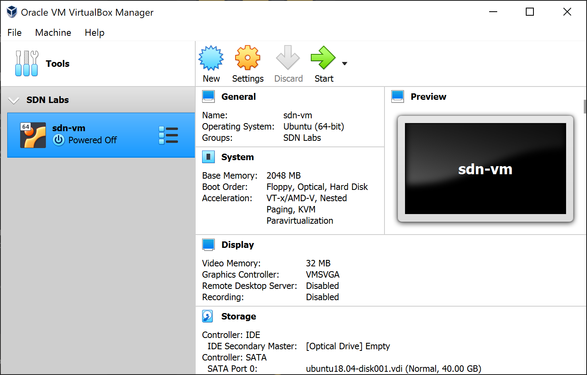

# 01 Lab 01 Linux Foundations

## Before You Begin

[Download the preconfigured Ubuntu SDN VM](https://liveswinburneeduau-my.sharepoint.com/:u:/g/personal/braminzad_swin_edu_au/IQAv_m6WfxYaTKZT4O6OhvkvAarseiSla89Hp5I4QfgqrNw?e=bmsMpi). It includes all required applications and can be reused throughout this series.

Complete [00 Lab Setup](../SDN_00_LabSetup/README.md) before starting. This lab assumes the Ubuntu VM boots, you can open a terminal, and the introductory utilities are installed. If you use the supplied preconfigured VM, import it and run the setup checks instead of reinstalling its applications.

## Purpose

Practise the Linux commands used throughout the SDN labs: navigating directories, creating and removing files, editing text, reading command help, filtering output, and saving results.

All exercises take place in a dedicated directory within this lab. They do not require changing network configuration or starting a controller. The VM installation material from the original Lab01 is consolidated into Lab00 so it only needs to be completed once.

## Working Environment

```text
Your computer
└── VirtualBox
    └── Ubuntu VM
        └── Terminal
            └── SDN repository / SDN_01_Lab01_Linux_Foundations
                ├── practice
                └── config_backup
```

Run the `bash` blocks in an **Ubuntu terminal**, not in Mininet or on your laptop's host shell. Run them in the same terminal so variables and the current directory remain available.

## 1 Verify the Ubuntu Session

```bash
whoami
hostname
printf 'Home directory: %s\n' "$HOME"
pwd
cat /etc/os-release
```

### Verification

The output should identify your Ubuntu account and release. On the original image the account is `sdn` and its home is `/home/sdn`; use your actual home directory rather than typing that path blindly. `$HOME` expands to the logged-in user's home.

Check the required utilities:

```bash
command -v bash nano less man grep cp mv mkdir rm
```

Each utility should resolve to an executable or shell-recognized command. Return to Lab00 if the VM or tools are not ready.


**Imported SDN virtual machine in VirtualBox**



*This is the original VM example. Use Lab00 for the current resource allocation and start Ubuntu before running the shell checks.*

## 2 Create an Isolated Practice Directory

From your SDN repository root:

```bash
mkdir -p SDN_01_Lab01_Linux_Foundations/practice
mkdir -p SDN_01_Lab01_Linux_Foundations/config_backup
cd SDN_01_Lab01_Linux_Foundations
lab_dir="$PWD"
cd practice
```

### Verification

```bash
pwd
ls -ld . "$lab_dir/config_backup"
```

The working path should end in `SDN_01_Lab01_Linux_Foundations/practice`. Keep the practice files here so deletion exercises do not affect unrelated documents.

## 3 Inspect Files and Hidden Entries

```bash
touch visible.txt .hidden-example
ls
ls -al
```

### Verification

`ls` shows ordinary visible entries. `ls -al` also shows `.hidden-example`, along with `.` and `..`, and displays a detailed listing.

| Listing field | Meaning |
| --- | --- |
| First character | File type, such as `d` for a directory |
| Permission characters | Read, write, and execute permissions |
| Owner and group | Accounts associated with the entry |
| Size | File size in bytes for ordinary files |
| Timestamp | Modification time |
| Final field | Entry name |

New empty files normally show size zero. A filename beginning with `.` is hidden by convention; it is not protected from access.

## 4 Navigate with Relative and Absolute Paths

```bash
mkdir -p navigation/child
cd navigation
pwd
cd child
pwd
cd ..
pwd
cd "$lab_dir/practice"
pwd
```

### Verification

The printed paths should move into `navigation`, then `navigation/child`, then back to `navigation`, and finally to `practice`.

- `cd child` uses a path relative to the current directory.
- `cd ..` moves to its parent.
- `cd "$lab_dir/practice"` uses the absolute path saved earlier.
- `cd` without an argument returns to your home directory.
- `cd /` selects the filesystem root.

Test home and root navigation, then return:

```bash
cd
pwd
cd /
pwd
cd "$lab_dir/practice"
pwd
```

### Verification after returning

The final working directory must again be the lab's `practice` directory.

## 5 Read Command Help

```bash
man ls
```

Search within the manual using `/`, followed by the option name or a keyword. Press `n` for the next match and `q` to exit.

For shell built-ins, use Bash's help:

```bash
help cd
help pwd
type cd
type ls
```

### Verification

Confirm from the help text that `ls -a` includes dotfiles and `ls -l` selects the long listing. `type cd` should identify a shell built-in. `man cd` is not a reliable substitute for `help cd` because directory changes are handled by the shell itself.

## 6 Create and Remove a File

```bash
touch my_file.txt
ls -l my_file.txt
rm -- my_file.txt
```

### Verification

```bash
if test ! -e my_file.txt; then
  printf 'my_file.txt was removed\n'
else
  printf 'my_file.txt still exists\n'
fi
```

Expect confirmation that the file was removed. `rm` removes the named file; it does not move it to the desktop Trash.

## 7 Create and Remove Directories

```bash
mkdir my_directory
ls -ld my_directory
rm -- my_directory
```

### Verification of the deliberate failure

The last command should fail because ordinary `rm` does not remove a directory. It should leave `my_directory` intact. This is an intentional part of the exercise.

Remove the empty directory with:

```bash
rmdir my_directory
test ! -d my_directory && printf 'Empty directory removed\n'
```

For a directory containing files, recursive removal is required. Practise it on a new disposable example:

```bash
mkdir disposable_directory
touch disposable_directory/example.txt
ls -l disposable_directory
rm -r -- disposable_directory
```

### Verification after recursive removal

```bash
test ! -e disposable_directory && printf 'Disposable directory and its file removed\n'
```

Only use recursive removal with a specific, verified lab directory. No force flag is required here.

## 8 Copy Move and Compare Files

```bash
printf 'SDN learning notes\n' > my_file1.txt
cp -- my_file1.txt my_file2.txt
cmp my_file1.txt my_file2.txt && printf 'The copies match\n'
mv -- my_file2.txt my_file3.txt
mkdir -p saved
mv -- my_file3.txt saved/
```

### Verification

```bash
ls -l my_file1.txt saved/my_file3.txt
cat saved/my_file3.txt
test ! -e my_file2.txt && printf 'The old copy name is gone\n'
test ! -e my_file3.txt && printf 'The renamed copy is now inside saved/\n'
```

`cp` creates another file. `mv` changes the name or location. The original `my_file1.txt` remains available after moving the copy.

## 9 Edit a Text File with nano

```bash
nano my_name.txt
```

Enter your name and a second line describing your SDN learning goal. Press `Ctrl+O`, then Enter, to save. Press `Ctrl+X` to exit.

### Verification

```bash
cat my_name.txt
wc -l my_name.txt
ls -l my_name.txt
```

Expect your text, at least two lines, and a nonempty file. If the file is empty or missing, reopen it in nano and save again.

## 10 Read Longer Output with less

Create a deterministic example instead of relying on a Mininet source checkout being present:

```bash
for number in $(seq 1 100); do
  printf 'Line %03d: SDN learning record\n' "$number"
done > long_notes.txt

less long_notes.txt
```

Use the arrow keys, Page Up/Page Down, or Space to navigate. Search with `/SDN`, then use `n` to move between matches. Press `q` to exit.

### Verification

```bash
wc -l long_notes.txt
head -n 3 long_notes.txt
tail -n 3 long_notes.txt
```

Expect 100 lines, beginning at 001 and ending at 100.

## 11 Inspect System Settings through Pipes

Read the available kernel settings and send the output to a pager:

```bash
sysctl -a 2> "$lab_dir/config_backup/sysctl-errors.txt" | less
```

Press `q` to return. Now select network-related settings:

```bash
sysctl -a 2> "$lab_dir/config_backup/sysctl-errors.txt" \
  | grep '^net\.' > network_settings.txt
head -n 15 network_settings.txt
```

### Verification

The filtered file should contain setting names beginning with `net.`. Permission-dependent diagnostics, if any, are stored separately in `config_backup/sysctl-errors.txt`.

The pipe `|` sends standard output from one process into the next. `grep` selects matching lines. These commands **read** settings; they do not change them. Do not add `-w` to this exercise.

## 12 Compare Append and Overwrite Redirection

```bash
printf 'first file\n' > textfile1.txt
printf 'original second file\n' > textfile2.txt
cat textfile1.txt >> textfile2.txt
cat textfile2.txt
```

### Verification of append

The second file should contain both lines:

```text
original second file
first file
```

Overwrite the same destination:

```bash
cat textfile1.txt > textfile2.txt
cat textfile2.txt
cmp textfile1.txt textfile2.txt && printf 'Files match after overwrite\n'
```

### Verification of overwrite

Only `first file` should remain in `textfile2.txt`. `>>` appends; `>` replaces the destination's existing contents. Use consistent filenames, including their `.txt` suffixes.

## 13 Save Evidence in config_backup

Save the useful text outputs before cleaning the practice directory:

```bash
cp -- my_name.txt long_notes.txt network_settings.txt "$lab_dir/config_backup/"
{
  date -Is
  whoami
  hostname
  cat /etc/os-release
} > "$lab_dir/config_backup/session_environment.txt"
```

### Verification

```bash
ls -lh "$lab_dir/config_backup/"
cat "$lab_dir/config_backup/my_name.txt"
```

Confirm the expected text files are present and readable. Review personal information before publishing your evidence on GitHub.

## 14 Clean Up the Exercise

From the same terminal:

```bash
cd "$lab_dir"
pwd
```

### Verification before removal

The path must end in `SDN_01_Lab01_Linux_Foundations`. Then remove only its disposable practice directory:

```bash
rm -r -- practice
clear
```

### Verification after cleanup

```bash
test ! -d practice && printf 'Practice directory removed\n'
ls -lh config_backup/
```

The practice directory should be gone, while `config_backup` and this README remain. No reboot or VM shutdown is needed before continuing.

## Troubleshooting

| Symptom | Check and correction |
| --- | --- |
| A path containing spaces fails | Quote the complete path. |
| A command reports permission denied in the repository | Confirm the files belong to your Ubuntu user and that you are working on the guest's local filesystem. |
| `man cd` does not show useful help | Use `help cd` in Bash. |
| A directory cannot be removed with `rm` | Use `rmdir` for an empty directory, or `rm -r` for the specific disposable directory. |
| Terminal appears stuck in a manual or pager | Press `q`. |
| nano changes are missing | Save with `Ctrl+O`, confirm the filename with Enter, then exit. |
| `$lab_dir` is empty after opening another terminal | In the new terminal, enter this lab's directory and set `lab_dir="$PWD"` again. |

## Completion Checklist

- Navigated between home, root, parent, and child directories.
- Distinguished ordinary and hidden files.
- Used command manuals and built-in shell help.
- Created, copied, renamed, moved, and removed lab files.
- Edited and verified a text file.
- Read longer output with a pager.
- Filtered output through a pipe.
- Demonstrated append and overwrite redirection.
- Preserved results in `config_backup` and removed disposable files.

Continue to [Lab02 Mininet Basics](../SDN_02_Lab02_Mininet_Basics/README.md).

## Source and Further Reading

Adapted from the supplied **P-Lab-01-Introduction-P** handout. VM import steps are centralized in Lab00. Student assessment prompts are replaced with executable exercises and expected observations.

[Ubuntu's command-line tutorial](https://ubuntu.com/tutorials/command-line-for-beginners) provides additional background.
