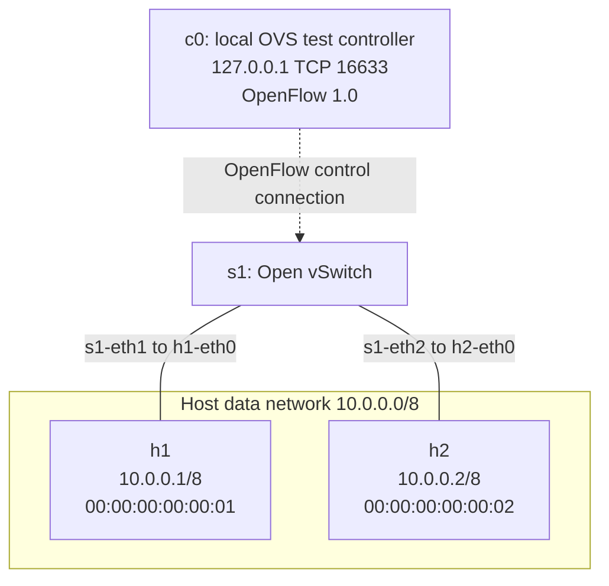
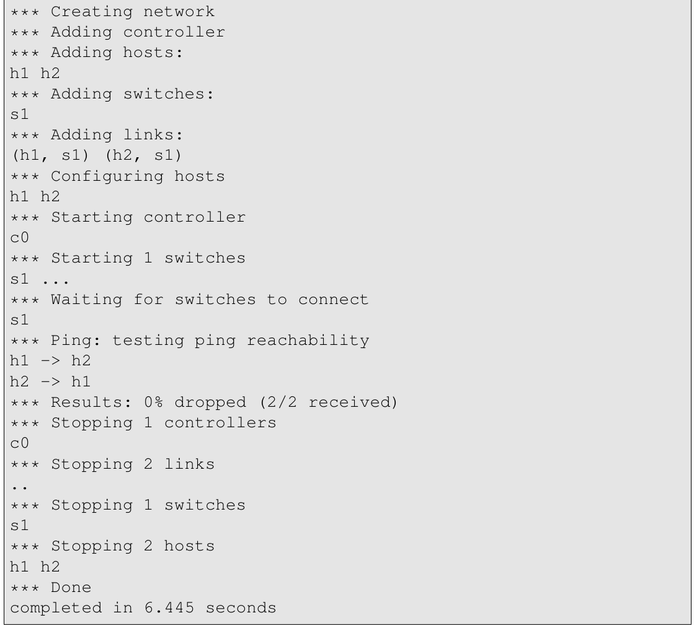
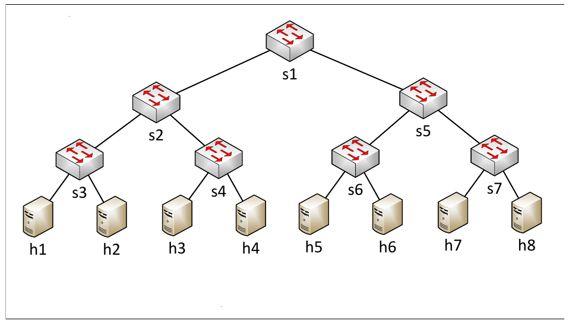

# 02 Lab 02 Mininet Basics

## Before You Begin

[Download the preconfigured Ubuntu SDN VM](https://liveswinburneeduau-my.sharepoint.com/:u:/g/personal/braminzad_swin_edu_au/IQAv_m6WfxYaTKZT4O6OhvkvAarseiSla89Hp5I4QfgqrNw?e=bmsMpi). It includes all required applications and can be reused throughout this series.

Complete [00 Lab Setup](../SDN_00_LabSetup/README.md) first. This lab assumes Ubuntu, Mininet, OVS, a local OVS test controller, iperf, tcpdump, Wireshark, and tmux are installed. The supplied preconfigured VM can be reused; no VM rebuild is required between labs.

Complete [Lab01 Linux Foundations](../SDN_01_Lab01_Linux_Foundations/README.md) if you need practice with the shell, paths, files, and redirection.

## Purpose

Create and inspect a small emulated network, verify host connectivity, measure throughput, interrupt and restore links, inspect ARP/ICMP traffic, and build larger topologies using Mininet's built-in options.

This guide combines the source Lab02 **Pass and Credit** exercises. The research and observation prompts are converted into commands, expected results, and explanations. The controller applications introduced in Lab04 are not required here.

Mininet runs real Linux networking tools and applications in network namespaces connected by virtual interfaces and OVS switches. Its hosts share the VM kernel and, by default, its filesystem and process space. They are lighter than complete guest VMs. The results are useful for protocol and forwarding experiments, but measured throughput also depends on the Ubuntu VM and host resources.

## Topology



| Node | Role | Address or connection |
| --- | --- | --- |
| h1 | Emulated Linux host | h1-eth0, 10.0.0.1/8 |
| h2 | Emulated Linux host | h2-eth0, 10.0.0.2/8 |
| s1 | OpenFlow-controlled OVS switch | Two host-facing data ports; no host-subnet IP required |
| c0 | Local learning-switch test controller | 127.0.0.1:16633 in the Ubuntu root network namespace |

TCP port **16633** is selected explicitly to avoid depending on implicit controller defaults or occupying Ryu/ONOS's usual ports. OpenFlow **1.0** is selected for this introductory test controller. Later controller labs will select their own compatible protocol versions and ports.

`bash` blocks run in an **Ubuntu shell**. `text` blocks labelled as Mininet commands run at the **`mininet>` prompt**; do not copy that prompt into commands. An ordinary Ubuntu terminal cannot address `h1` by its Mininet node name.

## 1 Verify Tools and Check for Conflicts

From your SDN repository root:

```bash
mkdir -p SDN_02_Lab02_Mininet_Basics/config_backup
cd SDN_02_Lab02_Mininet_Basics
mn --version
sudo ovs-vsctl show
iperf --version
tcpdump --version
command -v ovs-testcontroller || command -v ovs-controller || command -v test-controller
sudo ss -ltnp 'sport = :16633'
pgrep -af 'mininet:|ryu-manager|onos|ovs-testcontroller' || true
```

### Verification

Confirm tools are available and no process is listening on TCP 16633. Review any existing Mininet or controller processes before proceeding. Exit earlier Mininet sessions normally and stop any GNS3 exercise first.

Clean stale Mininet resources only after confirming no other experiment is active in this dedicated VM:

```bash
sudo mn -c
sudo ovs-vsctl list-br
```

### Verification after cleanup

There should be no stale Mininet bridge named `s1`. Existing non-Mininet bridges can remain. Do not remove a management bridge such as `virbr0` to force an empty interface list.

## 2 Start the Minimal Topology

Run in Ubuntu:

```bash
sudo mn --topo minimal --mac --switch ovs,protocols=OpenFlow10 \
  --controller ovsc,ip=127.0.0.1,port=16633
```

Mininet creates two hosts, one OVS switch, and its local controller, then presents `mininet>`. It does not require assigning IP addresses to physical switch ports.

### Verification

At the **Mininet prompt**:

```text
nodes
net
dump
help
```

Expect nodes `c0`, `h1`, `h2`, and `s1`, with host links matching the diagram. `nodes` lists names, `net` lists data-plane wiring, and `dump` adds object details such as host IPs and PIDs. The dotted controller link is a TCP control connection, not another host-facing Ethernet link.

## 3 Use a Mouse Enabled tmux Workspace

You can keep a Mininet CLI and two Ubuntu utility panes in a single terminal window. First exit the manually started topology at the **Mininet prompt**:

```text
exit
```

Copy the supplied `Lab02_Start_Mininet.sh` and `Lab02_Open_Terminals.sh` files into this lab directory. The first wraps the explicit controller/switch settings; the second opens three panes and enables mouse support automatically.

Run from an **Ubuntu terminal outside tmux**:

```bash
bash -n Lab02_Start_Mininet.sh
bash -n Lab02_Open_Terminals.sh
bash Lab02_Open_Terminals.sh
```

The Mininet pane may ask for your sudo password. Keep one Ubuntu pane for OVS inspection and another for viewing capture files. A Mininet host shell can be opened with xterm in step 6; these Ubuntu utility panes are not host namespaces.

### Verification

In an **Ubuntu pane**:

```bash
tmux list-panes -t sdn-lab02:lab
tmux show-options -g mouse
```

Expect three panes and `mouse on`. Click a pane to select it, drag a border to resize it, and use `Ctrl+b`, then `z` to zoom. Detach with `Ctrl+b`, then `d`; reconnect using:

```bash
tmux attach-session -t sdn-lab02
```

The script reattaches to an existing session rather than creating another topology. You can also complete the lab with separate Ubuntu terminal windows; tmux is a convenience, not a forwarding component.

## 4 Verify the Controller and Host Interfaces

At the **Mininet prompt**:

```text
h1 ip -br addr
h2 ip -br addr
h1 ip route
h2 ip route
s1 ip -br addr
sh ovs-vsctl show
sh ovs-vsctl get-controller s1
sh ovs-vsctl get bridge s1 protocols
sh ss -ltnp 'sport = :16633'
```

### Verification

Host1 should have `10.0.0.1/8` on `h1-eth0`, and host2 `10.0.0.2/8` on `h2-eth0`. Their MACs end in `01` and `02` because of `--mac`. Both have a connected route for `10.0.0.0/8`; no default gateway is needed for their same-subnet communication.

OVS should show controller target `tcp:127.0.0.1:16633`, `is_connected: true`, and `OpenFlow10` as the enabled protocol. The socket listing should show the controller listener.

The switch normally uses Ubuntu's root network namespace. Its `ip` output can include the VM's management interfaces, unlike the isolated host network namespaces. Do not delete these interfaces because they are not shown in the small topology diagram.

## 5 Test Reachability and Built In Throughput

At the **Mininet prompt**:

```text
pingall
pingallfull
h1 ping -c 5 h2
iperf h1 h2
```

### Verification

Both hosts should reach each other. The successful minimal `pingall` summary is typically:

```text
*** Results: 0% dropped (2/2 received)
```

`pingall` summarizes reachability. `pingallfull` includes per-pair packet counts and timing details. A host-specific ping exposes individual RTTs. The built-in `iperf` test reports throughput between the pair; it uses **iperf 2**, not the separately installed iperf3 program.

No fixed bandwidth is configured yet. The throughput value will depend on CPU, scheduler, and VM resources; it is not a measurement of your laptop's physical NIC speed.


**Mininet network creation and successful ping test**



*The original automatic test also shuts the topology down; this guide keeps its interactive topology running until the cleanup step. Output is a source example, not a new test run.*

## 6 Open Dedicated Host Terminals

In the **Mininet pane**, with a graphical Ubuntu session available:

```text
xterm h1 h2
```

In the **h1 xterm**:

```bash
ip -br addr
ping -c 4 10.0.0.2
```

In the **h2 xterm**:

```bash
ip -br addr
ping -c 4 10.0.0.1
```

### Verification

Each xterm should expose that host's own `h1-eth0` or `h2-eth0` interface, and both pings should receive replies. Inside an xterm, use the destination IP address rather than Mininet's node-name substitution.

If xterm reports a missing display, use the VirtualBox Ubuntu desktop or continue with node-prefixed commands in the Mininet CLI. No GUI is required for the command-line packet capture below.

## 7 Run an Explicit iperf Server and Client

This makes the client/server roles visible instead of relying only on the built-in test. At the **Mininet prompt**:

```text
h2 sh -c 'iperf -s -p 5001 > config_backup/h2-iperf-server.log 2>&1 & echo $! > config_backup/h2-iperf-server.pid'
h2 ss -ltn 'sport = :5001'
h1 iperf -c 10.0.0.2 -p 5001 -t 10 -i 1
```

### Verification

Host2 should listen on TCP 5001 and host1 should report a completed ten-second transfer. The measured rate should be broadly consistent with the unshaped built-in test, allowing for resource variation.

Read and stop the server at the **Mininet prompt**:

```text
sh tail -n 12 config_backup/h2-iperf-server.log
h2 sh -c 'kill "$(cat config_backup/h2-iperf-server.pid)"'
h2 ss -ltn 'sport = :5001'
```

### Verification after stopping

The listener on host2 TCP 5001 should be gone. Stop only the server started in this step, rather than terminating every iperf process on the VM.

## 8 Take a Host Link Down and Restore It

At the **Mininet prompt**:

```text
link s1 h1 down
h1 ip link show h1-eth0
pingall
```

### Verification of failure

The host1 link should be down and communication should fail. This is an expected negative test. Restore it:

```text
link s1 h1 up
h1 ip link show h1-eth0
pingall
```

### Verification after recovery

The interface should be up and `pingall` should succeed after the controller and ARP state settle. Repeat the ping if the first attempt occurs during reconnection.

## 9 Stop and Restart the Switch

At the **Mininet prompt**:

```text
switch s1 stop
h1 ping -c 3 -W 1 10.0.0.2
switch s1 start
sh ovs-vsctl show
pingall
```

### Verification

The ping while the switch is stopped should fail. After restart, OVS should reconnect to c0 and the final ping should succeed. If `is_connected` is not yet true, wait for the TCP connection before repeating the test. Treat this separately from simply disabling one host link.

## 10 Capture ARP and ICMP Traffic

Use a host-scoped tcpdump capture so it observes the data path, not the VM's management traffic. At the **Mininet prompt**:

```text
h1 sh -c 'tcpdump -Z root -U -n -i h1-eth0 -w config_backup/arp-icmp.pcap "arp or icmp" > config_backup/capture.log 2>&1 & echo $! > config_backup/capture.pid'
sh sleep 1
h1 ip neigh flush dev h1-eth0
h2 ip neigh flush dev h2-eth0
h2 ping -c 5 h1
h1 ping -c 5 h2
h1 sh -c 'kill -INT "$(cat config_backup/capture.pid)"'
sh sleep 1
sh ls -lh config_backup/arp-icmp.pcap
sh tcpdump -nn -r config_backup/arp-icmp.pcap
```

### Verification

Expect an ARP request to discover the destination MAC, an ARP reply, then ICMP echo requests and replies. The reverse ping usually reuses neighbor state established by the first exchange. Extra ARP packets can occur because of cache state, retries, or timing; do not assume an invariant packet count.

The first RTT may exceed later RTTs because the path initially needs address resolution and potentially controller processing. It is not guaranteed to be the largest sample on a busy VM. Use the packet sequence and controller state to explain observations rather than inferring the cause from timing alone.

In an **Ubuntu pane**, make the capture owned by your login account, then open it with Wireshark:

```bash
sudo chown "$(id -u):$(id -g)" config_backup/arp-icmp.pcap
wireshark config_backup/arp-icmp.pcap
```

Use display filter `arp || icmp`. Open the ARP and ICMP header trees to inspect source/destination addresses. This reads a saved capture; it does not require running the Wireshark GUI as root.

### Verification in Wireshark

Confirm host IPs `10.0.0.1` and `10.0.0.2`, the deterministic host MACs, ARP broadcasts, and matching ICMP request/reply identifiers. Save a screenshot in this lab's `images` folder if you want an example output for your repository.

## 11 Inspect the Switch Flow Table

At the **Mininet prompt**:

```text
sh ovs-ofctl -O OpenFlow10 show s1
sh ovs-ofctl -O OpenFlow10 dump-flows s1
h1 ping -c 5 h2
sh ovs-ofctl -O OpenFlow10 dump-flows s1
```

### Verification

Confirm host-facing ports and inspect match fields, actions, and packet counters. The local test controller provides L2 learning behaviour; its installed entries can vary with traffic and aging. Repeated traffic should increase counters on the relevant forwarding entries.

`ovs-vsctl` inspects OVS database configuration. `ovs-ofctl` inspects OpenFlow-facing switch state. These are related views, not interchangeable commands.

## 12 Build a Single Switch with Four Hosts

At the **Mininet prompt**, finish the current experiment:

```text
exit
```

The original Mininet tmux pane may close when its process exits. Use an **Ubuntu pane** to run the next experiment:

```bash
bash Lab02_Start_Mininet.sh --topo single,4
```

### Verification

At the new **Mininet prompt**:

```text
nodes
net
py [(host.name, host.IP(), host.MAC()) for host in net.hosts]
pingall
```

Expect four hosts connected to s1, host IPs from `10.0.0.1` through `10.0.0.4`, deterministic host MACs ending `01` through `04`, and successful connectivity. A complete all-to-all test sends 12 directed probes.

## 13 Build a Three Switch Linear Network

Exit the four-host experiment at the **Mininet prompt**:

```text
exit
```

In **Ubuntu**:

```bash
bash Lab02_Start_Mininet.sh --topo linear,3,2
```

This creates three switches with two attached hosts each:

```text
       s1 -------- s2 -------- s3
      /  \       /  \       /  \
   h1s1 h2s1  h1s2 h2s2  h1s3 h2s3
```

### Verification

At the **Mininet prompt**:

```text
nodes
net
py len(net.switches), len(net.hosts), len(net.links)
pingall
```

Expect **3 switches, 6 hosts, and 8 data links**, with successful reachability after learning settles. Host naming can vary with Mininet version; `nodes` and `net` are authoritative. A six-host all-to-all test sends 30 directed probes.

To open xterms for every node in a graphical session, repeat this topology after exiting, adding `-x`:

```bash
bash Lab02_Start_Mininet.sh --topo linear,3,2 -x
```

### Verification of terminal creation

Each node should have an xterm. This can create many windows; the CLI commands remain sufficient if screen space or GUI support is limited.

## 14 Build a Tree with Depth Three and Fanout Two

Exit the previous topology first. In **Ubuntu**:

```bash
bash Lab02_Start_Mininet.sh --topo tree,depth=3,fanout=2
```

The switch hierarchy has one root switch, two middle switches, and four edge switches. Each edge switch connects to two hosts:

```text
                         root switch
                         /         \
                 middle switch   middle switch
                  /       \       /       \
               edge      edge   edge      edge
               / \       / \    / \       / \
              h   h     h   h  h   h     h   h
```

### Verification

At the **Mininet prompt**:

```text
nodes
net
py len(net.switches), len(net.hosts), len(net.links)
pingall
```

Expect **7 switches, 8 hosts, and 14 data links**. A complete test sends 56 directed probes. In this Mininet tree, depth counts the switch layers and the final fanout creates hosts. The graph is acyclic, so this exercise does not introduce redundant Layer 2 paths.


**Depth-three, fanout-two tree**



*This source diagram illustrates the same graph used by the built-in tree exercise.*

## 15 Run a Controlled Link Performance Experiment

Exit the tree topology. In **Ubuntu**:

```bash
bash Lab02_Start_Mininet.sh --topo minimal --link tc,bw=10,delay=20ms,loss=0
```

At the **Mininet prompt**:

```text
h1 ping -c 5 h2
iperf h1 h2
h1 tc qdisc show dev h1-eth0
s1 tc qdisc show dev s1-eth1
```

### Verification

Both host-to-switch links have a 10 Mbps rate setting and 20 ms delay in each direction. The h1-to-h2 round trip crosses four delayed link directions, so its baseline RTT is approximately **80 ms**, plus scheduling/processing overhead. TCP throughput should be around the configured bottleneck rate, allowing for overhead and VM variation.

`loss=0` configures no artificial random loss; it does not guarantee that resource overload cannot drop packets. The queue listing should expose the traffic-control configuration rather than only an unshaped default queue.

This introduces command-line link parameters. Lab03 will build custom and parameterized Python topologies using the same concepts.

## 16 Save Configuration Evidence and Rebuild Commands

While the final topology is still running, at the **Mininet prompt**:

```text
sh ovs-vsctl show > config_backup/ovs-show.txt
sh ovs-vsctl --format=json list Bridge > config_backup/bridges.json
sh ovs-ofctl -O OpenFlow10 dump-flows s1 > config_backup/s1-flows.txt
h1 ip addr show > config_backup/h1-addresses.txt
h2 ip addr show > config_backup/h2-addresses.txt
```

In an **Ubuntu pane**, save the startup commands:

```bash
cat > config_backup/rebuild-commands.txt <<'EOF'
# Run one topology at a time; exit Mininet before starting the next.
bash Lab02_Start_Mininet.sh --topo minimal
bash Lab02_Start_Mininet.sh --topo single,4
bash Lab02_Start_Mininet.sh --topo linear,3,2
bash Lab02_Start_Mininet.sh --topo tree,depth=3,fanout=2
bash Lab02_Start_Mininet.sh --topo minimal --link tc,bw=10,delay=20ms,loss=0
EOF
```

### Verification

```bash
ls -lh config_backup/
cat config_backup/rebuild-commands.txt
head -n 15 config_backup/ovs-show.txt
```

The files are diagnostic evidence. The OVS database/flow dumps are not a drop-in backup to import into another run with different ephemeral ports. Recreate the network using the saved commands, then repeat the tests. Keep the original launcher files alongside this README.

## 17 Terminate the Lab and Verify Cleanup

At the **Mininet prompt**:

```text
exit
```

In an **Ubuntu pane**:

```bash
sudo mn -c
sudo ovs-vsctl list-br
sudo ss -ltnp 'sport = :16633'
ip -o link show | grep -E '(h[0-9].*-eth|s[0-9]+-eth)' || true
ls -lh config_backup/
```

### Verification

There should be no lab `s1` bridge, no listener on this lab's controller port 16633, and no remaining host/switch data interfaces from the experiment. Saved captures and configuration evidence should remain. Mininet does not use Docker containers for these hosts, so `docker ps` is not the relevant cleanup check.

Close any host xterms. Detach with `Ctrl+b`, then `d`. From **Ubuntu outside tmux**:

```bash
tmux kill-session -t sdn-lab02
clear
```

### Verification after closing tmux

```bash
if tmux has-session -t sdn-lab02 2>/dev/null; then
  printf 'The lab tmux session remains open\n'
else
  printf 'The lab tmux session is closed\n'
fi
```

If you used separate terminal windows instead, no tmux shutdown is needed. OVS and Mininet stay installed for later labs.

## Troubleshooting

| Symptom | Check and correction |
| --- | --- |
| No default controller found | Use this guide's explicit `ovsc` settings and verify a supported test-controller binary exists. |
| Port 16633 is already in use | Identify the listener with `sudo ss -ltnp`; exit the earlier lab process before starting another. |
| OVS database connection fails | Verify the OVS service and repeat the Lab00 smoke test. |
| Host ping fails immediately after startup | Check controller `is_connected`, link state, addressing, and flow tables; repeat after initial learning. |
| `h1` is not recognized in Ubuntu | Enter the command at `mininet>`, or use an xterm attached to that host. |
| xterm cannot open a display | Use the Ubuntu desktop or keep using node-prefixed CLI commands. |
| Capture file is empty | Inspect `config_backup/capture.log`, confirm the host interface name, and start capture before generating traffic. |
| Built-in iperf fails despite iperf3 being installed | Install the separate `iperf` package; the built-in test expects iperf 2. |
| Tree or linear tests exhaust VM resources | Close xterms and other labs, increase VM resources, or reduce topology size. |
| Mininet exits but the network remains partly present | Run `sudo mn -c` only after stopping other active experiments in the dedicated VM. |

## Completion Checklist

- Identified hosts, switch, controller, interfaces, and controller port.
- Verified both host addresses and deterministic MACs.
- Confirmed the controller-backed OpenFlow connection.
- Passed host pings and throughput tests.
- Demonstrated failure and recovery for a link and the switch.
- Captured and interpreted ARP/ICMP exchanges.
- Inspected forwarding entries and counters.
- Verified single-switch, linear, and tree topology sizes.
- Compared shaped bandwidth and delay with expected results.
- Saved evidence in `config_backup` and cleaned up the lab.

## Source and Further Reading

Adapted from **P-Lab-02-Mininet-P** and **P-Lab-02-Mininet-C**. Installation is centralized in Lab00. The [Mininet walkthrough](https://mininet.org/walkthrough/) and [test-controller manual](https://manpages.ubuntu.com/manpages/noble/man8/ovs-testcontroller.8.html) provide command reference material.
