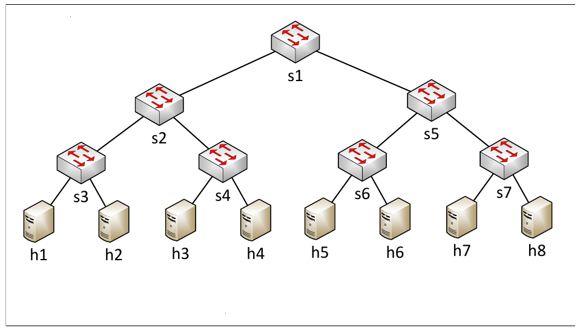

# 03 Lab 03 Mininet Python Topologies

## Before You Begin

[Download the preconfigured Ubuntu SDN VM](https://liveswinburneeduau-my.sharepoint.com/:u:/g/personal/braminzad_swin_edu_au/IQAv_m6WfxYaTKZT4O6OhvkvAarseiSla89Hp5I4QfgqrNw?e=bmsMpi). It includes all required applications and can be reused throughout this series.

Complete [00 Lab Setup](../SDN_00_LabSetup/README.md) and [Lab02](../SDN_02_Lab02_Mininet_Basics/README.md). Reuse the supplied Ubuntu VM. This lab needs Python 3 with Mininet, the OVS test controller, iperf **2**, tcpdump, and tmux. It combines the original Pass and Distinction exercises.

## Purpose

Define reusable Mininet topologies in Python, change their size without editing every node, and apply bandwidth, delay, and loss settings. Build single-switch, linear, and recursive tree networks. These are software emulations for learning SDN fundamentals; they do not reproduce a production Oracle data-centre fabric.

## Topology

```mermaid
flowchart TB
    c["OVS test controller: 127.0.0.1:16633"]
    s1 --- s2 --- s3
    s1 --- h1
    s2 --- h2
    s3 --- h3
    c -. OpenFlow1.0 .-> s1
    c -.-> s2
    c -.-> s3
```

The diagram represents `linearlab,3`. The other two topologies use the same controller and default host subnet `10.0.0.0/8`. No physical switch or YAML file is required: `Lab03_Topologies.py` is the topology definition.

`bash` commands run in Ubuntu; `text` commands below run at `mininet>`. Run only one Mininet experiment at a time.

## 1 Prepare the Lab Folder and Tools

Copy this entire lab folder into your repository, then run from the repository root:

```bash
cd SDN_03_Lab03_Mininet_Python_Topologies
mkdir -p config_backup
python3 -m py_compile Lab03_Topologies.py
mn --version
sudo ovs-vsctl show
sudo ss -ltnp 'sport = :16633'
```

Exit any earlier Mininet session normally. After confirming it is no longer in use, remove stale resources:

```bash
sudo mn -c
```

### Verification

Compilation must succeed. TCP 16633 should be free before starting the local test controller. `sudo mn -c` is specific to Mininet cleanup; leave GNS3 and management bridges alone.

## 2 Read the Python Topology Definition

```bash
sed -n '1,180p' Lab03_Topologies.py
```

`Topo` is Mininet's topology base class. Each `build()` method calls `addSwitch`, `addHost`, and `addLink` to describe a graph. Mininet subsequently creates that graph. The final `topos` dictionary exposes short names to `mn --topo`; changing a class name alone does not change that CLI name.

`SingleLab` creates one switch and `n` hosts. `LinearLab` connects each new switch to its predecessor and attaches one host per switch. `TreeLab` recursively creates switch levels, then hosts beneath the last switch level. Names are unique across the entire tree.

### Verification

```bash
python3 -c 'from Lab03_Topologies import topos; print(sorted(topos))'
```

Expect `linearlab`, `singlelab`, and `treelab`. If importing fails under `python3`, use the Python interpreter that your VM's `mn` installation uses; do not mix a Python2 Mininet installation with these Python3 scripts.

## 3 Start Three Hosts on One Switch

```bash
bash Lab03_Start_Mininet.sh singlelab,3
```

### Verification — Mininet

```text
nodes
net
dump
pingall
sh ovs-vsctl get Bridge s1 protocols
sh ovs-ofctl dump-flows s1
```

Expect three hosts, one switch, three data links, OpenFlow 10, and zero loss after learning. Controller `c0` is an additional control object, not a host or data link. Initial ARP resolution can delay the first probe.

## 4 Scale to Eight Hosts

Exit the previous experiment:

```text
exit
```

In Ubuntu:

```bash
bash Lab03_Start_Mininet.sh singlelab,8
```

### Verification — Mininet

```text
nodes
net
pingall
```

Expect eight hosts, one switch, eight links. To add another CLI topology alias, add an entry such as `'learning': SingleLab` to the `topos` dictionary, exit Mininet, and launch with `--topo learning,8`. Keep the shipped aliases for subsequent examples.

## 5 Build the Three-Switch Linear Network

Exit the eight-host experiment. From Ubuntu:

```bash
bash Lab03_Start_Mininet.sh linearlab,3
```

### Verification — Mininet

```text
net
pingall
h1 ping -c 5 h3
iperf h1 h3
```

Expect three switches, three hosts, five links: three access links and two inter-switch links. `h1` to `h3` traverses all three switches. Save the printed throughput as the unshaped reference; it reflects this VM's CPU scheduling and software datapath.

## 6 Apply Controlled Link Bandwidth and Delay

Exit Mininet. Launch a two-host single-switch topology with traffic control enabled on every link:

```bash
sudo mn --custom Lab03_Topologies.py --topo singlelab,2 --mac \
  --switch ovs,protocols=OpenFlow10 \
  --controller ovsc,ip=127.0.0.1,port=16633 \
  --link tc,bw=10,delay=20ms,loss=0,use_htb=True
```

### Verification — Mininet

```text
h1 tc qdisc show dev h1-eth0
h2 tc qdisc show dev h2-eth0
h1 ping -c 6 h2
iperf h1 h2
```

The path crosses two links in each direction, so the added round-trip delay is approximately **80 ms**. The bottleneck is approximately **10 Mbit/s**, with TCP goodput slightly lower. Shaping is applied to link endpoints; this is not a claim about an actual 10 Mbit/s physical interface. Leave the first ping out of the comparison if ARP skews it.

## 7 Compare Loss and Recovery

Exit and relaunch the preceding command with `loss=1`. Keep all other settings unchanged.

### Verification — Mininet

```text
h1 ping -c 100 -i 0.1 h2
iperf h1 h2
```

Record ping loss and TCP throughput. `loss=1` applies independently at configured egress points, so end-to-end loss need not equal exactly 1%, and a short sample may show zero loss. TCP retransmission and the added RTT can reduce throughput further. Exit and restore `loss=0` to confirm the effect is reversible.

## 8 Build the Parameterized Tree

Exit any current experiment. In Ubuntu:

```bash
bash Lab03_Start_Mininet.sh treelab,depth=3,fanout=2
```

### Verification — Mininet

```text
nodes
net
pingall
h1 ping -c 5 h8
```

For depth 3 and fanout 2, expect **7 switches, 8 hosts, and 14 links**. Here depth counts switch levels. The counts are `hosts = fanout**depth`, `switches = 1 + fanout + ... + fanout**(depth-1)`, and `links = switches + hosts - 1`. With fanout 1, switches form a chain and only one host is created; use node/link counts instead of pairwise ping in that case.


**Parameterized tree: seven switches and eight hosts**




## 9 Open a Mouse Enabled Terminal Workspace

Exit Mininet first. Run outside tmux:

```bash
bash Lab03_Open_Terminals.sh
```

The script starts the three-host single-switch experiment in one pane and two Ubuntu utility panes. It always enables `tmux set -g mouse on`. Click a pane to select it. Use **Ctrl+B then D** to detach; reconnect with:

```bash
tmux attach -t sdn03
```

### Verification

In a utility pane:

```bash
tmux list-panes -t sdn03:lab
tmux show -gv mouse
sudo ovs-vsctl list-br
```

Expect three panes and mouse setting `on`. The Ubuntu panes are not Mininet host namespaces; use `h1 command` at the Mininet prompt to run inside h1.

## 10 Save Definitions and Evidence

While a topology is running, run in an Ubuntu utility pane:

```bash
cp Lab03_Topologies.py Lab03_Start_Mininet.sh config_backup/
sudo ovs-vsctl show > config_backup/ovs-topology.txt
sudo ovs-ofctl dump-flows s1 > config_backup/s1-flows.txt
```

At Mininet, save a host test to the shared filesystem:

```text
h1 ping -c 5 h2 > config_backup/host-ping.txt
```

### Verification

```bash
ls -lh config_backup
cat config_backup/host-ping.txt
```

Host namespaces share the working directory. The Python file recreates the topology; the dumped flow text is evidence, not a complete portable OVS configuration restore file.

## 11 Terminate and Clean Up

At Mininet:

```text
exit
```

Then in Ubuntu:

```bash
sudo mn -c
tmux kill-session -t sdn03 2>/dev/null || true
sudo ovs-vsctl list-br
sudo ss -ltnp 'sport = :16633'
```

### Verification

The lab switches and its local test controller are gone. Keep your files and `config_backup`. Existing unrelated bridges can remain.

## Troubleshooting

| Symptom | Action |
| --- | --- |
| Custom topology not found | Run from this folder and check the `topos` dictionary alias. |
| Traffic fails everywhere | Check TCP 16633, OVS protocols, controller logs, and stale Mininet processes. |
| RTT approximately40 ms rather than80 ms | Confirm both host links were shaped, not just one link. |
| Tree has the wrong size | Check depth counts switch levels and all switch/host IDs are unique. |

## Completion Checklist

- Single-switch, linear, and tree graph counts match their parameters.
- All baseline connectivity tests pass.
- Traffic-control settings appear in `tc` and influence measurements.
- Topology definitions and verification results are saved.
- Mininet and the tmux session have been cleaned up.

Continue with [Lab04 SDN Controllers](../SDN_04_Lab04_SDN_Controllers_Ryu_ONOS/README.md). Reference: [Mininet walkthrough](https://mininet.org/walkthrough/) and [Python API](https://mininet.org/api/).
