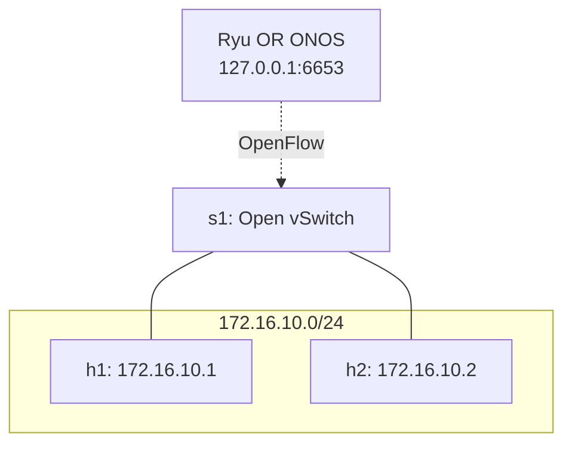
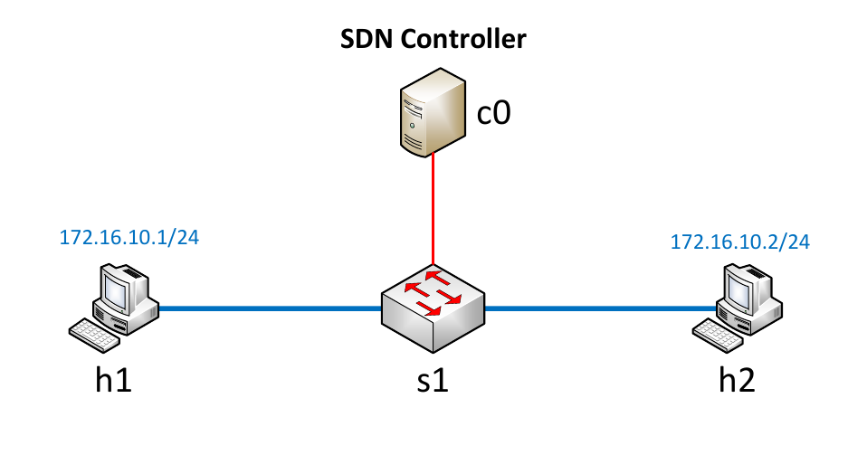
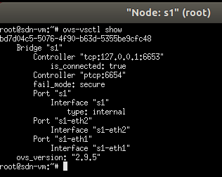
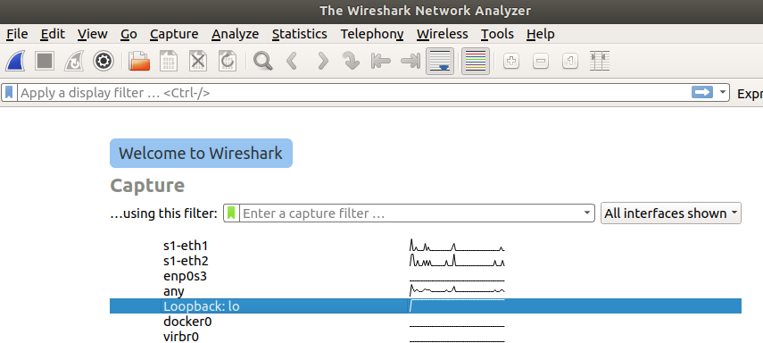
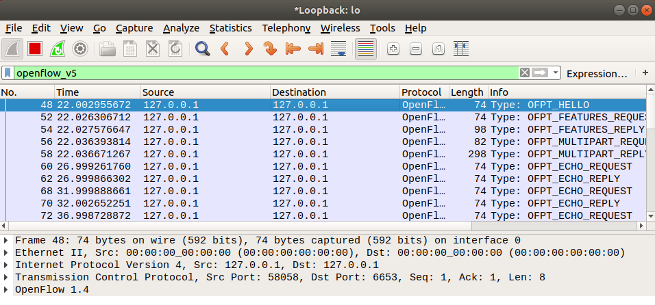
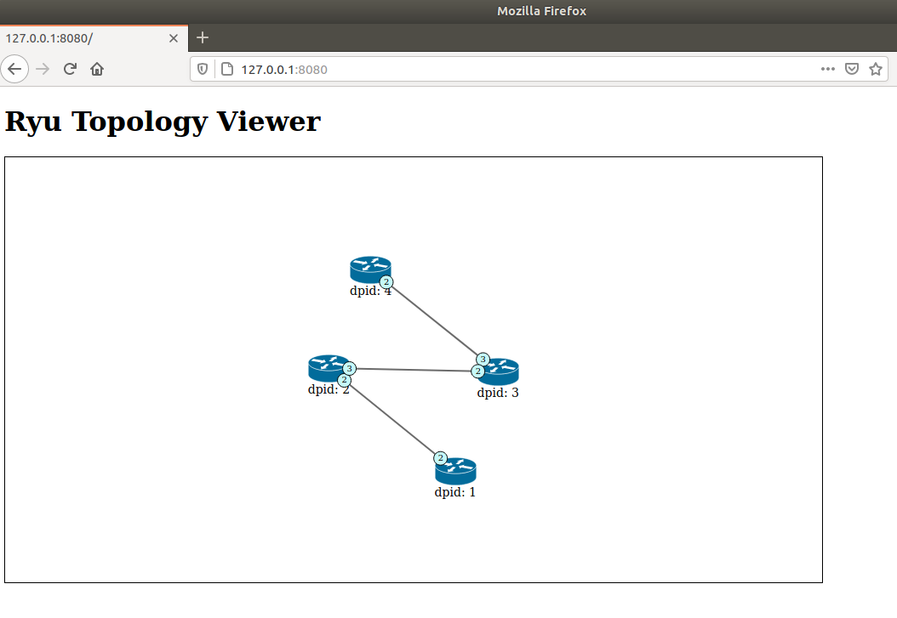
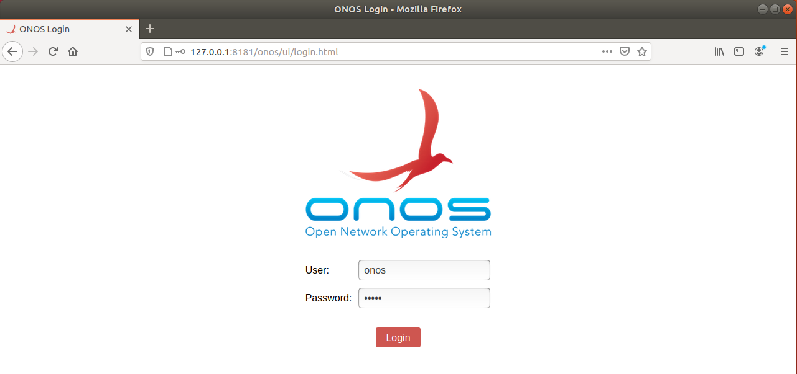
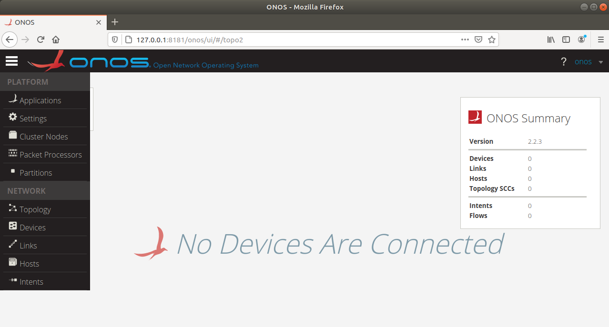

# 04 Lab 04 SDN Controllers: Ryu and ONOS

## Before You Begin

[Download the preconfigured Ubuntu SDN VM](https://liveswinburneeduau-my.sharepoint.com/:u:/g/personal/braminzad_swin_edu_au/IQAv_m6WfxYaTKZT4O6OhvkvAarseiSla89Hp5I4QfgqrNw?e=bmsMpi). It includes all required applications and can be reused throughout this series.

Complete [00 Lab Setup](../SDN_00_LabSetup/README.md), including its controller compatibility checks. Use the supplied preconfigured Ubuntu VM for the full series. Verify that Ryu and ONOS are present before proceeding; installing a random current Python dependency set is not a substitute for the VM's working Ryu environment.

This combines the Pass and Credit labs. Lab02's test controller must be stopped. Ryu and ONOS will use TCP 6653 **one at a time** in this lab.

## Purpose

Separate controller connectivity from forwarding behaviour. First connect switches to Ryu without a forwarding application and observe failed host traffic. Add a learning-switch application, capture OpenFlow messages, inspect topology discovery, then repeat the forwarding experiment with ONOS.

## Topology



| Experiment | Switch protocol | Controller application | Web interface |
| --- | --- | --- | --- |
| Ryu baseline | OpenFlow 1.4 | No forwarding app | None |
| Ryu learning | OpenFlow 1.4 | `ryu.app.simple_switch_14` | None |
| Ryu topology viewer | OpenFlow 1.4 | GUI topology + learning app | localhost:8080 |
| ONOS | OpenFlow 1.3 | OpenFlow provider + Reactive Forwarding | localhost:8181/onos/ui |

`bash` commands run in Ubuntu. `text` blocks are labelled Mininet or ONOS CLI. No Oracle cloud service is required; these are general SDN control-plane exercises.


**Two hosts and one controller-managed switch**




## 1 Verify Controller Installations

From your repository root:

```bash
cd SDN_04_Lab04_SDN_Controllers_Ryu_ONOS
mkdir -p config_backup
source "$HOME/sdn-controller.env"
"$RYU_MANAGER" --version
java -version
ls "$ONOS_HOME/bin/onos-service"
ss -ltnp | grep -E ':(6653|8080|8181|8101)\b' || true
```

`sdn-controller.env` is created in Lab00. It defines the actual Ryu executable and ONOS directory. The source handout uses ONOS 2.2.3 and Java 11; record the versions present in your supplied VM. Stop any earlier controller using its own terminal or configured service, rather than killing every Java/Python process.

### Verification

The Ryu command imports successfully, Java is compatible with ONOS, and the four ports are free. In a VM with an installed ONOS systemd service, use `sudo systemctl stop onos` before the manual launch below. Do not start both service and manual instances.

## 2 Open Four Mouse Enabled Panes

```bash
bash Lab04_Open_Terminals.sh
```

Use one pane for Ryu/ONOS, one for Mininet, one for commands, and one for capture. In each new pane that needs controller variables:

```bash
source "$HOME/sdn-controller.env"
```

### Verification

```bash
tmux list-panes -t sdn04:lab
tmux show -gv mouse
```

Expect four panes and `on`. Click panes to switch; detach with Ctrl+B then D and reattach using `tmux attach -t sdn04`.

## 3 Connect to Ryu Without a Learning App

In the controller pane:

```bash
"$RYU_MANAGER" --verbose --ofp-tcp-listen-port 6653
```

In the Mininet pane:

```bash
bash Lab04_Start_Mininet.sh ryu
```

### Verification — Ubuntu utility pane

```bash
sudo ovs-vsctl list Controller
sudo ovs-vsctl get Bridge s1 protocols
sudo ovs-ofctl -O OpenFlow14 dump-flows s1
```

### Verification — Mininet

```text
net
pingall
```

Expect a controller TCP connection but failed pings because no learning/forwarding application is loaded. `is_connected: true` establishes control connectivity only. If traffic passes, inspect for old flows or another controller before accepting the result.


**Connected OpenFlow controller in OVS**



*The historical dump includes an additional disconnected controller entry; this lab uses the single explicit controller target in its commands.*

## 4 Load the Ryu Learning Switch

Exit Mininet normally. Stop the Ryu process with Ctrl+C in its own pane. In Ubuntu:

```bash
sudo mn -c
```

Restart Ryu in its pane:

```bash
"$RYU_MANAGER" --verbose --ofp-tcp-listen-port 6653 ryu.app.simple_switch_14
```

Start Mininet in its pane:

```bash
bash Lab04_Start_Mininet.sh ryu
```

### Verification — Mininet

```text
h1 ip -br address
h2 ip -br address
pingall
h1 ping -c 5 h2
```

### Verification — Ubuntu utility pane

```bash
sudo ovs-ofctl -O OpenFlow14 dump-flows s1
sudo ovs-vsctl list Controller
```

Expect .1 and .2 in172.16.10.0/24, successful pings after learning, and entries populated after traffic. A controller table-miss entry sends unknown packets to the application; learned destination flows reduce later packet-ins.

## 5 Capture OpenFlow on the Loopback Interface

In the capture pane:

```bash
sudo tcpdump -ni lo -s 0 -w config_backup/ryu-openflow.pcap 'tcp port 6653'
```

At Mininet, clear host neighbours and generate traffic:

```text
h1 ip neigh flush dev h1-eth0
h2 ip neigh flush dev h2-eth0
h1 ping -c 5 h2
```

Stop tcpdump with Ctrl+C, then open as your normal Ubuntu desktop user:

```bash
wireshark config_backup/ryu-openflow.pcap
```

### Verification

Apply display filter `tcp.port == 6653`. If Wireshark does not decode the stream, use **Analyze → Decode As → OpenFlow**. Inspect packet-in, packet-out, and flow-mod messages. Existing learned flows may suppress some packet-ins; to capture hello/features negotiation and first learning, start capture **before restarting** the controller and topology. The host payload is inside some control messages; this is not a capture of every host packet.


**Select the loopback capture interface in Wireshark**




**OpenFlow messages captured on loopback**



*Message sequence and display vary with the selected OpenFlow version and when the capture starts.*

## 6 Discover a Larger Topology

Exit Mininet and stop Ryu. Clean Mininet, then start in the controller pane:

```bash
sudo mn -c
"$RYU_MANAGER" --observe-links --ofp-tcp-listen-port 6653 \
  ryu.app.gui_topology.gui_topology ryu.app.simple_switch_14
```

In the Mininet pane:

```bash
bash Lab04_Start_Mininet.sh ryu linear,4
```

Open `http://127.0.0.1:8080` in the VM browser.

### Verification — Mininet

```text
net
pingall
```

### Verification — Ubuntu

```bash
curl -fsS http://127.0.0.1:8080/v1.0/topology/switches | python3 -m json.tool
curl -fsS http://127.0.0.1:8080/v1.0/topology/links | python3 -m json.tool
```

Expect four switches and three inter-switch links (the API may list both directions). LLDP and `--observe-links` support link discovery. GUI assets vary by bundled Ryu release; the topology REST output is an independent check. Host icons may appear only after traffic.


**Ryu topology viewer**



*This source GUI example uses a different four-switch arrangement; the current linear topology and REST checks remain authoritative.*

## 7 Start ONOS Separately

Exit Mininet, stop Ryu with Ctrl+C, and clean:

```bash
sudo mn -c
sudo ss -ltnp 'sport = :6653'
```

In the controller pane, source the environment and launch ONOS **in the foreground**:

```bash
source "$HOME/sdn-controller.env"
sudo "$ONOS_HOME/bin/onos-service" start
```

Leave that pane running. If your VM is configured with an ONOS service, use `sudo systemctl start onos` instead and inspect `sudo systemctl status onos`; use only one launch method.

### Verification — Ubuntu utility pane

```bash
curl -I http://127.0.0.1:8181/onos/ui/
ss -ltn | grep -E ':(8181|8101)\b'
ssh -p 8101 onos@127.0.0.1
```

Use the credentials published with your VM. The source ONOS 2.2.3 appliance uses `onos` / `rocks`; do not assume those credentials for an arbitrary installation. Open `http://127.0.0.1:8181/onos/ui/`. An HTTP redirect or authentication response proves the service is reachable but not yet that switches are managed.


**ONOS login screen**



*Use the credentials supplied with your VM.*

**ONOS before device connections**



*An empty inventory before connecting switches is expected; it is not a successful forwarding test.*

## 8 Connect an ONOS Switch Before Enabling Forwarding

At the **ONOS CLI**, activate the provider and ensure Reactive Forwarding is inactive:

```text
app activate org.onosproject.openflow
app deactivate org.onosproject.fwd
apps -s
```

An already-inactive app may report that it is not active; confirm the final list. In the Mininet pane:

```bash
bash Lab04_Start_Mininet.sh onos
```

### Verification — ONOS CLI

```text
devices
ports
flows
```

### Verification — Mininet

```text
pingall
```

Expect `s1` to appear as available, but host forwarding to fail while no forwarding app is active. Provider discovery rules alone do not implement arbitrary host communication. If ping succeeds, inspect `flows` for another application such as proxy ARP or forwarding enabled by the VM profile.

## 9 Enable ONOS Reactive Forwarding

At the ONOS CLI:

```text
app activate org.onosproject.fwd
apps -s
```

At Mininet:

```text
pingall
h1 ping -c 5 h2
```

### Verification — ONOS CLI

```text
devices
hosts
links
flows
```

### Verification — Ubuntu

```bash
sudo ovs-ofctl -O OpenFlow13 dump-flows s1
```

Expect successful traffic, learned hosts, and application-created rules. A single-switch topology has no inter-switch link. To inspect a larger ONOS topology, exit and relaunch `bash Lab04_Start_Mininet.sh onos linear,4`, generate `pingall`, and refresh the topology UI.

## 10 Save Results and Compare Controllers

In Ubuntu:

```bash
sudo ovs-vsctl show > config_backup/onos-switches.txt
sudo ovs-ofctl -O OpenFlow13 dump-flows s1 > config_backup/onos-s1-flows.txt
cp Lab04_Start_Mininet.sh config_backup/
ls -lh config_backup
```

Save screenshots under this lab's `images` folder, starting with `image.png`, then `image-1.png`. Add those files to your GitHub repo with the README. Ryu is an application framework; ONOS additionally provides an application platform, device/host services, CLI, and UI. Neither forwards host traffic merely because the TCP connection is established.

### Verification

Check that flow evidence contains real entries and the PCAP is readable with `tcpdump -nr config_backup/ryu-openflow.pcap -c 5`. These files document behaviour; they do not replace controller startup and application configuration.

## 11 Terminate and Clean Up

Exit Mininet. Exit the SSH CLI with Ctrl+D. Stop ONOS using the same lifecycle method used to start it: Ctrl+C in its dedicated foreground pane, or `sudo systemctl stop onos` for a service installation. Then:

```bash
sudo mn -c
ss -ltn | grep -E ':(6653|8080|8181|8101)\b' || true
tmux kill-session -t sdn04 2>/dev/null || true
```

### Verification

No lab controller listener or Mininet bridge remains. If a service automatically restarts ONOS, stop that service explicitly. Do not remove shared VM management networking.

## Troubleshooting

| Symptom | Action |
| --- | --- |
| Ryu import/eventlet error | Restore the supplied VM's compatible Python environment; consult Lab00. |
| OpenFlow negotiation fails | Match simple_switch_14 with OF14; use OF13 for this ONOS experiment. |
| Controller connected but no ping | Confirm forwarding app is active and inspect actual flow entries. |
| Address already in use | Find the listener with `ss`; stop the earlier experiment in its own pane. |
| No topology links | Use at least two switches, enable discovery, and wait for LLDP. |

## Completion Checklist

- Control connectivity is distinguished from forwarding.
- Negative and positive tests work with both controllers.
- OpenFlow negotiation and forwarding messages are captured.
- The topology viewer, ONOS CLI, and flow tables agree with the experiment.
- Results are saved and all lab processes are stopped.

Continue with [Lab05 Ryu L3 Routing](../SDN_05_Lab05_Ryu_L3_Routing/README.md). References: [Ryu applications](https://ryu.readthedocs.io/en/latest/app.html), [Ryu source](https://github.com/faucetsdn/ryu), [ONOS service lifecycle](https://wiki.onosproject.org/display/ONOS/Running+ONOS+as+a+service).
