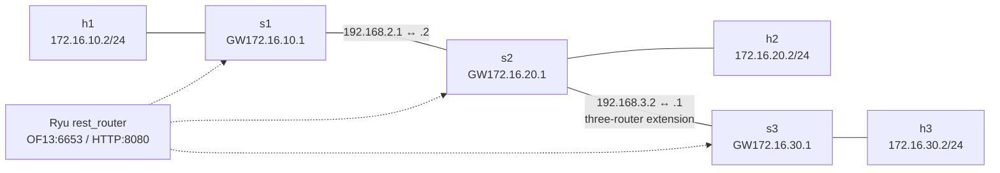
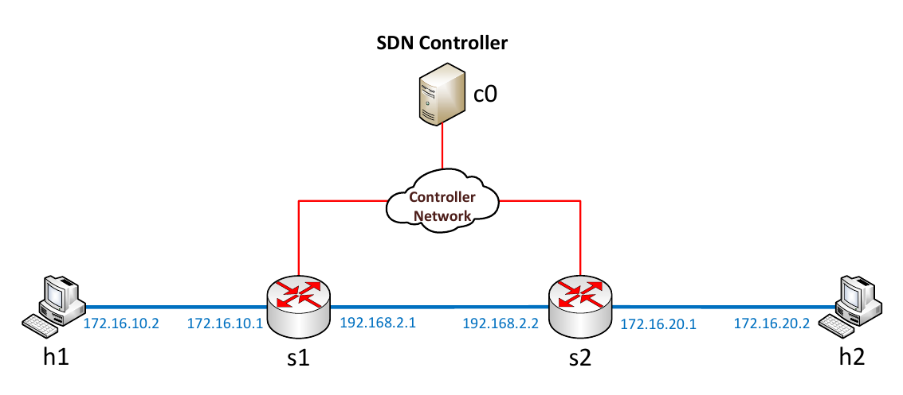
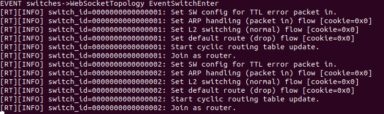
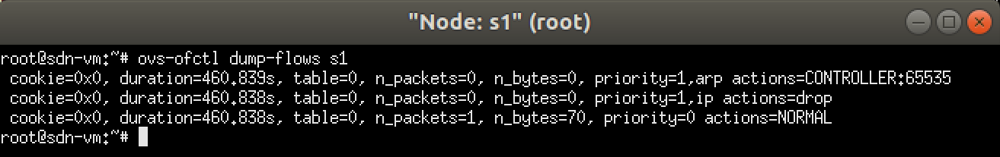
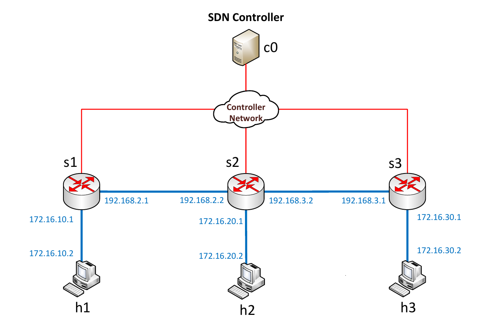

# 05 Lab 05 Ryu Layer 3 Routing

## Before You Begin

[Download the preconfigured Ubuntu SDN VM](https://liveswinburneeduau-my.sharepoint.com/:u:/g/personal/braminzad_swin_edu_au/IQAv_m6WfxYaTKZT4O6OhvkvAarseiSla89Hp5I4QfgqrNw?e=bmsMpi). It includes all required applications and can be reused throughout this series.

Complete [00 Lab Setup](../SDN_00_LabSetup/README.md) and [Lab04](../SDN_04_Lab04_SDN_Controllers_Ryu_ONOS/README.md). This lab assumes the supplied VM's working Ryu environment, Mininet, OVS, curl, Python3, tcpdump, Wireshark, iperf, and tmux. Stop ONOS and any other Ryu instance before using ports 6653/8080.

## Purpose

Use Ryu's `rest_router` application to configure software routers through HTTP. Start with two routers and two subnets, then extend to three routers, three host subnets, and two transit networks. Verify routes, address resolution, packet forwarding, TTL changes, and API-based removal/recovery.

This is controller-programmed IPv4 routing. It does not use VXLAN, EVPN, or a distributed routing protocol. IPs posted to Ryu are virtual router interfaces managed by its application, not addresses to add to Linux switch member interfaces.

## Topology and Addressing



| Router | DPID | Host-facing address | Transit addresses |
| --- | --- | --- | --- |
| s1 | 0000000000000001 | 172.16.10.1/24 | 192.168.2.1/24 |
| s2 | 0000000000000002 | 172.16.20.1/24 | 192.168.2.2/24; 192.168.3.2/24 in extension |
| s3 | 0000000000000003 | 172.16.30.1/24 | 192.168.3.1/24 |

All commands are Ubuntu `bash` unless labelled **Mininet**. Controller and Mininet must run in separate panes.

## 1 Prepare Files and Start tmux

From the repository root:

```bash
cd SDN_05_Lab05_Ryu_L3_Routing
mkdir -p config_backup
python3 -m py_compile Lab05_Router_Config.py
python3 -m json.tool Lab05_Two_Routers.json
bash Lab05_Open_Terminals.sh
```

### Verification

```bash
tmux list-panes -t sdn05:lab
tmux show -gv mouse
ss -ltn | grep -E ':(6653|8080)\b' || true
```

Expect four panes and mouse `on`. Confirm no earlier controller is using either port. Exit any old Mininet session before running `sudo mn -c`. Detach with Ctrl+B then D; reattach with `tmux attach -t sdn05`.

## 2 Start the Routing Controller

In the controller pane:

```bash
source "$HOME/sdn-controller.env"
"$RYU_MANAGER" --ofp-tcp-listen-port 6653 ryu.app.rest_router
```

### Verification — separate Ubuntu pane

```bash
ss -ltn | grep -E ':(6653|8080)\b'
curl -fsS http://127.0.0.1:8080/router/all | python3 -m json.tool
```

Expect both listeners. Before switches connect, the router list can be empty. This application supports OpenFlow 1.3 in this lab; do not copy the previous lab's OF14 setting.

## 3 Start Two Routers and Address the Hosts

In the Mininet pane:

```bash
sudo mn --topo linear,2 --mac --switch ovs,protocols=OpenFlow13 \
  --controller remote,ip=127.0.0.1,port=6653
```

At **Mininet**:

```text
h1 ip addr flush dev h1-eth0
h1 ip addr add 172.16.10.2/24 dev h1-eth0
h1 ip route replace default via 172.16.10.1
h2 ip addr flush dev h2-eth0
h2 ip addr add 172.16.20.2/24 dev h2-eth0
h2 ip route replace default via 172.16.20.1
net
h1 ip route
h2 ip route
```

### Verification — Ubuntu utility pane

```bash
sudo ovs-vsctl get Bridge s1 datapath_id
sudo ovs-vsctl get Bridge s2 datapath_id
curl -fsS http://127.0.0.1:8080/router/all | python3 -m json.tool
```

Expect DPIDs ending0001/0002 and two registered routers. Host gateways are not configured on the routers yet, so cross-subnet ping is expected to fail at this point.


**Two-router REST routing scenario**




**Ryu router-join and initialization logs**




## 4 Add Router Addresses with REST

In Ubuntu:

```bash
curl -fsS -X POST -H 'Content-Type: application/json' \
  -d '{"address":"172.16.10.1/24"}' http://127.0.0.1:8080/router/0000000000000001
curl -fsS -X POST -H 'Content-Type: application/json' \
  -d '{"address":"192.168.2.1/24"}' http://127.0.0.1:8080/router/0000000000000001
curl -fsS -X POST -H 'Content-Type: application/json' \
  -d '{"address":"172.16.20.1/24"}' http://127.0.0.1:8080/router/0000000000000002
curl -fsS -X POST -H 'Content-Type: application/json' \
  -d '{"address":"192.168.2.2/24"}' http://127.0.0.1:8080/router/0000000000000002
```

### Verification

```bash
curl -fsS http://127.0.0.1:8080/router/0000000000000001 | python3 -m json.tool
curl -fsS http://127.0.0.1:8080/router/0000000000000002 | python3 -m json.tool
```

Inspect the JSON `command_result` for `success`; HTTP 200 alone is insufficient. At **Mininet**:

```text
h1 ping -c 3 172.16.10.1
h2 ping -c 3 172.16.20.1
```

Both local gateways should answer. Save actual `address_id` values; never assume IDs remain the same after deletions/restarts.

## 5 Add Default Routes and Test End to End

In Ubuntu:

```bash
curl -fsS -X POST -H 'Content-Type: application/json' \
  -d '{"gateway":"192.168.2.2"}' http://127.0.0.1:8080/router/0000000000000001
curl -fsS -X POST -H 'Content-Type: application/json' \
  -d '{"gateway":"192.168.2.1"}' http://127.0.0.1:8080/router/0000000000000002
python3 Lab05_Router_Config.py Lab05_Two_Routers.json --verify
```

### Verification — Mininet

```text
h1 ping -c 5 172.16.20.2
h2 ping -c 5 172.16.10.2
h1 ip neigh
h2 ip neigh
iperf h1 h2
```

Expect successful connectivity and gateway MAC resolution. The two default routes are sufficient for these two connected routers. They can form a loop for other unknown destinations, so they are deliberately scoped to this isolated exercise; the three-router middle node will use specific routes.

## 6 Inspect Routing Behaviour and Capture Traffic

In an Ubuntu capture pane:

```bash
sudo ovs-ofctl -O OpenFlow13 dump-flows s1
sudo ovs-ofctl -O OpenFlow13 dump-flows s2
sudo tcpdump -ni s1-eth2 -s 0 -w config_backup/two-router-transit.pcap 'arp or icmp'
```

First use Mininet `net` or `sudo ovs-ofctl -O OpenFlow13 show s1` to confirm `s1-eth2` is the inter-switch interface on this VM. Generate another h1→h2 ping, then stop capture with Ctrl+C.

### Verification

```bash
sudo tcpdump -ner config_backup/two-router-transit.pcap -c 12
```

Inspect in Wireshark. Inner IP source/destination remain the host IPs while Ethernet source/destination change at router hops. IPv4 TTL is decremented by routing. Inspect gateway ARP and the resulting specific forwarding entries, not just the default drop/table-miss entries.


**Initial router OpenFlow entries**



*This is the source application baseline. Compare your actual table before and after host traffic; use OpenFlow13 as shown in the current commands.*

## 7 Remove and Restore a Route

Read s1's current route IDs:

```bash
curl -fsS http://127.0.0.1:8080/router/0000000000000001 | python3 -m json.tool
read -r -p 'Route ID for s1 default route: ' route_id
curl -fsS -X DELETE -H 'Content-Type: application/json' \
  -d "{\"route_id\":\"$route_id\"}" http://127.0.0.1:8080/router/0000000000000001
```

At Mininet, test h1→h2 again; it should fail after route-dependent flows are removed. Restore from the supplied desired-state JSON:

```bash
python3 Lab05_Router_Config.py Lab05_Two_Routers.json
python3 Lab05_Router_Config.py Lab05_Two_Routers.json --verify
```

### Verification

Repeat both host pings. Run the apply command a second time: it should print `VERIFIED` without duplicate `ADD` operations. The helper checks existing untagged router state, rejects conflicting routes, validates POST results, and reads back the result. To practise deleting an interface, use the same DELETE pattern with `address_id` discovered from GET; restore it with the helper and retest.

## 8 Rebuild as Three Routers

Exit Mininet and stop/restart Ryu in its own pane to clear application memory before changing topology. In Ubuntu:

```bash
sudo mn -c
sudo mn --topo linear,3 --mac --switch ovs,protocols=OpenFlow13 \
  --controller remote,ip=127.0.0.1,port=6653
```

At **Mininet**:

```text
h1 ip addr flush dev h1-eth0
h1 ip addr add 172.16.10.2/24 dev h1-eth0
h1 ip route replace default via 172.16.10.1
h2 ip addr flush dev h2-eth0
h2 ip addr add 172.16.20.2/24 dev h2-eth0
h2 ip route replace default via 172.16.20.1
h3 ip addr flush dev h3-eth0
h3 ip addr add 172.16.30.2/24 dev h3-eth0
h3 ip route replace default via 172.16.30.1
net
```

### Verification — Ubuntu utility pane

```bash
curl -fsS http://127.0.0.1:8080/router/all | python3 -m json.tool
python3 Lab05_Router_Config.py Lab05_Three_Routers.json
python3 Lab05_Router_Config.py Lab05_Three_Routers.json --verify
```

Expect all three DPIDs. This file gives s2 both transit addresses and specific routes to .10 and .30; it gives s1/s3 their adjacent default gateways. If a switch is not registered, fix its controller connection before applying configuration.


**Three routers, three host subnets, and two transit networks**




## 9 Verify All Three Subnets

At **Mininet**:

```text
pingall
h1 ping -c 5 172.16.30.2
h3 ping -c 5 172.16.10.2
h2 ping -c 5 172.16.30.2
iperf h1 h3
```

### Verification — Ubuntu

```bash
curl -fsS http://127.0.0.1:8080/router/0000000000000002 | python3 -m json.tool
sudo ovs-ofctl -O OpenFlow13 dump-flows s2
```

Expect zero steady-state loss and a route in each direction. If only one direction works, inspect the return route and both host gateways. Ryu's virtual route state is authoritative here; `ip route` on the Ubuntu root namespace does not display these router routes.

## 10 Back Up and Redeploy

In Ubuntu:

```bash
cp Lab05_Three_Routers.json Lab05_Router_Config.py config_backup/
curl -fsS http://127.0.0.1:8080/router/all > config_backup/router-state.json
for sw in s1 s2 s3; do
  sudo ovs-ofctl -O OpenFlow13 dump-flows "$sw" > "config_backup/$sw-flows.txt"
done
python3 -m json.tool config_backup/router-state.json
```

### Verification

The desired-state JSON and helper are sufficient to reapply router settings after restarting Ryu and rebuilding/readdressing Mininet as in step8. Live API state includes assigned IDs and is evidence; do not POST that entire response as configuration. Run the helper and repeat step9 after a redeployment to validate the backup procedure.

## 11 Terminate and Clean Up

Exit Mininet, stop Ryu with Ctrl+C, then in Ubuntu:

```bash
sudo mn -c
ss -ltn | grep -E ':(6653|8080)\b' || true
tmux kill-session -t sdn05 2>/dev/null || true
sudo ovs-vsctl list-br
```

### Verification

No lab controller listener or Mininet bridge remains; saved configs and captures remain. For an API error, inspect its JSON body and Ryu log. For an unreachable transit gateway, compare the diagram, neighbouring addresses, actual links, and OpenFlow 13 settings.

## Completion Checklist

- Local gateways and cross-subnet traffic work in both scenarios.
- API reads show the expected addresses and routes.
- Route deletion causes the expected failure, and restoration recovers connectivity.
- Captures and flow counters show routing rather than simple L2 forwarding.
- Configuration, evidence, and cleanup are complete.

Continue with [Lab06 GNS3 and OVS](../SDN_06_Lab06_GNS3_OVS_Foundations/README.md). Reference: [Ryu router guide and REST API](https://osrg.github.io/ryu-book/en/html/rest_router.html).
