# 06 Lab 06 GNS3 and Open vSwitch Foundations

## Before You Begin

[Download the preconfigured Ubuntu SDN VM](https://liveswinburneeduau-my.sharepoint.com/:u:/g/personal/braminzad_swin_edu_au/IQAv_m6WfxYaTKZT4O6OhvkvAarseiSla89Hp5I4QfgqrNw?e=bmsMpi). It includes all required applications and can be reused throughout this series.

Complete [00 Lab Setup](../SDN_00_LabSetup/README.md). Use the supplied preconfigured Ubuntu VirtualBox VM with GNS3, a local GNS3 server, VPCS, Docker, an Ubuntu Docker guest template, and an Open vSwitch appliance template. This combines the source Pass and Credit tasks. Lab00 includes checks and installation references for missing components.

## Purpose

Build GNS3 networks, configure OVS bridges, separate management from data ports, connect a node to NAT, make interface settings persistent, resolve DNS names, and exchange files with the physical computer. These procedures underpin Labs07–10 and the project.

## Topology

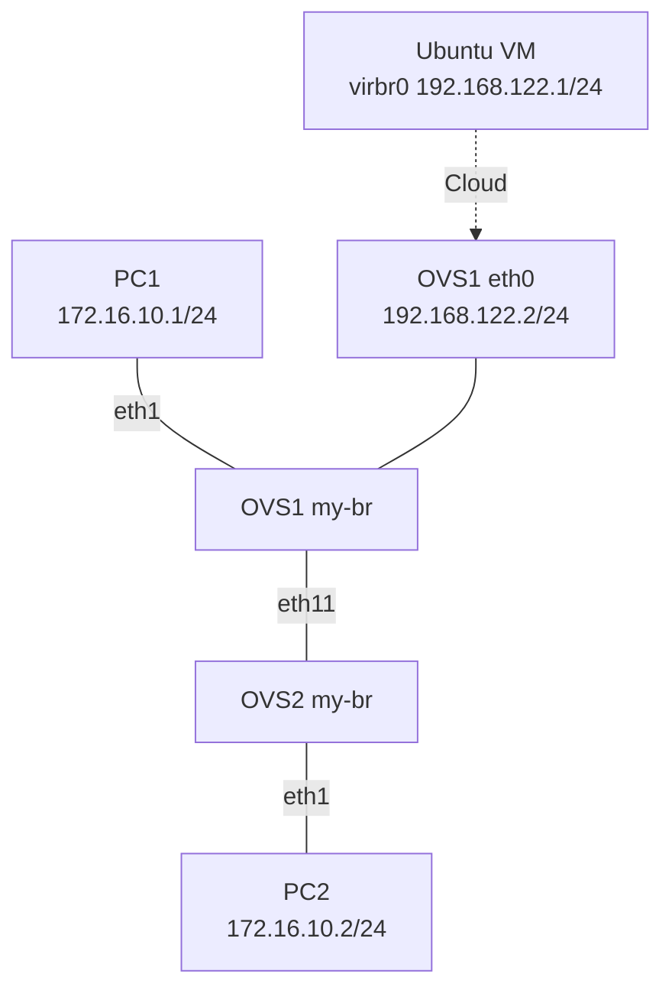

The dotted line is management, outside `my-br`. Initially use VPCS for PC1/PC2. Replace them with Ubuntu Docker guests in the persistence/DNS phase. A separate NAT experiment temporarily connects OVS1 eth0 to a GNS3 NAT node instead of the management Cloud.

**Command contexts:** Ubuntu VM blocks use `sudo` where needed. OVS/Ubuntu Docker node consoles normally run as root, so their commands omit it. VPCS has a small command interpreter, not a Linux shell.

## 1 Verify GNS3 and Appliance Availability

In the Ubuntu VM:

```bash
mkdir -p SDN_06_Lab06_GNS3_OVS_Foundations/config_backup
cd SDN_06_Lab06_GNS3_OVS_Foundations
gns3 --version
gns3server --version
sudo docker ps
ip -br address show virbr0
command -v vpcs
command -v telnet
```

Open GNS3, select the **local server inside Ubuntu**, and check that VPCS, Ubuntu Docker Guest, and Open vSwitch templates exist. Template names can differ in your VM; inspect the image and number of adapters before choosing. OVS needs interfaces through eth15 for later labs.

### Verification

The local server indicator is connected. Docker responds and templates can be instantiated. In this source VM, virbr0 is192.168.122.1/24. If missing, prepare the isolated libvirt management network described in Lab00 before using that address. Do not repurpose the VM's internet-facing adapter.


**Create a GNS3 project**

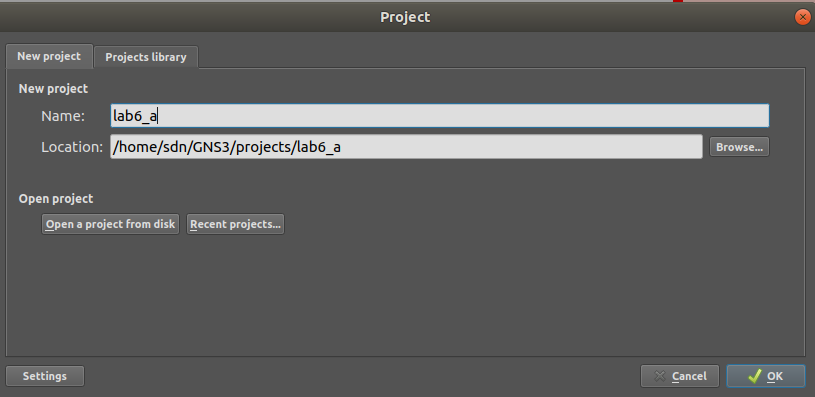

*Use this guide’s project name; the screenshot shows the original handout’s example name.*

## 2 Create a Minimal VPCS Network

Create project `Lab06_GNS3_OVS`. Add PC1, PC2, and a GNS3 built-in Ethernet switch. Connect both PCs to the switch and start the nodes. Right-click a node → Console.

At **PC1 VPCS**:

```text
ip 172.16.10.1/24
show ip
save
```

At **PC2 VPCS**:

```text
ip 172.16.10.2/24
show ip
save
ping 172.16.10.1
```

### Verification

Both node links are green and ping works. Stop/start the PCs and repeat `show ip` and ping. `save` stores VPCS startup configuration. No gateway is needed for this same-subnet test. Change node symbols through right-click → Change symbol if desired; symbols do not alter forwarding or node type.


**Initial two-host VPCS network**

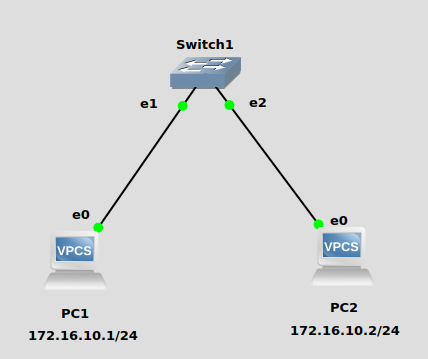


**Start GNS3 devices from the toolbar**

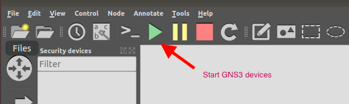


**VPCS address configuration example**

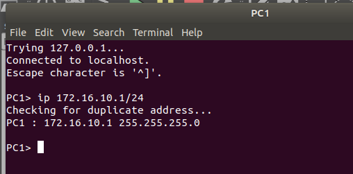


## 3 Replace the Built-In Switch with Two OVS Nodes

Stop all nodes, remove the built-in switch, add OVS1 and OVS2, and wire exactly as the diagram: PC1→OVS1 eth1, OVS1 eth11→OVS2 eth11, OVS2 eth1→PC2. Start nodes.

At **each OVS console**:

```bash
hostname
ip -br link
ovs-vsctl show
```

If the appliance has example bridges br0–br3, inspect their members first. Delete **only those unused example bridges inside this disposable appliance**, one by one, for example `ovs-vsctl --if-exists del-br br0`. Repeat for the actual unused example names shown. Never run a blanket deletion loop in the Ubuntu VM.

At **each OVS console**:

```bash
ovs-vsctl --may-exist add-br my-br
ovs-vsctl set Bridge my-br protocols=OpenFlow13 stp_enable=true
ovs-vsctl set-fail-mode my-br secure
ovs-vsctl --may-exist add-port my-br eth1
ovs-vsctl --may-exist add-port my-br eth11
ip link set eth1 up
ip link set eth11 up
ip link set my-br up
ovs-ofctl -O OpenFlow13 add-flow my-br 'cookie=0x600,priority=0,actions=NORMAL'
```

`NORMAL` invokes OVS's VLAN-aware learning pipeline. Secure fail mode makes forwarding explicit rather than relying on controller-failure fallback. STP may take time to move a new port into forwarding state.

### Verification — OVS consoles

```bash
ovs-vsctl list-ports my-br
ovs-ofctl -O OpenFlow13 show my-br
ovs-appctl stp/show my-br
ovs-ofctl -O OpenFlow13 dump-flows my-br
```

Repeat PC1↔PC2 ping. Expect data ports eth1 and eth11 only; management eth0 is not a bridge member.


**Locate an Open vSwitch appliance template**

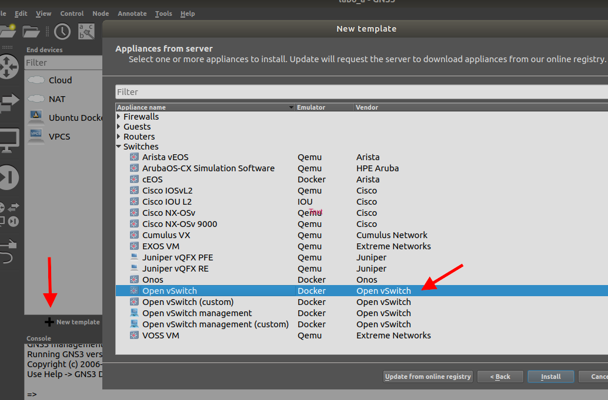

*Select the matching template already installed in your VM.*

**Two OVS nodes and two Linux hosts**

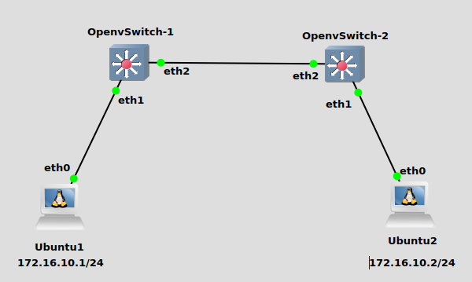

*The original inter-switch link uses eth2. This guide deliberately uses eth11; keep the current diagram and commands when wiring.*

**Read and enable OVS spanning-tree state**

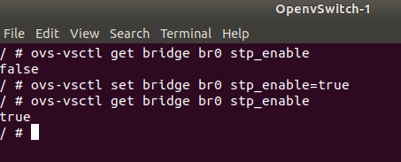

*The source bridge is named br0; use my-br in this guide.*

## 4 Attach an Isolated Management Cloud

In GNS3, stop OVS1, add a Cloud on the local server, and configure it to expose `virbr0` in the Ethernet interfaces list. Enable display of special Ethernet interfaces if necessary. Connect Cloud virbr0→OVS1 eth0; start OVS1.

At **OVS1**:

```bash
ovs-vsctl port-to-br eth0 || true
ip addr flush dev eth0
ip addr add 192.168.122.2/24 dev eth0
ip link set eth0 up
ping -c 3 192.168.122.1
```

If `port-to-br` showed an example data bridge, remove eth0 from that identified bridge before assigning its management IP. Do not remove it from an unrelated VM bridge.

### Verification — Ubuntu VM

```bash
ping -c 3 192.168.122.2
ip route get 192.168.122.2
```

Expect connected management reachability over virbr0. No default route is needed for this isolated management subnet. PC traffic still passes through the separate data bridge.


**Management Cloud attached to the first OVS node**

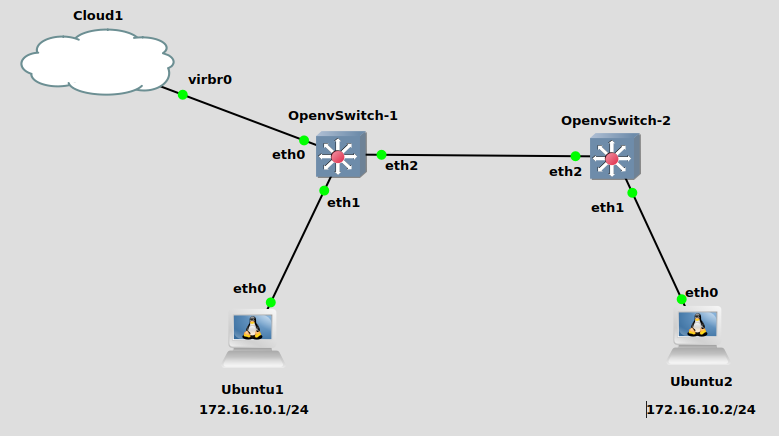

*The original data link uses eth2; this guide uses eth11 and keeps eth0 outside my-br.*

**OVS management address example**

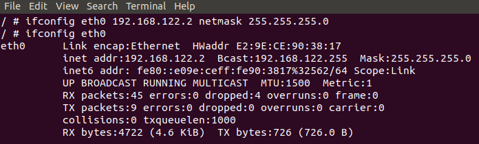

*The address matches this exercise; use ip commands and persistence steps from the current text.*

## 5 Use Ubuntu Docker Hosts and Persist Addresses

Stop PC1/PC2 and replace VPCS nodes with Ubuntu Docker Guest nodes wired to the same OVS access ports. Their connected host interface is normally eth0. At each **Ubuntu Docker host** inspect:

```bash
ip -br link
cat /etc/network/interfaces
ps -p 1 -o comm=
command -v ifup
```

For the source appliances using **ifupdown**, edit `/etc/network/interfaces` with `nano`, preserving unrelated entries. PC1's data-interface stanza is:

```text
auto eth0
iface eth0 inet static
    address 172.16.10.1
    netmask 255.255.255.0
```

PC2 uses172.16.10.2. OVS1's management eth0 stanza uses192.168.122.2 and the same /24 mask. Include `gateway 192.168.122.1` only if deliberately using the libvirt NAT network for internet access; same-subnet management does not need it. Do not configure a data IP on OVS eth1/eth11.

Stop/start each node through GNS3 so its appliance startup applies configuration. On images using NetworkManager or systemd-networkd, use their native persistence mechanism instead; do not paste ifupdown files into the outer Ubuntu VM's network configuration.

### Verification — node consoles

```bash
ip -br address
ip route
```

PC1↔PC2 and OVS1↔192.168.122.1 must still work after a full project close/reopen. If OVS flows or bridge state disappear on restart, reapply the step3 commands; `/etc/network/interfaces` does not store OVS OpenFlow rules.


**Example ifupdown interface-file layout**

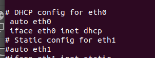

*The source shows DHCP as an alternative. Use the static data-host and management stanzas specified in this step.*

## 6 Test NAT Internet Access in a Separate Phase

Save the management configuration. Stop OVS1, disconnect its Cloud link, and connect eth0 to a GNS3 **NAT** node. Replace only its eth0 ifupdown stanza with:

```text
auto eth0
iface eth0 inet dhcp
```

Restart OVS1. The NAT subnet and gateway are allocated by GNS3; do not assume the earlier static management IP still applies.

### Verification — OVS1

```bash
ip -4 addr show eth0
ip route
cat /etc/resolv.conf
getent hosts www.swinburne.edu.au
```

Expect a DHCP address, default route, and working DNS. If available, run `curl -I https://www.swinburne.edu.au`. A server may redirect or restrict HTTP; distinguish that from DNS/route failure. This NAT phase is for the OVS node itself, not automatic routing/NAT for the downstream host subnet.


**An OVS management interface connected to a GNS3 NAT node**

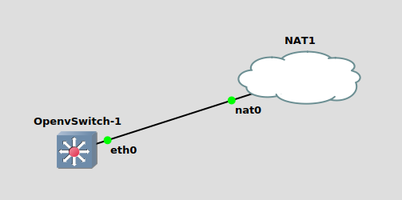

*This illustrates the temporary NAT phase; restore the management Cloud afterward.*

## 7 Configure and Verify DNS

At the appliance, inspect `/etc/resolv.conf`. `nameserver` lines specify resolver addresses; `search` appends a domain to short names; `options` adjusts resolver behaviour. The filename is **resolv.conf**.

First test an explicit resolver without changing managed files:

```bash
nslookup www.swinburne.edu.au 8.8.8.8
nslookup 8.8.8.8 8.8.8.8
```

For the source ifupdown image with `resolvconf` integration, add this under the DHCP stanza:

```text
    dns-nameservers 8.8.8.8
```

If `/etc/resolv.conf` is a regular unmanaged appliance file and no resolver manager exists, back it up and set it directly:

```bash
cp /etc/resolv.conf /root/resolv.conf.before-lab06
printf 'nameserver 8.8.8.8\n' > /etc/resolv.conf
```

### Verification

```bash
nslookup www.swinburne.edu.au
getent hosts www.swinburne.edu.au
```

Repeat after restarting the node. The resolver used should match your configuration. DHCP can replace the file; use the appliance's resolver mechanism if so. Public DNS may be blocked on some networks; use a permitted resolver there. Reverse lookups do not necessarily exist for every IP and are not proof of host reachability.

## 8 Restore the Management Network

Stop OVS1, reconnect eth0 to Cloud virbr0, restore its static192.168.122.2/24 stanza, and start it. Reapply its OVS bridge/flow commands if needed.

### Verification

```bash
ip -4 addr show eth0
ping -c 3 192.168.122.1
ovs-vsctl show
```

Retest PC1↔PC2 and Ubuntu VM↔OVS1. The later labs use the management Cloud, not this temporary NAT wiring.

## 9 Share Files Between VirtualBox and Ubuntu

On the physical computer, create a folder named `SDNShare`. In VirtualBox VM Settings → Shared Folders, add it with share name **SDNShare** and enable auto-mount. Guest Additions must be installed in Ubuntu.

In the **Ubuntu VM**:

```bash
sudo usermod -aG vboxsf "$USER"
```

Log out and back in. Auto-mount normally appears at `/media/sf_SDNShare`. Alternatively mount explicitly:

```bash
mkdir -p "$HOME/Documents/shared"
sudo mount -t vboxsf -o "uid=$(id -u),gid=$(id -g)" SDNShare "$HOME/Documents/shared"
```

Use the actual mounted location; `~/Documents/shared` is not created automatically by the share name alone.

### Verification

```bash
findmnt -t vboxsf
printf 'Lab06 shared folder test\n' > "$HOME/Documents/shared/lab06-test.txt"
cat "$HOME/Documents/shared/lab06-test.txt"
```

Use `/media/sf_SDNShare` instead if you chose auto-mount only. Confirm the same file is visible on the physical computer. A VirtualBox share is unrelated to GNS3's appliance filesystems.


**VirtualBox Shared Folders settings**

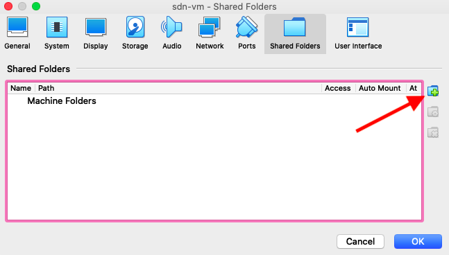


**Configure a VirtualBox share and mount point**

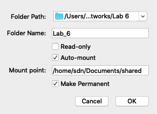

*The historical share name and mount path differ. Follow this guide’s SDNShare example and verify the actual mount.*

## 10 Open Device Consoles in tmux

In GNS3, inspect each running node's console TCP port (node information/configuration) and confirm it is a **Telnet console on the local server**. In an Ubuntu terminal outside tmux, replace the example numbers with the actual ports:

```bash
bash Lab06_Open_Terminals.sh PC1:5000 PC2:5001 OVS1:5002 OVS2:5003
```

### Verification

```bash
tmux list-panes -t sdn06:lab
tmux show -gv mouse
```

Expect four device panes and one Ubuntu pane. The script connects using telnet automatically and always enables mouse selection. Ctrl+B then D detaches; `tmux attach -t sdn06` returns. GNS3 assigns console ports dynamically; interface eth1 is not console port 1. For remote servers change the helper's127.0.0.1 to the actual server address before use.

## 11 Export Configuration and Preserve the Project

Save the GNS3 project. Export it as a portable project through **File → Export portable project** to this lab's `config_backup` folder. Follow the VM's GNS3 version prompts; do not redistribute licensed appliance images without the necessary rights.

For text backups, in the **Ubuntu VM**, list containers and identify the correct running node:

```bash
sudo docker ps --format 'table {{.ID}}\t{{.Names}}\t{{.Image}}'
read -r -p 'PC1 container ID from the table: ' pc1_id
sudo docker cp "$pc1_id:/etc/network/interfaces" config_backup/PC1-interfaces
read -r -p 'OVS1 container ID from the table: ' ovs1_id
sudo docker cp "$ovs1_id:/etc/network/interfaces" config_backup/OVS1-interfaces
sudo docker exec "$ovs1_id" ovs-vsctl show > config_backup/OVS1-ovs.txt
sudo docker exec "$ovs1_id" ovs-ofctl -O OpenFlow13 dump-flows my-br > config_backup/OVS1-flows.txt
```

GNS3 nodes may be named differently in Docker. Confirm node identity before copying; for non-Docker OVS appliances, save equivalent console output and the portable project instead.

### Verification

```bash
ls -lh config_backup
cat config_backup/PC1-interfaces
```

Restore an interfaces file with `docker cp config_backup/PC1-interfaces "$pc1_id:/etc/network/interfaces"` and restart that node. Rebuild OVS using step3 commands and verify pings. Flow dumps are evidence; create explicit commands for restoration rather than feeding raw dump text back as a complete config.

## 12 Stop and Clean Up

Stop all project nodes through GNS3, save, and close the project. In Ubuntu:

```bash
tmux kill-session -t sdn06 2>/dev/null || true
sudo docker ps
ip -br address show virbr0
```

### Verification

This project's containers stop, and virbr0 remains. Leave Docker, libvirt, and the GNS3 server installed for future labs. No global Docker prune or VM bridge deletion is needed.

## Troubleshooting

| Symptom | Action |
| --- | --- |
| OVS commands fail | Confirm this is an OVS appliance console and its OVS service is running. |
| Cloud cannot see virbr0 | Choose the local Ubuntu server and show special interfaces. |
| Management ping fails | Check eth0 is outside my-br and has the correct /24 address. |
| Configuration disappears | Verify the appliance's persisted files and startup process; retain portable export and rebuild commands. |
| Shared folder permission denied | Re-login after group change and inspect `findmnt`; check Guest Additions. |

## Completion Checklist

- VPCS and Ubuntu Docker connectivity are verified.
- Two OVS data bridges forward with explicit NORMAL rules.
- Management is separate, NAT and DNS tests are complete, and management wiring is restored.
- Persistence survives a stop/start and project reopen.
- Shared files, text backups, and the portable project are saved.

Continue with [Lab07 VLANs, LACP, and Controllers](../SDN_07_Lab07_OVS_VLAN_LACP_Controllers/README.md). References: [GNS3 documentation](https://docs.gns3.com/), [OVS VLAN tutorial](https://docs.openvswitch.org/en/stable/tutorials/vlan-configuration/).
