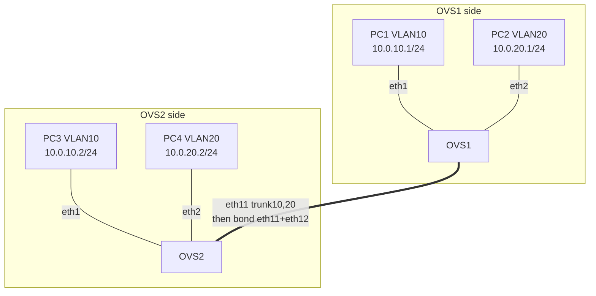
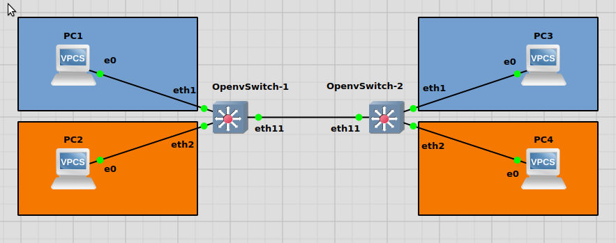
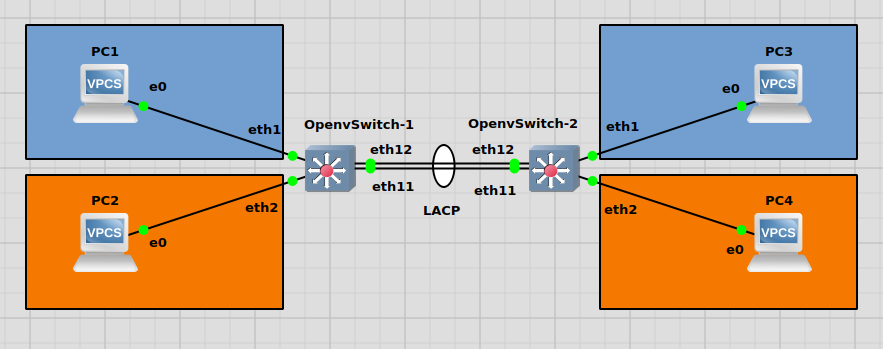
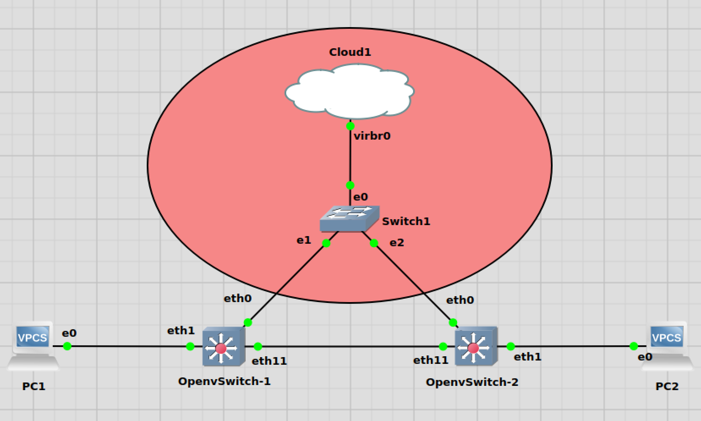
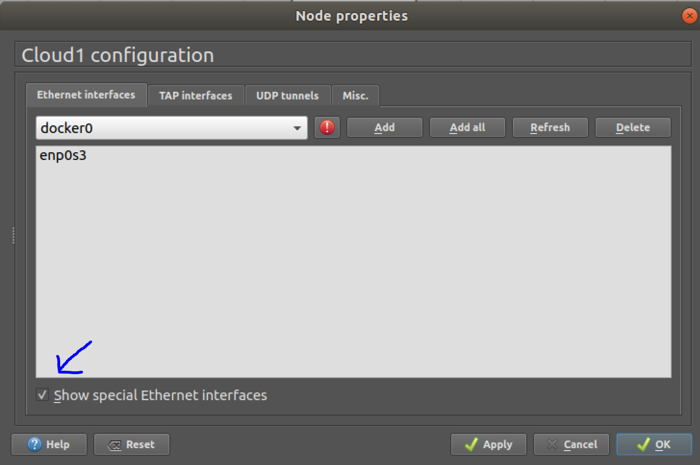
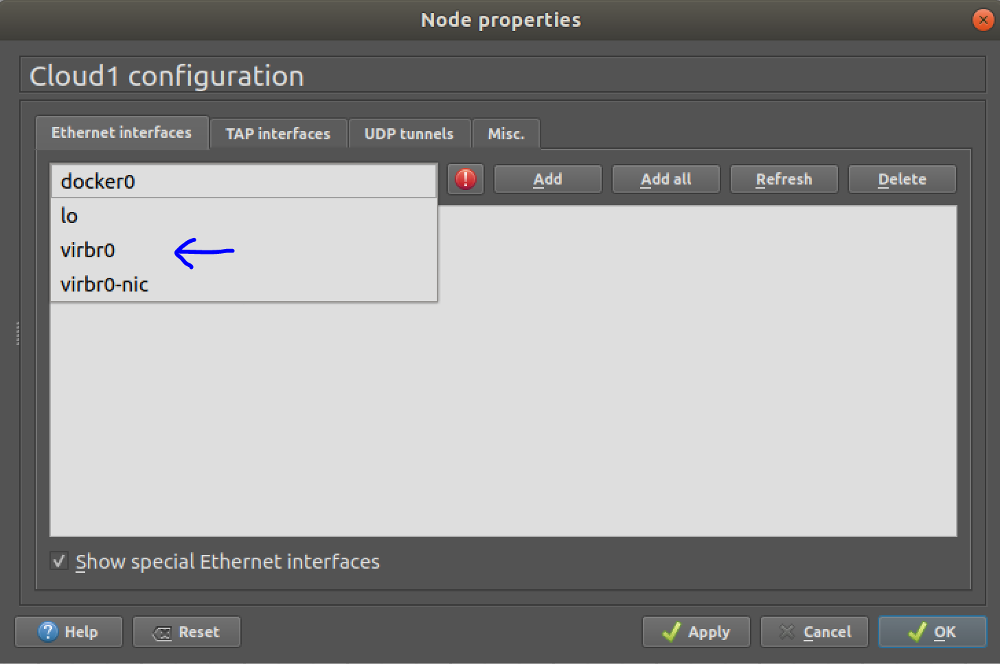
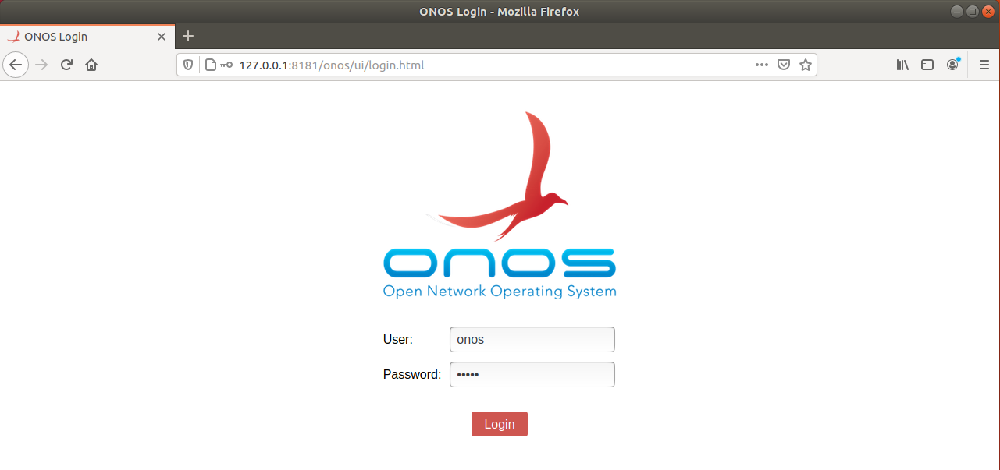

# 07 Lab 07 OVS VLANs, LACP, and Controllers

## Before You Begin

[Download the preconfigured Ubuntu SDN VM](https://liveswinburneeduau-my.sharepoint.com/:u:/g/personal/braminzad_swin_edu_au/IQAv_m6WfxYaTKZT4O6OhvkvAarseiSla89Hp5I4QfgqrNw?e=bmsMpi). It includes all required applications and can be reused throughout this series.

Complete [00 Lab Setup](../SDN_00_LabSetup/README.md) and [Lab06](../SDN_06_Lab06_GNS3_OVS_Foundations/README.md). Use the supplied Ubuntu VM, GNS3 appliances, and management Cloud. Controller phase also assumes [Lab04](../SDN_04_Lab04_SDN_Controllers_Ryu_ONOS/README.md). Stop earlier projects and controller instances.

## Purpose

Isolate two VLANs over a shared trunk, replace the trunk with an LACP bond, test failover, and connect separate OVS devices to ONOS and Ryu. The controller exercise is a separate untagged phase, because a generic learning-switch application's output actions must not be assumed to honour OVSDB VLAN isolation.

## Topology



GNS3 node-shell commands run inside the named OVS appliance as root. VPCS commands are `text`. Ubuntu VM commands are labelled separately. The bond is configured on **both** ends before both cables are active.


**Two VLANs across a single inter-switch trunk**




## 1 Create and Check the Project

In GNS3 create `Lab07_VLAN_LACP`. Add two OVS nodes and four VPCS. Wire the access ports and only eth11 between switches; leave eth12 disconnected for now. Start nodes, inspect default appliance bridges as in Lab06, and remove only unused sample bridges inside those nodes.

In the **Ubuntu VM**, from the repository root:

```bash
cd SDN_07_Lab07_OVS_VLAN_LACP_Controllers
mkdir -p config_backup
bash -n Lab07_Configure_OVS.sh
sudo docker ps --format 'table {{.ID}}\t{{.Names}}\t{{.Image}}'
```

### Verification

GNS3 link endpoints match the diagram. At each OVS console run `ip -br link` and `ovs-vsctl show`; eth0 must remain outside the data bridge. Use node console information and `Lab07_Open_Terminals.sh` as in Lab06 to open all six devices plus one Ubuntu pane, with mouse support always enabled.

## 2 Address All Four Hosts

At **PC1 VPCS**:

```text
ip 10.0.10.1/24
save
show ip
```

At **PC2 VPCS**:

```text
ip 10.0.20.1/24
save
show ip
```

At **PC3 VPCS**:

```text
ip 10.0.10.2/24
save
show ip
```

At **PC4 VPCS**:

```text
ip 10.0.20.2/24
save
show ip
```

### Verification

Each address and mask matches the diagram. No gateway is configured: this exercise has no router between VLANs. VPCS sends untagged access traffic; the switch assigns its VLAN.

## 3 Configure VLAN Access Ports and the Trunk

Copy `Lab07_Configure_OVS.sh` into each OVS appliance. For a Docker appliance, run in the **Ubuntu VM**, selecting the real container IDs:

```bash
read -r -p 'OVS1 container ID: ' ovs1_id
read -r -p 'OVS2 container ID: ' ovs2_id
sudo docker cp Lab07_Configure_OVS.sh "$ovs1_id:/root/Lab07_Configure_OVS.sh"
sudo docker cp Lab07_Configure_OVS.sh "$ovs2_id:/root/Lab07_Configure_OVS.sh"
sudo docker exec "$ovs1_id" bash /root/Lab07_Configure_OVS.sh trunk
sudo docker exec "$ovs2_id" bash /root/Lab07_Configure_OVS.sh trunk
```

For non-Docker appliances, paste the relevant commands from the script into each root console. The script deliberately touches only `my-br` and the listed lab ports; resolve any port already assigned to an example bridge before running it.

### Verification — each OVS console

```bash
ovs-vsctl show
ovs-vsctl list Port eth1 eth2 eth11
ovs-ofctl -O OpenFlow13 dump-flows my-br
ovs-appctl stp/show my-br
```

Expect access tags10/20, trunk allow-list10,20, and an explicit NORMAL action. Wait for STP forwarding before testing.

## 4 Verify Connectivity and VLAN Isolation

At **PC1**:

```text
ping 10.0.10.2
ping 10.0.20.2
```

At **PC2**:

```text
ping 10.0.20.2
ping 10.0.10.2
```

### Verification

Same-VLAN remote peers must respond; cross-subnet pings should fail because no routing exists. Also prove **Layer2** isolation independently of subnet differences: temporarily change **PC2** to10.0.10.99/24, leaving its switch port in VLAN 20:

```text
ip 10.0.10.99/24
ping 10.0.10.1
ip 10.0.20.1/24
save
```

That same-subnet cross-VLAN probe must fail. Restore PC2 before continuing. Check learned entries on each OVS:

```bash
ovs-appctl fdb/show my-br
```

MAC entries should be associated with their correct VLANs. Different IP subnets alone would not prove VLAN separation.

## 5 Capture Access and Trunk Frames

In GNS3, right-click the PC1 access link → Start capture; then capture eth11 between switches. Generate PC1→PC3 and PC2→PC4 pings and stop both captures.

### Verification

In Wireshark, inspect Ethernet details. PC-facing frames are untagged. Trunk frames carry802.1Q VLAN 10 or20. Use filters `vlan.id == 10` and `vlan.id == 20` on the trunk. Save captures to `config_backup` through Wireshark's Save As dialog. Capture decoding, endpoint placement, and VLAN configuration should agree.

## 6 Replace the Trunk with an LACP Bond

Stop the two OVS nodes. Add a second cable eth12↔eth12, then start the nodes with that second link suspended if supported by your GNS3 version. Keep user traffic stopped until both ends are configured. In the **Ubuntu VM**:

```bash
sudo docker exec "$ovs1_id" bash /root/Lab07_Configure_OVS.sh bond
sudo docker exec "$ovs2_id" bash /root/Lab07_Configure_OVS.sh bond
```

Re-identify container IDs after restart if GNS3 recreated them. Enable the second GNS3 link after both scripts complete. The former standalone eth11 port is removed and becomes a member of logical port `bond1`; VLAN settings move onto bond1.

### Verification — each OVS

```bash
ovs-vsctl list Port bond1
ovs-appctl lacp/show bond1
ovs-appctl bond/show bond1
ovs-ofctl -O OpenFlow13 show my-br
```

Expect LACP active, both members attached/eligible, and one logical data port for the bond. If either member fails to negotiate, compare peer cabling, LACP settings, and link state. Do not proceed with two unbonded parallel forwarding links.


**Two inter-switch links grouped as an LACP bond**




## 7 Test Bond Resilience and Capacity Correctly

Repeat same-VLAN pings. While a repeated PC1→PC3 ping runs, suspend one bond member link in GNS3; restore it, then test the other member.

### Verification

```bash
ovs-appctl lacp/show bond1
ovs-appctl bond/show bond1
ip -s link show eth11
ip -s link show eth12
```

Expect connectivity after convergence with either one remaining member. A brief loss at transition is possible. One TCP connection usually hashes to one member: a bond does not automatically double its throughput. To measure aggregate use, replace VPCS with Linux Docker hosts using the same addresses, run `iperf3 -s` on a receiver, and `iperf3 -c 10.0.10.2 -P 8 -t 20` on its peer. Repeat simultaneously in VLAN 20. Check **both** member counters; GNS3 links without explicit rate limits and VM CPU limits do not establish physical link-capacity claims.

Capture eth11 or eth12 again while traffic runs, allowing at least one LACP periodic interval (slow mode can be about30 seconds). In Wireshark use `lacp` or `eth.type == 0x8809` to identify the new LACP control frames. They advertise actor/partner identity and member synchronization; ordinary host data remains802.1Q-tagged with VLAN10/20. The bond changes link selection, not the tenant VLAN numbering.

## 8 Build a Separate Controller Coexistence Phase

Save/export the VLAN project first. Create `Lab07_Controller_Coexistence`: two OVS, two Ubuntu Docker hosts, one link eth11↔eth11, host eth0→switch eth1, and both switch eth0 ports→a management Ethernet switch→Cloud virbr0.

| Node | Management eth0 | Data host address |
| --- | --- | --- |
| OVS1 | 192.168.122.10/24 | PC1:10.0.0.1/24 |
| OVS2 | 192.168.122.20/24 | PC2:10.0.0.2/24 |
| Ubuntu VM | 192.168.122.1/24 | Controller location |

At **each fresh OVS**, create an untagged bridge:

```bash
ovs-vsctl --may-exist add-br my-br
ovs-vsctl set Bridge my-br protocols=OpenFlow13
ovs-vsctl set-fail-mode my-br secure
ovs-vsctl --may-exist add-port my-br eth1
ovs-vsctl --may-exist add-port my-br eth11
ip link set eth1 up
ip link set eth11 up
```

Set each switch's eth0 management address using Lab06's persistent ifupdown method. At **PC1 Linux**, set eth0 to10.0.0.1/24; at **PC2**, use10.0.0.2/24, using `ip addr flush`, `ip addr add`, and `ip link set eth0 up`, then persist with Lab06's method.

### Verification

Each OVS can ping192.168.122.1. `ovs-vsctl list Port` shows **no** access tags, trunks, or bond in this phase. The previous tagged network must be stopped before enabling generic reactive forwarding here.


**Separate untagged topology with management connectivity**




**Show special Ethernet interfaces in a GNS3 Cloud**




**Select virbr0 for the GNS3 management Cloud**




## 9 Manage Both Switches with ONOS, Then Start Ryu

Start ONOS as in Lab04. At the **ONOS CLI**:

```text
app activate org.onosproject.openflow
cfg set org.onosproject.openflow.controller.impl.OpenFlowControllerImpl openflowPorts 12345
app activate org.onosproject.fwd
cfg get org.onosproject.openflow.controller.impl.OpenFlowControllerImpl
```

Before splitting control ownership, connect **both OVS1 and OVS2** to ONOS at their node consoles:

```bash
ovs-vsctl set-controller my-br tcp:192.168.122.1:12345
```

Verify both devices in the ONOS CLI (`devices`, `links`, `hosts`, `flows`) and repeat PC1→PC2 ping. Open `http://127.0.0.1:8181/onos/ui/`: show hosts, enable device labels, select a device to inspect ports/flows, and drag devices into positions matching GNS3. In the Applications view, confirm the OpenFlow provider and Reactive Forwarding are active and inspect the dependencies activated alongside them. The provider establishes device control; the forwarding application programs host reachability.

Then start Ryu in a separate Ubuntu pane:

```bash
source "$HOME/sdn-controller.env"
"$RYU_MANAGER" --observe-links --ofp-tcp-listen-port 6653 \
  ryu.app.gui_topology.gui_topology ryu.app.simple_switch_13
```

### Verification — Ubuntu

```bash
ss -ltn | grep -E ':(12345|6653|8080|8181)\b'
```

Expect ONOS on12345 and Ryu on6653. Component names/settings are for the source ONOS 2.2.3 image. If changing a setting requires a provider restart in your release, use the VM's ONOS instructions and verify the listener before connecting switches. Do not substitute a target port until the matching listener exists.


**Access the ONOS web interface**



*Use your VM credentials and the listen ports in this guide.*

## 10 Connect One Switch to Each Controller

At **OVS1**:

```bash
ovs-vsctl set-controller my-br tcp:192.168.122.1:12345
```

At **OVS2**:

```bash
ovs-vsctl set-controller my-br tcp:192.168.122.1:6653
```

### Verification — each OVS

```bash
ovs-vsctl list Controller
ovs-ofctl -O OpenFlow13 dump-flows my-br
```

From PC1, ping10.0.0.2. Expect success after both applications learn MACs. ONOS sees only its controlled device; it is not a complete authoritative view of Ryu's switch. Each controller's logs and each switch's flow table establish control ownership. Open Ryu at `http://127.0.0.1:8080` alongside ONOS at `http://127.0.0.1:8181/onos/ui/`; each should show its one managed switch. Old ONOS inventory can retain a disconnected device, so inspect availability rather than counting all historical entries.

## 11 Save, Restore, and Clean Up

In the Ubuntu VM, keep the actual current OVS IDs in `ovs1_id`/`ovs2_id`:

```bash
cp Lab07_Configure_OVS.sh config_backup/
sudo docker exec "$ovs1_id" ovs-vsctl show > config_backup/OVS1-state.txt
sudo docker exec "$ovs2_id" ovs-ofctl -O OpenFlow13 dump-flows my-br > config_backup/OVS2-flows.txt
ls -lh config_backup
```

Export each GNS3 phase as a separate portable project. To restore VLAN/bond operation, reopen that phase, reapply the script in `trunk` or `bond` mode on **both** switches, and repeat the isolation/failover tests. Save management interfaces and controller commands with the controller-phase export.

Stop all nodes, stop Ryu and ONOS using their launch method, and kill only this lab's tmux session:

```bash
tmux kill-session -t sdn07 2>/dev/null || true
ss -ltn | grep -E ':(12345|6653|8080|8181)\b' || true
```

### Verification

The lab listeners and nodes stop; VM networking remains. ONOS settings persist across restarts, so later labs explicitly choose their ports rather than assuming6653.

## Completion Checklist

- Same-VLAN forwarding and same-subnet cross-VLAN isolation are demonstrated.
- Access/trunk captures show the expected tagging.
- Both LACP members negotiate and failover works.
- Separate ONOS/Ryu control connections and forwarding work in the untagged phase.
- Both projects, configs, captures, and cleanup are complete.

Continue with [Lab08 VXLAN and GRE](../SDN_08_Lab08_OVS_VXLAN_GRE/README.md). References: [OVS VLAN FAQ](https://docs.openvswitch.org/en/stable/faq/vlan/), [OVS bonding](https://docs.openvswitch.org/en/stable/topics/bonding/).
