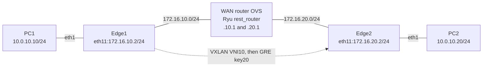
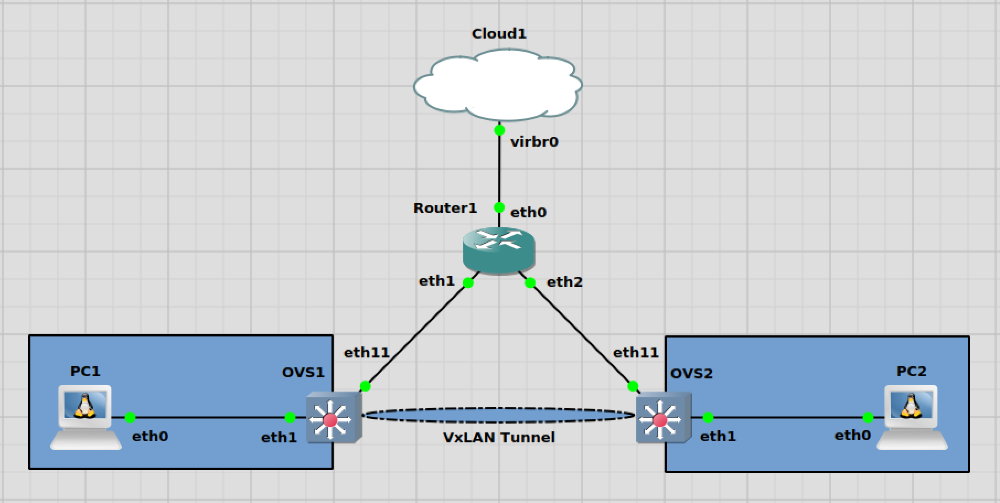
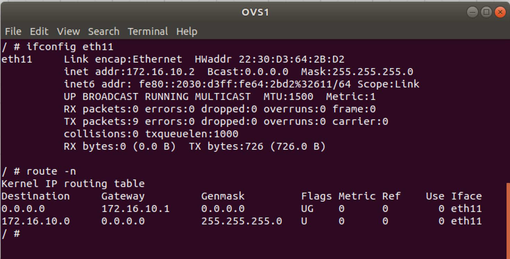
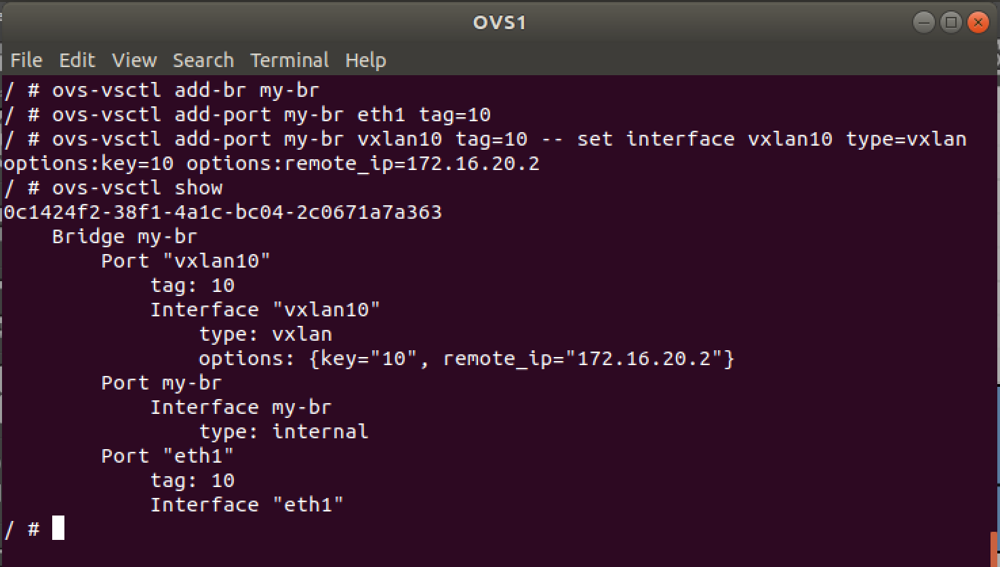
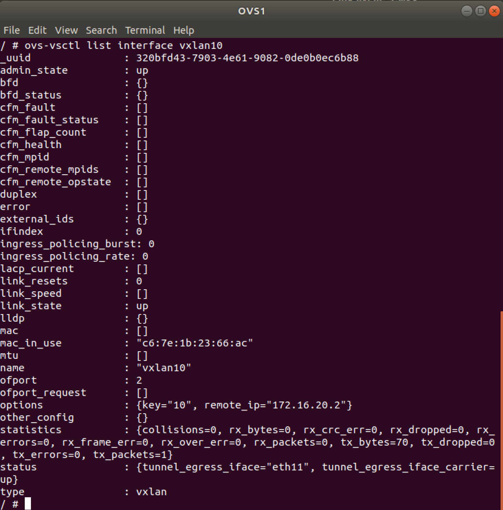
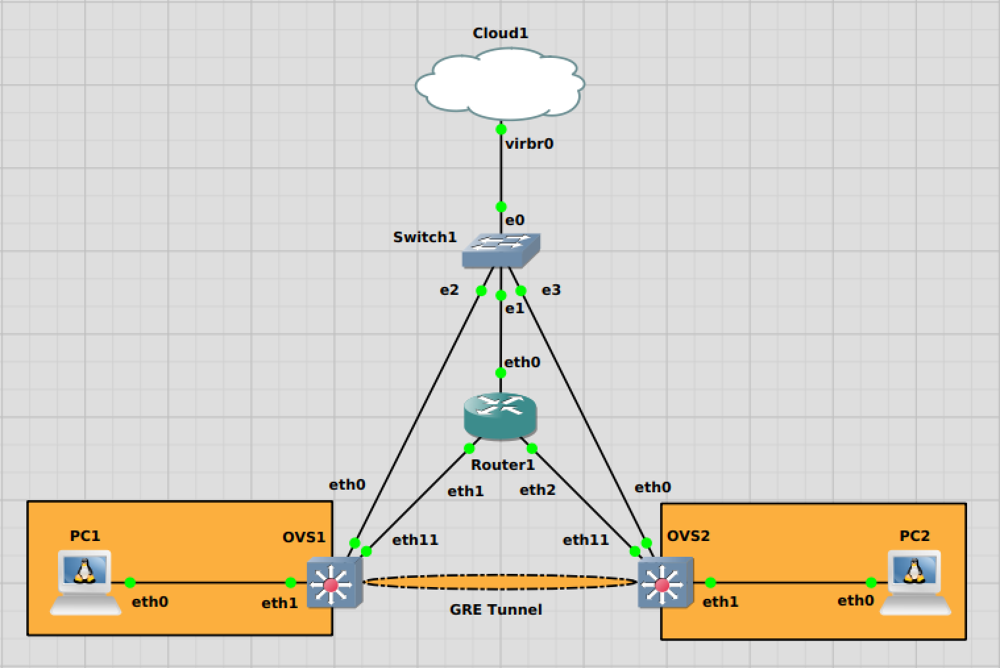

# 08 Lab 08 OVS VXLAN and GRE Overlays

## Before You Begin

[Download the preconfigured Ubuntu SDN VM](https://liveswinburneeduau-my.sharepoint.com/:u:/g/personal/braminzad_swin_edu_au/IQAv_m6WfxYaTKZT4O6OhvkvAarseiSla89Hp5I4QfgqrNw?e=bmsMpi). It includes all required applications and can be reused throughout this series.

Complete [00 Lab Setup](../SDN_00_LabSetup/README.md), [Lab05 REST routing](../SDN_05_Lab05_Ryu_L3_Routing/README.md), and [Lab06](../SDN_06_Lab06_GNS3_OVS_Foundations/README.md). Reuse the supplied VM. This combines the source VXLAN Pass and GRE Distinction tasks. Stop previous projects/controllers first.

## Purpose

Extend one Ethernet segment across a routed transport using VXLAN, then rebuild the same overlay using GRE. Ryu controls the intermediate router. Static tunnel endpoints and OVS's NORMAL pipeline forward tenant traffic. ONOS optionally monitors edge switches on a separate OpenFlow port.

Neither tunnel requires EVPN here. Static peer configuration supplies endpoint knowledge; MAC learning and flooding provide the small lab's L2 forwarding.

## Topology and Addressing



| Device | Management eth0 | Transport/data |
| --- | --- | --- |
| Edge1 | 192.168.122.20/24 | eth11:172.16.10.2/24; eth1→PC1 |
| Edge2 | 192.168.122.30/24 | eth11:172.16.20.2/24; eth1→PC2 |
| WAN router | 192.168.122.40/24 | eth1→Edge1; eth2→Edge2 |
| Ubuntu VM | 192.168.122.1/24 | Ryu6653/8080; optional ONOS 7777/8181 |

Connect all management eth0 ports via a GNS3 Ethernet switch to Cloud virbr0. These ports stay outside all data bridges. Use Ubuntu Docker hosts for PCs. All node-shell blocks run as root inside the named appliance; Ubuntu VM commands are labelled.


**VXLAN endpoints across a routed WAN**



*The original OVS1/OVS2 labels correspond to Edge1/Edge2 here. The management layout is expanded in the current diagram.*

## 1 Create the Project and Verify Interfaces

Create GNS3 project `Lab08_VXLAN_GRE`, add the three OVS and two Docker hosts, and wire as shown. Inspect/remove unused example bridges inside each new OVS using Lab06's method. Start nodes.

In the **Ubuntu VM**, from the repo root:

```bash
cd SDN_08_Lab08_OVS_VXLAN_GRE
mkdir -p config_backup
bash -n Lab08_Configure_Edge.sh
python3 -m py_compile Lab08_Router_Config.py
```

Set management addresses persistently as in Lab06. Copy the edge script into the edge containers using `docker cp` after identifying them with `sudo docker ps`.

### Verification — each OVS

```bash
ip -br link
ip -br address
ping -c 3 192.168.122.1
ovs-vsctl show
```

Confirm port numbering matches actual GNS3 cables. The WAN router's data ports must not have Linux host addresses; Ryu will supply its virtual addresses.

## 2 Open Device Consoles and Controller Panes

In an Ubuntu terminal outside tmux, use actual console ports from GNS3 (these numbers are examples):

```bash
bash Lab08_Open_Terminals.sh Edge1:5000 Edge2:5001 WAN:5002 PC1:5003 PC2:5004
```

The helper opens five connected device panes and an Ubuntu pane. Create an extra Ubuntu window for Ryu with Ctrl+B then C. Source `~/sdn-controller.env` there before launching it.

### Verification

```bash
tmux list-panes -t sdn08:lab
tmux show -gv mouse
```

Expect six panes and mouse `on`. Detach with Ctrl+B then D; reattach with `tmux attach -t sdn08`.

## 3 Configure and Start the Ryu WAN Router

At the **WAN OVS console**:

```bash
ovs-vsctl --may-exist add-br wan-br
ovs-vsctl set Bridge wan-br protocols=OpenFlow13 other-config:datapath-id=0000000000000003
ovs-vsctl set-fail-mode wan-br secure
ovs-vsctl --may-exist add-port wan-br eth1
ovs-vsctl --may-exist add-port wan-br eth2
ip link set eth1 up
ip link set eth2 up
ovs-vsctl set-controller wan-br tcp:192.168.122.1:6653
```

In the **Ubuntu controller pane**:

```bash
source "$HOME/sdn-controller.env"
"$RYU_MANAGER" --ofp-tcp-listen-port 6653 ryu.app.rest_router
```

In an **Ubuntu utility pane**, after the router joins:

```bash
python3 Lab08_Router_Config.py Lab08_Router.json
python3 Lab08_Router_Config.py Lab08_Router.json --verify
```

### Verification

```bash
curl -fsS http://127.0.0.1:8080/router/0000000000000003 | python3 -m json.tool
```

Expect172.16.10.1/24 and172.16.20.1/24 as connected virtual networks. No static route is needed between them. Do not add a default NORMAL flow to wan-br: Ryu owns its routing pipeline.

## 4 Prepare the Edge Transport and VXLAN

At **Edge1**, with the supplied script under `/root`:

```bash
bash /root/Lab08_Configure_Edge.sh edge1 vxlan
```

At **Edge2**:

```bash
bash /root/Lab08_Configure_Edge.sh edge2 vxlan
```

The script creates a VLAN 10 access port, an access-mode tunnel port with VNI 10, Linux transport addressing on eth11, and a /32 route to the remote tunnel endpoint via the WAN router. A tunnel port's access tag maps its untagged decapsulated frames into that local VLAN. The VNI is independently carried in the VXLAN header.

### Verification — Edge1

```bash
ip route get 172.16.20.2
ping -c 5 172.16.10.1
ping -c 5 172.16.20.2
ovs-vsctl list Interface overlay
ovs-vsctl list Port eth1 overlay
```

Repeat from Edge2 toward172.16.10.2. Resolve transport reachability **before** testing tenant traffic. VXLAN does not have a session handshake that a ping must “establish”.


**Transport interface and next-hop route example**



*The source uses a default route. This guide uses a specific remote-endpoint route to preserve separate management routing.*

**VLAN access port and VXLAN tunnel configuration example**



*The source calls the tunnel vxlan10; this guide calls it overlay and uses the supplied configuration script. Do not replace the current commands with the historical screenshot.*

## 5 Address Hosts and Set a Safe MTU

At **PC1**:

```bash
ip addr flush dev eth0
ip addr add 10.0.10.10/24 dev eth0
ip link set eth0 mtu 1450 up
```

At **PC2**:

```bash
ip addr flush dev eth0
ip addr add 10.0.10.20/24 dev eth0
ip link set eth0 mtu 1450 up
```

Persist address/mask and `mtu 1450` in each host's ifupdown stanza using Lab06's method. The hosts are in one subnet and need no gateway. With a1500-byte IPv4 transport MTU, VXLAN overhead reduces the usable inner IP MTU;1450 leaves room for ordinary Ethernet-over-IPv4 VXLAN in this topology.

### Verification — PC1

```bash
ip -br address
ping -c 5 10.0.10.20
ping -c 4 -M do -s 1422 10.0.10.20
```

The second test sends a1450-byte IPv4 packet including20-byte IP and8-byte ICMP headers. Check for zero steady-state loss and no fragmentation-needed error. Retest in reverse from PC2.

## 6 Inspect Learning and Encapsulation

At **each edge**:

```bash
ovs-appctl fdb/show my-br
ovs-ofctl -O OpenFlow13 dump-flows my-br
ip -s link show eth11
```

In GNS3 capture an access link and a WAN data link while repeating a host ping.

### Verification

Access capture: host source/destination10.0.10.10↔10.0.10.20, no VXLAN. WAN capture: outer172.16.10.2↔172.16.20.2, UDP 4789, VNI 10, and the encapsulated Ethernet/IP/ICMP packet. Wireshark filter `vxlan.vni == 10` identifies the overlay; `udp.port == 4789` identifies its transport. Save both captures under `config_backup`.


**VXLAN interface option details**



*Read local/remote endpoints, tunnel type, and key. Interface name and dynamically allocated values can differ.*

## 7 Add ONOS Edge Visibility Without Replacing VLAN Forwarding

Start ONOS in its own Ubuntu window as in Lab04. In the **ONOS CLI**:

```text
app activate org.onosproject.openflow
app deactivate org.onosproject.fwd
cfg set org.onosproject.openflow.controller.impl.OpenFlowControllerImpl openflowPorts 7777
```

In Ubuntu verify a listener with `ss -ltn | grep ':7777'`. At **each edge**:

```bash
ovs-vsctl set-controller my-br tcp:192.168.122.1:7777
ovs-ofctl -O OpenFlow13 add-flow my-br 'cookie=0x800,priority=100,arp,actions=CONTROLLER:128,NORMAL'
```

### Verification

At the edges, `ovs-vsctl list Controller` should show connected. At ONOS run `devices`, `hosts`, `ports`, and `flows`; generate host pings first. Devices should appear; host discovery can depend on the image's active host/provider services. Ryu still owns only WAN DPID 0003.

The explicit NORMAL flow remains the forwarding baseline so OVSDB VLAN behaviour is preserved. ONOS Reactive Forwarding stays inactive. LLDP topology visibility through static tunnels varies with discovery rules; endpoint connectivity and captures, rather than a GUI line alone, prove forwarding.

## 8 Rebuild the Overlay as Keyed GRE

Save the working VXLAN phase first. Keep the WAN router and transport addresses unchanged. At **Edge1**:

```bash
bash /root/Lab08_Configure_Edge.sh edge1 gre
```

At **Edge2**:

```bash
bash /root/Lab08_Configure_Edge.sh edge2 gre
```

The script replaces only `overlay`, changes its type to GRE/key20, and changes the local access VLAN to20 on both edges. Host IPs can remain10.0.10.10/.20: VLAN identifiers need not match an IP subnet's numeric value. Keep MTU1450 for both phases.

### Verification — each edge

```bash
ovs-vsctl list Interface overlay
ovs-vsctl list Port eth1 overlay
```

Expect `type: gre`, key20, correct endpoints, and access tag20 on both ports. Repeat both host pings and the no-fragment test from step5. Keyed GRE here carries Ethernet over IPv4, using IP protocol47 rather than UDP 4789.


**GRE overlay across the routed transport**



*The source OVS1/OVS2 names map to Edge1/Edge2. Use the current address table and GRE key 20 configuration.*

## 9 Capture GRE and Test a Broken Peer

Capture a WAN link while generating host pings. Inspect Wireshark filter `gre` or `ip.proto == 47`, decode the key, and compare inner/outer addresses with the VXLAN capture.

Temporarily break the tunnel on **Edge1**:

```bash
ovs-vsctl set Interface overlay options:remote_ip=172.16.20.99
```

PC1→PC2 should fail while Edge1→172.16.20.2 transport ping still works. Restore:

```bash
bash /root/Lab08_Configure_Edge.sh edge1 gre
```

### Verification

Host connectivity recovers; WAN routing was not changed. This separates an overlay peer error from an underlay route error. Save the GRE capture with a different filename from the VXLAN capture.

## 10 Save and Redeploy the Lab

In the Ubuntu VM:

```bash
cp Lab08_Configure_Edge.sh Lab08_Router_Config.py Lab08_Router.json config_backup/
curl -fsS http://127.0.0.1:8080/router/all > config_backup/wan-router-state.json
python3 -m json.tool config_backup/wan-router-state.json
```

Export the GNS3 project into `config_backup`. Save each node's `/etc/network/interfaces` using Lab06's container-copy method. Preserve WAN bridge/controller commands from step3 and note the chosen overlay mode.

To redeploy: reopen the saved project, verify management addresses, recreate WAN bridge/controller settings if necessary, start Ryu, apply `Lab08_Router.json`, run the edge script with the saved mode on both edges, restore host IP/MTU settings, and repeat steps4–6 or8–9. OVSDB and runtime flows can have different persistence; do not rely on flow dumps alone.

### Verification

After a full stop/start, transport pings, host pings, and the expected encapsulation must all pass again. Add screenshots to this folder's `images`, beginning `image.png`; include them in the repository with the README.

## 11 Terminate and Clean Up

Stop all project nodes in GNS3, stop Ryu and ONOS using their launch methods, and then in Ubuntu:

```bash
tmux kill-session -t sdn08 2>/dev/null || true
ss -ltn | grep -E ':(6653|7777|8080|8181)\b' || true
```

### Verification

The lab controllers and nodes stop. virbr0 remains available. If host ping fails after redeployment, check in order: management/controller, WAN registration/API state, transport route, tunnel options, access VLAN, host address/MTU.

## Completion Checklist

- Routed transport works independently of the overlay.
- VXLAN VNI 10 and GRE key20 each carry successful bidirectional host traffic.
- Captures distinguish inner payload, outer routing, and encapsulation.
- MTU, broken-peer recovery, backup, and redeployment are verified.
- Optional ONOS visibility preserves the explicit VLAN-aware forwarding baseline.

Continue with [Lab09 Filtering and Translation](../SDN_09_Lab09_OpenFlow_Filtering_Translation/README.md). References: [OVS tunnelling](https://docs.openvswitch.org/en/stable/howto/tunneling/), [OVS configuration examples](https://docs.openvswitch.org/en/stable/faq/configuration/).
