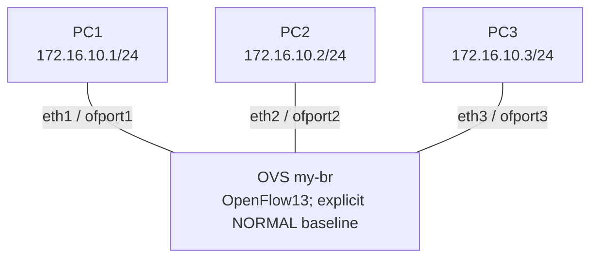
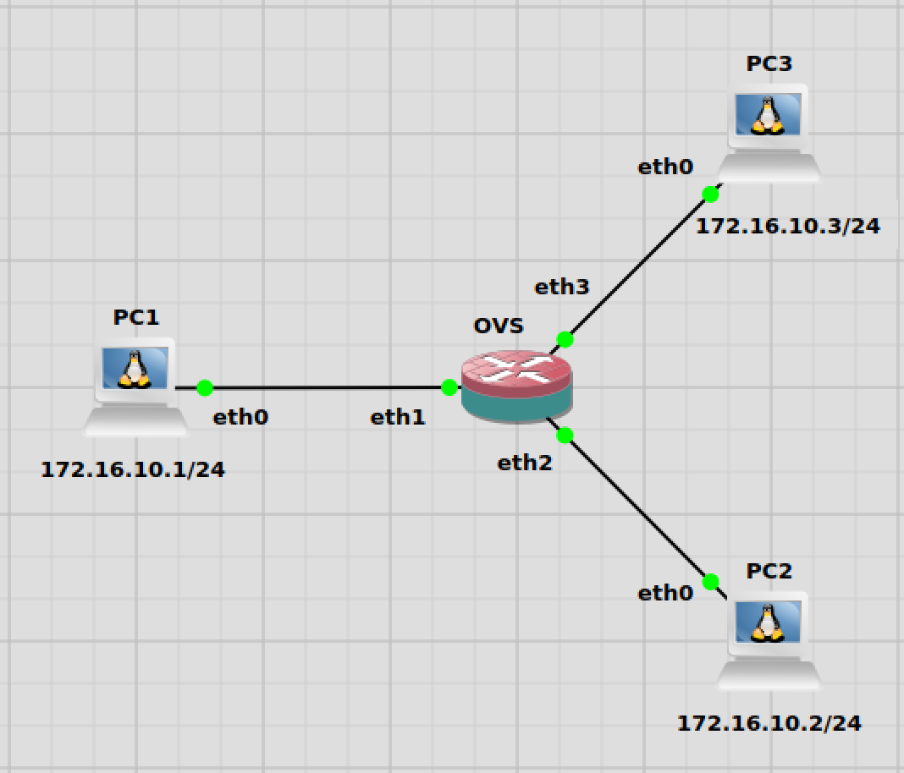
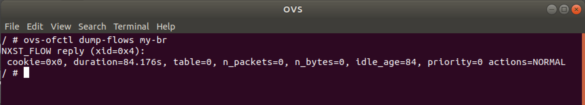
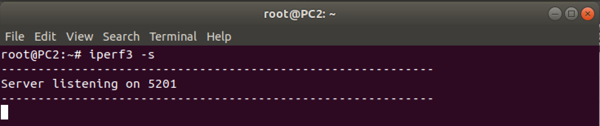
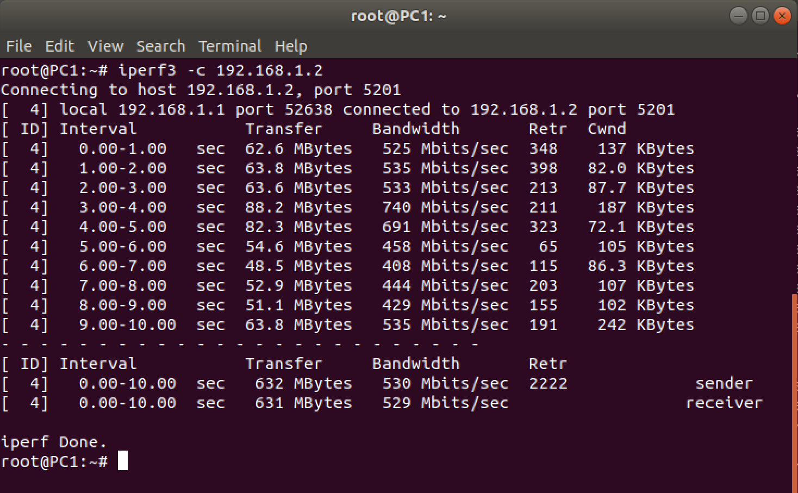
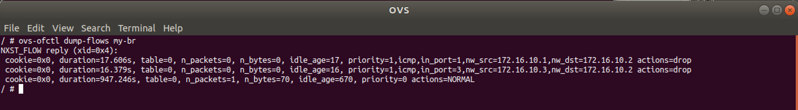
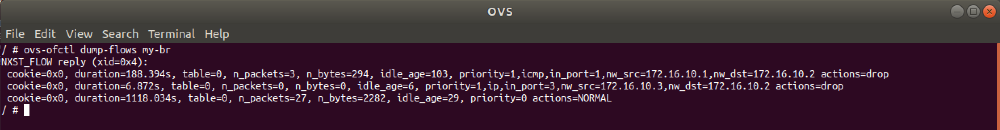
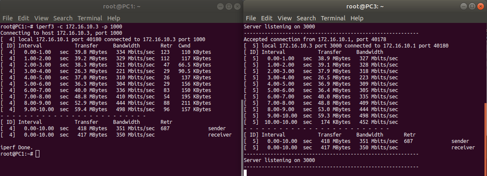
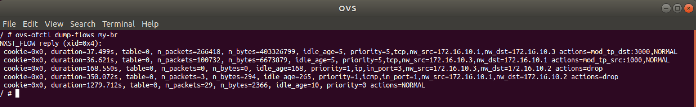

# 09 Lab 09 OpenFlow Filtering and Port Translation

## Before You Begin

[Download the preconfigured Ubuntu SDN VM](https://liveswinburneeduau-my.sharepoint.com/:u:/g/personal/braminzad_swin_edu_au/IQAv_m6WfxYaTKZT4O6OhvkvAarseiSla89Hp5I4QfgqrNw?e=bmsMpi). It includes all required applications and can be reused throughout this series.

Complete [00 Lab Setup](../SDN_00_LabSetup/README.md) and [Lab06](../SDN_06_Lab06_GNS3_OVS_Foundations/README.md). Use the supplied Ubuntu VM with GNS3, OVS, three Ubuntu Docker hosts, **iperf3**, tcpdump, and Wireshark. Stop other projects/controllers. No external controller is used in this lab.

## Purpose

Generate TCP/UDP traffic, install selective OpenFlow drops, prove rule priorities with counters, and translate a service port in both directions. Match rules precisely so unrelated traffic is unchanged. These exercises manipulate transport ports without changing IP addresses; this is not a complete general-purpose NAT implementation.

## Topology



PC eth0 connects to the named OVS port. Commands run at root **node consoles**, except explicitly labelled Ubuntu VM blocks. OVS bridge ports have no host-subnet IP. iperf3 differs from the iperf2 used by Mininet's built-in command.


**Three-host OVS topology for filtering and translation**




## 1 Build and Verify the GNS3 Project

Create `Lab09_Filtering_Translation`, add three Ubuntu Docker hosts and one OVS, and wire the diagram. Start nodes; remove unused example bridges only inside the OVS appliance.

At **OVS**:

```bash
ovs-vsctl --may-exist add-br my-br
ovs-vsctl set Bridge my-br protocols=OpenFlow13
ovs-vsctl del-controller my-br
ovs-vsctl set-fail-mode my-br secure
ovs-vsctl --may-exist add-port my-br eth1 -- set Interface eth1 ofport_request=1
ovs-vsctl --may-exist add-port my-br eth2 -- set Interface eth2 ofport_request=2
ovs-vsctl --may-exist add-port my-br eth3 -- set Interface eth3 ofport_request=3
ip link set eth1 up
ip link set eth2 up
ip link set eth3 up
ovs-ofctl -O OpenFlow13 add-flow my-br 'cookie=0x9000,priority=0,actions=NORMAL'
```

### Verification

```bash
ovs-ofctl -O OpenFlow13 show my-br
ovs-vsctl get Interface eth1 ofport
ovs-vsctl get Interface eth2 ofport
ovs-vsctl get Interface eth3 ofport
ovs-ofctl -O OpenFlow13 dump-flows my-br
```

Require actual OpenFlow ports 1/2/3. `ofport_request` is a request, not proof it was accepted. Correct conflicts before using numeric in_port matches below.


**OVS NORMAL forwarding baseline**



*Cookie, duration, counters, and formatting differ from a fresh run; preserve the current explicit baseline commands.*

## 2 Configure Hosts and Open Consoles

At **PC1**:

```bash
ip addr flush dev eth0
ip addr add 172.16.10.1/24 dev eth0
ip link set eth0 up
iperf3 --version
```

Repeat on PC2 with172.16.10.2 and PC3 with172.16.10.3. Persist addresses as in Lab06. All are in one subnet, with no gateway needed.

In the **Ubuntu VM**, from the repository root:

```bash
cd SDN_09_Lab09_OpenFlow_Filtering_Translation
mkdir -p config_backup
bash Lab09_Open_Terminals.sh PC1:5000 PC2:5001 PC3:5002 OVS:5003
```

Replace console numbers with GNS3's actual values. The launcher opens four device panes and one Ubuntu pane, enables mouse selection, and reconnects to an existing session. Reattach later with `tmux attach -t sdn09`.

### Verification — PC1

```bash
ping -c 4 172.16.10.2
ping -c 4 172.16.10.3
```

All baseline pings should pass. Check `tmux show -gv mouse` in the Ubuntu pane: expect `on`.

## 3 Measure Baseline TCP Traffic

At **PC2**, start a tracked server:

```bash
iperf3 -s -D -I /tmp/lab09-default.pid
ss -ltn 'sport = :5201'
```

At **PC1**:

```bash
iperf3 -c 172.16.10.2 -t 10 -i 1
iperf3 -c 172.16.10.2 -n 300M -i 1
```

### Verification

Expect a connection to default TCP 5201 and sender/receiver summaries. Read each one-second row for interval bytes and bit rate; read the final sender/receiver rows for total transferred bytes and average throughput. Inspect the connection line or capture to identify the client's dynamically allocated source port; it is not fixed to the server port. `-t` limits duration; `-n` transfers a fixed byte count, with iperf3's suffix conventions (`300M` is300×1024×1024 bytes). VM load and virtual links determine measured throughput; the result is not hardware line-rate evidence.


**iperf3 server listening on TCP 5201**




**iperf3 client interval and summary output**



*The original throughput example uses 192.168.1.0/24. This lab uses 172.16.10.0/24; source ports and measured rates vary.*

## 4 Use a Custom Port and UDP

At **PC2**:

```bash
iperf3 -s -p 1002 -D -I /tmp/lab09-1002.pid
```

At **PC1**:

```bash
iperf3 -c 172.16.10.2 -p 1002 -n 300M -i 1
iperf3 -c 172.16.10.2 -p 1002 -u -b 2M -t 25 -i 1
```

### Verification

Record the elapsed time for the300Mbyte transfer from its final interval; it depends on throughput rather than a fixed duration. Capture the PC2 link in GNS3. TCP mode uses TCP 1002; UDP mode has a **TCP control connection as well as UDP data** on the service port. Inspect UDP loss and jitter. `-b 2M` bounds offered UDP load instead of flooding the VM. Save the capture under this lab's `config_backup` through Wireshark.

## 5 Block ICMP Between PC1 and PC2

At **OVS**:

```bash
ovs-ofctl -O OpenFlow13 add-flow my-br \
  'cookie=0x9100,priority=100,icmp,nw_src=172.16.10.1,nw_dst=172.16.10.2,actions=drop'
```

At **PC1**:

```bash
ping -c 4 172.16.10.2
iperf3 -c 172.16.10.2 -t 5
ping -c 4 172.16.10.3
```

### Verification — OVS

```bash
ovs-ofctl -O OpenFlow13 dump-flows my-br 'cookie=0x9100/-1'
```

PC1→PC2 ping fails; TCP to PC2 and ping to PC3 pass. Reverse PC2→PC1 ping also fails because its echo replies are ICMP from PC1 to PC2 and match this rule. This is a stateless packet filter, not a directional session firewall. The matching rule's packet counter should increase.

Add PC3→PC2 ICMP filtering:

```bash
ovs-ofctl -O OpenFlow13 add-flow my-br \
  'cookie=0x9100,priority=100,icmp,nw_src=172.16.10.3,nw_dst=172.16.10.2,actions=drop'
```

Verify PC3's ping to PC2 now fails while its TCP client to PC2 still works.


**ICMP drop entries and a NORMAL fallback**



*The source uses different priorities and older match examples. This guide’s cookie-scoped rules and verification remain authoritative.*

## 6 Replace ICMP Filtering with an IPv4 Drop

At **OVS**:

```bash
ovs-ofctl -O OpenFlow13 del-flows my-br 'cookie=0x9100/-1'
ovs-ofctl -O OpenFlow13 add-flow my-br \
  'cookie=0x9200,priority=100,ip,nw_src=172.16.10.3,nw_dst=172.16.10.2,actions=drop'
```

### Verification — PC3

```bash
ping -c 4 172.16.10.2
timeout 10 iperf3 -c 172.16.10.2 -t 3
timeout 10 iperf3 -c 172.16.10.2 -p 1002 -u -b 2M -t 3
```

All fail because IPv4 ICMP, TCP, and UDP match. ARP is still permitted by the NORMAL baseline. PC1→PC2 traffic should work again, confirming the removed rule no longer applies. Inspect the cookie0x9200 counter.


**IPv4 filtering in the switch flow table**



*Use the current rules and counters rather than copying the original priority values.*

## 7 Prove Priority with a Specific Allow

At **OVS** add a PC1→PC2 IPv4 drop and a higher-priority ICMP exception:

```bash
ovs-ofctl -O OpenFlow13 add-flow my-br \
  'cookie=0x9200,priority=100,ip,nw_src=172.16.10.1,nw_dst=172.16.10.2,actions=drop'
ovs-ofctl -O OpenFlow13 add-flow my-br \
  'cookie=0x9200,priority=200,icmp,nw_src=172.16.10.1,nw_dst=172.16.10.2,actions=NORMAL'
```

### Verification — PC1

```bash
ping -c 4 172.16.10.2
timeout 10 iperf3 -c 172.16.10.2 -t 3
```

Ping succeeds while TCP fails. Both rules can match an ICMP packet, but only the highest-priority matching rule is selected. At OVS inspect counters, then remove **only this phase's rules**:

```bash
ovs-ofctl -O OpenFlow13 dump-flows my-br 'cookie=0x9200/-1'
ovs-ofctl -O OpenFlow13 del-flows my-br 'cookie=0x9200/-1'
```

Confirm PC1 andPC3 can again reachPC2 over TCP and ICMP. The cookie filter preserves the NORMAL baseline.

## 8 Start a Service on PC3 Port3000

At **PC3**:

```bash
iperf3 -s -p 3000 -D -I /tmp/lab09-3000.pid
iperf3 -s -p 4000 -D -I /tmp/lab09-4000.pid
ss -ltn | grep -E ':(3000|4000)\b'
```

At **PC1**:

```bash
iperf3 -c 172.16.10.3 -p 3000 -t 5
timeout 10 iperf3 -c 172.16.10.3 -p 1000 -t 3
```

### Verification

Direct3000 works;1000 fails before translation. Port4000 is an unrelated service used to check the rule scope. Low ports in this lab run as root inside disposable node containers; the Ubuntu VM does not need to expose them externally.

## 9 Translate PC1→PC3 Port1000 to3000

Copy the supplied `Lab09_Translation.sh` into the OVS node using Lab06's Docker-copy method, then at **OVS**:

```bash
bash /root/Lab09_Translation.sh install
ovs-ofctl -O OpenFlow13 dump-flows my-br 'cookie=0x9300/-1'
```

Four rules translate TCP and UDP request destination1000→3000 and reply source3000→1000. They also match ingress port and both IP addresses. Both directions are needed: a client expecting a reply from1000 will not accept an untranslated reply from3000.

### Verification — PC1

```bash
iperf3 -c 172.16.10.3 -p 1000 -t 10
iperf3 -c 172.16.10.3 -p 1000 -u -b 2M -t 10
```

Both tests should work. The TCP translation is also needed for iperf3's UDP control channel. Confirm request and reverse counters increase.


**Client port 1000 communicating with server port 3000**



*This is a source success example; run the current tests to produce your own result.*

## 10 Capture Translation and Prove Selectivity

Capture both PC1 and PC3 access links. Repeat the translated TCP/UDP tests.

### Verification

PC1-side packets target1000 and replies appear from1000. PC3-side packets target3000 and replies appear from3000. IP addresses remain unchanged. Wireshark filters `tcp.port == 1000 || udp.port == 1000` and the corresponding3000 filter make the change visible.

At **PC1**:

```bash
iperf3 -c 172.16.10.3 -p 4000 -t 5
```

At **PC2**:

```bash
iperf3 -c 172.16.10.3 -p 3000 -t 5
timeout 10 iperf3 -c 172.16.10.3 -p 1000 -t 3
```

PC1→4000 andPC2→3000 pass unchanged; PC2→1000 fails because it is not the selected source. Confirm the translation counters do not grow during these unrelated tests. Rule priorities alone are not sufficient without precise match fields.


**TCP and UDP translation entries**



*The source matches are broader than the current helper. Retain this guide’s exact ingress, IP, and service-port matches.*

## 11 Back Up and Redeploy

In the **Ubuntu VM**, identify the running OVS container ID:

```bash
cp Lab09_Translation.sh config_backup/
read -r -p 'OVS container ID: ' ovs_id
sudo docker exec "$ovs_id" ovs-vsctl show > config_backup/ovs-state.txt
sudo docker exec "$ovs_id" ovs-ofctl -O OpenFlow13 dump-flows my-br > config_backup/flows.txt
ls -lh config_backup
```

Save node interface files and export the portable GNS3 project as in Lab06. To restore: reopen project, restore host IPs, recreate the bridge/port mapping and NORMAL baseline from step1, start PC3's service, run the translation script, and repeat steps9–10. Keep negative test results alongside successful captures.

### Verification

A full stop/start and reapplication reproduces the port 1000 service while preserving port 4000 and source restrictions. Save new screenshots under `images/image.png`, then `image-1.png`, and add them to the repo with the README.

## 12 Remove Rules, Stop Servers, and Clean Up

At **OVS**:

```bash
bash /root/Lab09_Translation.sh remove
ovs-ofctl -O OpenFlow13 dump-flows my-br
```

At **PC1**, port 1000 should now fail and direct3000 still work. At **PC2**, stop only its recorded servers:

```bash
for file in /tmp/lab09-default.pid /tmp/lab09-1002.pid; do
  if [ -f "$file" ]; then kill "$(cat "$file")"; rm -f "$file"; fi
done
```

At **PC3**, do the same for `/tmp/lab09-3000.pid` and `/tmp/lab09-4000.pid`. Verify those ports are no longer listening with `ss -ltn`. Stop all project nodes in GNS3. In Ubuntu:

```bash
tmux kill-session -t sdn09 2>/dev/null || true
```

### Verification

Only the explicitly retained baseline remains before stopping the OVS node. No experiment server or tmux session remains. Avoid global flow deletion outside this disposable bridge.

## Completion Checklist

- TCP, byte-count, custom-port, and bounded UDP tests are complete.
- ICMP-only and all-IPv4 filtering have distinct observed effects.
- Priority, cookies, counters, and selective removal are verified.
- Bidirectional TCP/UDP translation works only for the intended tuple.
- Positive/negative captures, backups, redeployment, and cleanup are complete.

Continue with [Lab10 Port Mirroring](../SDN_10_Lab10_OVS_Port_Mirroring/README.md). References: [OVS action reference](https://docs.openvswitch.org/en/stable/ref/ovs-actions.7/), [iperf3 manual](https://software.es.net/iperf/invoking.html).
