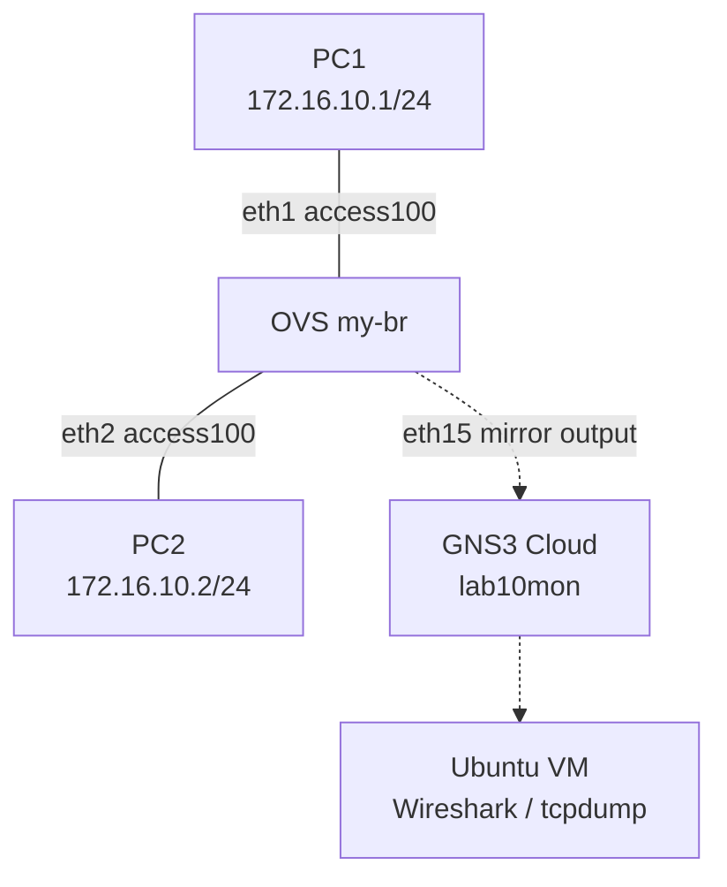
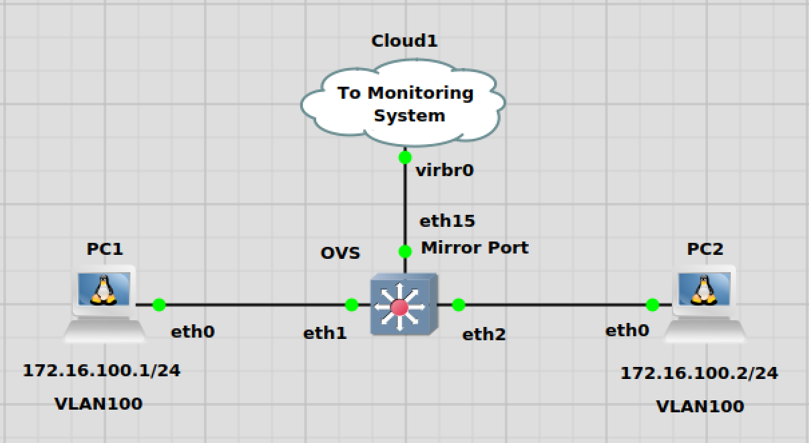
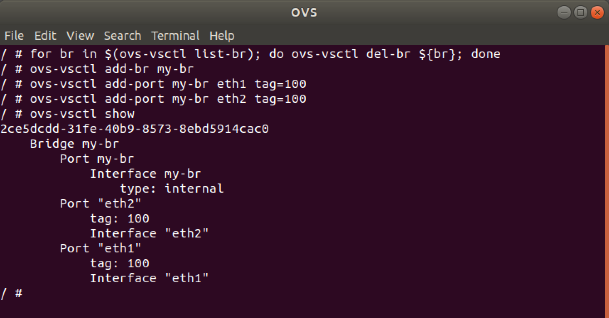
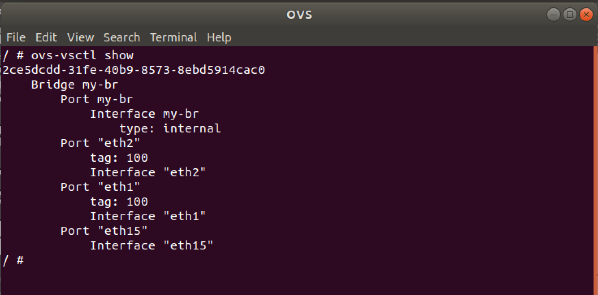
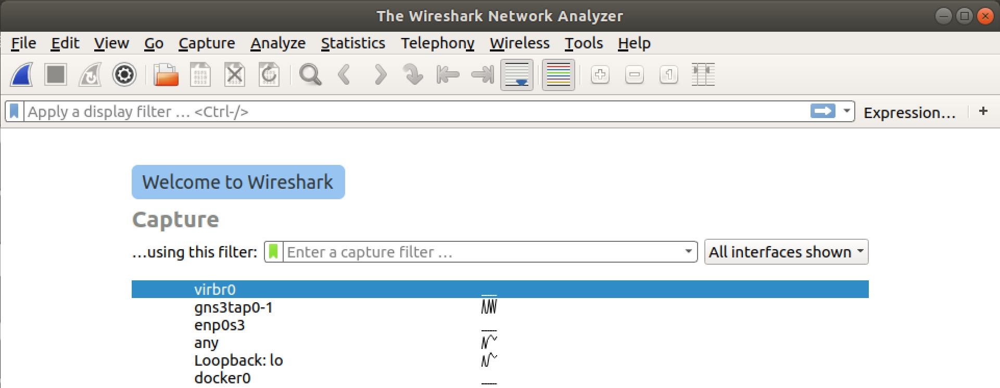
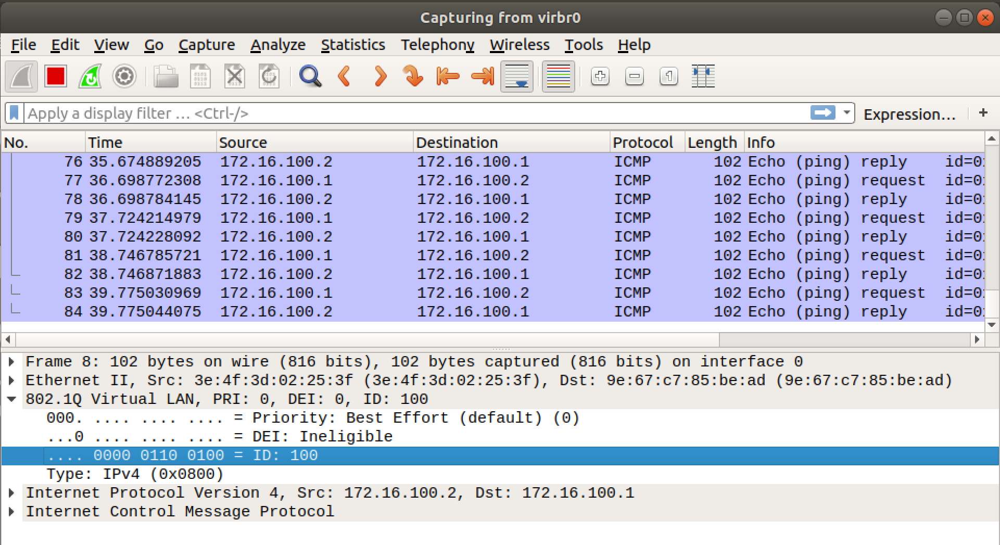

# 10 Lab 10 OVS Port Mirroring

## Before You Begin

[Download the preconfigured Ubuntu SDN VM](https://liveswinburneeduau-my.sharepoint.com/:u:/g/personal/braminzad_swin_edu_au/IQAv_m6WfxYaTKZT4O6OhvkvAarseiSla89Hp5I4QfgqrNw?e=bmsMpi). It includes all required applications and can be reused throughout this series.

Complete [00 Lab Setup](../SDN_00_LabSetup/README.md) and [Lab06](../SDN_06_Lab06_GNS3_OVS_Foundations/README.md). Use the supplied Ubuntu VM with GNS3, an OVS appliance with eth15, two Ubuntu Docker hosts, iperf3, tcpdump, and Wireshark. Stop other projects and controllers.

## Purpose

Copy switch traffic to a monitoring interface without placing the monitoring computer in the host forwarding path. Verify ICMP, TCP/UDP, VLAN information, and the difference between normal switching and mirrored delivery. Remove the mirror and confirm only the extra copies stop.

## Topology



This guide uses a dedicated, unnumbered Linux bridge **lab10mon** in the Ubuntu VM for capture. The original source uses virbr0; the dedicated capture bridge makes copied traffic easier to distinguish from VM management traffic. Do not assign an IP address or default route to the monitoring bridge.


**Two hosts, an OVS switch, and a mirror output**



*The source uses virbr0 and 172.16.100.0/24. This guide uses the isolated lab10mon capture bridge and 172.16.10.0/24; keep its current addressing and wiring.*

## 1 Prepare a Dedicated Capture Interface

In the **Ubuntu VM**, from the repository root:

```bash
cd SDN_10_Lab10_OVS_Port_Mirroring
mkdir -p config_backup
ip link show lab10mon
```

If it does not exist, create it:

```bash
sudo ip link add lab10mon type bridge
sudo ip link set lab10mon up
```

If an interface with that name already exists, inspect it and confirm it belongs to this lab rather than replacing it. This is a runtime interface; recreating it after VM reboot is intentional.

### Verification

```bash
ip -br address show lab10mon
ip -d link show lab10mon
```

Expect a Linux bridge, state up, and no assigned IPv4 address. The carrier state can be DOWN until GNS3 attaches its link; administrative UP and actual traffic are the relevant checks.

## 2 Build and Verify the GNS3 Network

Create `Lab10_Port_Mirroring`. Add two Ubuntu Docker hosts, one OVS, and a Cloud on the **local Ubuntu GNS3 server**. In Cloud configuration, show special interfaces and add `lab10mon`. Wire PC1 eth0→OVS eth1, PC2 eth0→OVS eth2, and OVS eth15→Cloud lab10mon.

Start nodes; remove unused sample bridges inside the OVS appliance as in Lab06. At **OVS**:

```bash
ip -br link
ovs-vsctl show
```

### Verification

All specified interfaces exist, and eth15 is physically connected to the capture Cloud. Do not connect the mirror output back into a production or management network.

## 3 Configure Host Addresses

At **PC1**:

```bash
ip addr flush dev eth0
ip addr add 172.16.10.1/24 dev eth0
ip link set eth0 up
```

At **PC2**:

```bash
ip addr flush dev eth0
ip addr add 172.16.10.2/24 dev eth0
ip link set eth0 up
```

Persist both addresses in the appliance's `/etc/network/interfaces` as in Lab06. The OVS access VLAN will be100; host addresses do not have to use100 in their subnet number.

### Verification

At each host run `ip -br address` and `ip route`. Both /24 networks should be connected directly, with no gateway required. Forwarding is configured next.

## 4 Configure the Bridge and Mirror

Copy `Lab10_Configure_OVS.sh` into the OVS appliance as in Lab06, then run at **OVS**:

```bash
bash /root/Lab10_Configure_OVS.sh
ovs-vsctl show
ovs-vsctl list Mirror
ovs-ofctl -O OpenFlow13 dump-flows my-br
```

The script configures access VLAN 100 on eth1/eth2, explicit NORMAL forwarding, and a `select-all=true` mirror whose output port is eth15. It clears only this lab bridge's existing mirror association before rebuilding it.

### Verification — PC1

```bash
ping -c 5 172.16.10.2
```

Ping must work. OVS mirror rows should name `lab10-mirror`, select all traffic, and point to eth15's port UUID. A dedicated mirror output port is not a normal host-forwarding port; ingress traffic arriving on it is discarded by OVS.


**VLAN 100 host-facing bridge ports**



*The screenshot is a historical membership example. Use the current script rather than the source’s blanket bridge-removal command.*

**Bridge membership after adding mirror output eth15**



*Verify the actual Mirror row as well as bridge membership, as instructed above.*

## 5 Open Device Consoles in a Mouse Enabled Workspace

In the **Ubuntu VM** outside tmux, replace example console numbers with actual GNS3 values:

```bash
bash Lab10_Open_Terminals.sh PC1:5000 PC2:5001 OVS:5002
```

### Verification

```bash
tmux list-panes -t sdn10:lab
tmux show -gv mouse
```

Expect three device panes and one Ubuntu capture pane. Mouse selection is always enabled. Ctrl+B then D detaches; `tmux attach -t sdn10` reattaches.

## 6 Capture Mirrored ICMP in the Ubuntu VM

In the Ubuntu pane:

```bash
sudo tcpdump -ni lab10mon -e -s 0 -w config_backup/mirror-icmp.pcap
```

At **PC1**:

```bash
ping -c 10 172.16.10.2
```

Stop capture with Ctrl+C. Open it as a normal Ubuntu desktop user:

```bash
wireshark config_backup/mirror-icmp.pcap
```

### Verification

Filter `arp || icmp` and inspect host addresses172.16.10.1/.2. Inspect the VLAN header and compare it with VLAN 100 classification on the switch. An OVS mirror copies the selected packet's VLAN context; do not treat mirror-port access/trunk settings as a separate VLAN translation feature. Captures can expose VLAN 100 tags even though host access links carry untagged traffic. For tagging discrepancies, compare a GNS3 access-link capture and `ovs-vsctl list Port eth1 eth2`, and inspect decode/offload behaviour before changing the topology.

The monitoring interface has no host-subnet IP, yet receives the copied frames. Packet counts can differ from a single host capture due to mirror selection, broadcasts, or duplicate visibility; evaluate packet fields and timing as well as totals.


**Select a capture interface in Wireshark**



*The original screenshot selects virbr0; select lab10mon for this guide.*

**Mirrored ICMP and VLAN 100 in Wireshark**



*The original host addresses are 172.16.100.1/.2. Your capture should show 172.16.10.1/.2 on lab10mon.*

## 7 Generate TCP and Bounded UDP Traffic

At **PC2**:

```bash
iperf3 -s -p 500 -D -I /tmp/lab10-iperf.pid
ss -ltn 'sport = :500'
```

In the **Ubuntu VM**:

```bash
sudo tcpdump -ni lab10mon -s 0 -w config_backup/mirror-iperf.pcap
```

At **PC1**:

```bash
iperf3 -c 172.16.10.2 -p 500 -t 12 -i 3
iperf3 -c 172.16.10.2 -p 500 -u -b 2M -t 15 -i 3
```

Stop capture after both tests.

### Verification

Open the PCAP and filter `tcp.port == 500 || udp.port == 500`. Expect TCP control traffic even during the UDP test. Read the client/server throughput and UDP loss/jitter summaries. The mirror copies traffic; it does not generate the test stream or guarantee lossless monitoring under overload.

## 8 Disable Mirroring Without Interrupting Forwarding

At **OVS**:

```bash
ovs-vsctl clear Bridge my-br mirrors
ovs-vsctl get Bridge my-br mirrors
```

In the **Ubuntu VM**, start a new capture:

```bash
sudo timeout 12 tcpdump -ni lab10mon -s 0 -w config_backup/mirror-disabled.pcap
```

While it runs, at **PC1**:

```bash
ping -c 5 172.16.10.2
```

### Verification

Host pings still work, while the new capture contains no copies of those pings. Timeout exit status124 is expected when it ends the capture. There may be unrelated bridge/control traffic; use `icmp && ip.addr == 172.16.10.1` to test absence of the selected host flow. The mirror list is `[]`; NORMAL forwarding remains.

## 9 Re-Enable and Save Configuration

At **OVS**:

```bash
bash /root/Lab10_Configure_OVS.sh
ovs-vsctl list Mirror
```

Capture briefly and repeat a host ping to confirm copied traffic returns. In the **Ubuntu VM**:

```bash
cp Lab10_Configure_OVS.sh config_backup/
read -r -p 'OVS container ID from docker ps: ' ovs_id
sudo docker exec "$ovs_id" ovs-vsctl show > config_backup/ovs-state.txt
sudo docker exec "$ovs_id" ovs-vsctl list Mirror > config_backup/mirror-state.txt
ls -lh config_backup
```

Export the portable project and host interface settings using Lab06's method. To redeploy, recreate lab10mon first, reopen the project, restore host addresses, reapply the OVS script, and repeat steps6–8.

### Verification

Saved PCAPs cover enabled and disabled states. Project export, configuration script, and interface settings recreate the forwarding and monitoring paths after stop/start. Save future screenshots under this lab's own `images` folder and add them to the repo with the README.

## 10 Terminate and Clean Up

At **PC2**:

```bash
kill "$(cat /tmp/lab10-iperf.pid)"
rm -f /tmp/lab10-iperf.pid
```

Verify `ss -ltn 'sport = :500'` is empty. Stop all GNS3 project nodes, save, and close the project. In the **Ubuntu VM**, after the Cloud is detached:

```bash
bridge link show master lab10mon
sudo ip link set lab10mon down
sudo ip link delete lab10mon type bridge
tmux kill-session -t sdn10 2>/dev/null || true
```

Delete lab10mon only if created for this lab and no other project uses it. Keep virbr0 and the VM's management interfaces.

### Verification

```bash
ip link show lab10mon
ip -br address show virbr0
```

The first should report no such device; management remains available. The deliberate missing-device result is the expected cleanup check.

## Completion Checklist

- Host forwarding works before, during, and after mirror changes.
- The unnumbered monitoring interface receives copied host traffic.
- VLAN context, ICMP, TCP, and UDP/control traffic are inspected.
- Disabled-state capture proves mirroring stopped independently of forwarding.
- Configs, captures, redeployment, and cleanup are complete.

Continue with the [SDN Branch Network Project](../SDN_11_Project_SDN_Branch_Network_Automation/README.md). Reference: [OVS mirror configuration](https://docs.openvswitch.org/en/stable/faq/configuration/).
