# 11 Project: SDN Branch Network and Automation

## Before You Begin

Complete [00 Lab Setup](../SDN_00_LabSetup/README.md) and Labs01–10. Reuse the supplied Ubuntu VirtualBox VM with GNS3, OVS, Ubuntu Docker hosts, Ryu `rest_router`, ONOS, Python3, iperf3, Wireshark, and tmux. This scenario-based project consolidates what you learned in the previous ten SDN labs, progressing from basic connectivity to security, monitoring, and automation.

[Download the preconfigured Ubuntu SDN VM](https://liveswinburneeduau-my.sharepoint.com/:u:/g/personal/braminzad_swin_edu_au/IQAv_m6WfxYaTKZT4O6OhvkvAarseiSla89Hp5I4QfgqrNw?e=bmsMpi). All required applications are already installed. Follow [00 Lab Setup](../SDN_00_LabSetup/README.md) to import and verify it. No rebuild is needed between labs.

## Purpose

Connect three branch LANs through a Ryu-controlled routed provider, using VXLAN and GRE. Add a second isolated VLAN between two branches, an inline firewall, selective TCP/UDP service-port translation, mirrored monitoring, and Python controller lifecycle/configuration automation.

The exercises teach general SDN mechanisms relevant to understanding programmable networks. They do not emulate or claim access to Oracle's production DC SDN implementation.

## Topology

### Initial Three-Branch Scenario

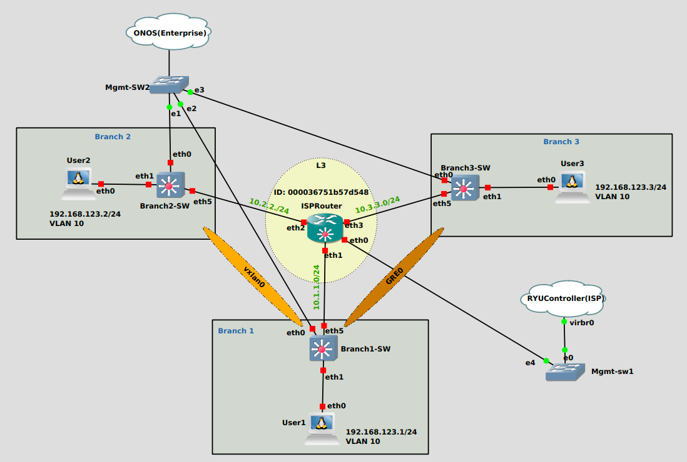

This figure shows the initial user-network scenario before the firewall, servers, and monitoring extensions. The complete build below uses fixed DPIDs from its addressing table rather than the example DPID printed in the original figure.

### Complete Build

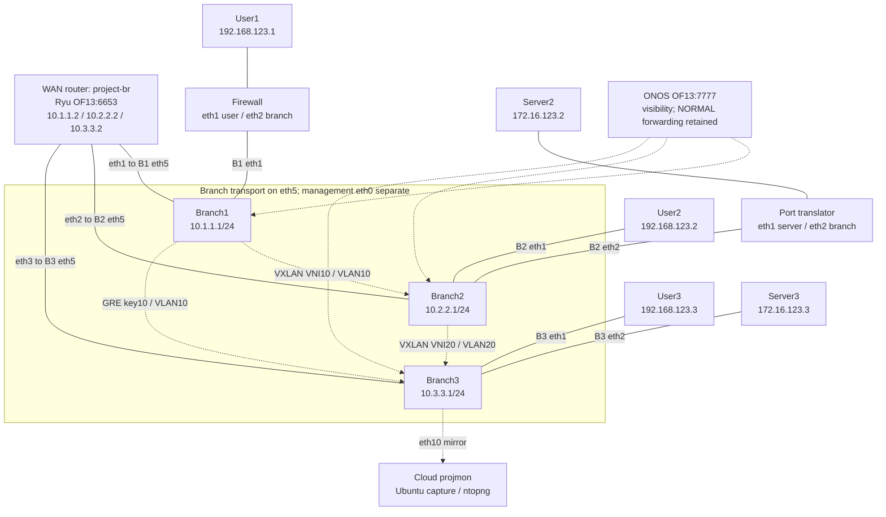

The logical tunnel lines are not extra physical cables. Each branch's eth5 connects only to its WAN router port. Branch management eth0 ports connect through **Mgmt-ONOS** to **Cloud-ONOS**; WAN eth0 connects through **Mgmt-Ryu** to **Cloud-Ryu**. Both Cloud objects expose the Ubuntu VM’s **virbr0** interface. They represent two management access paths into the same192.168.122.0/24 network, not two isolated subnets.

| Node | Management eth0 | Data address / role |
| --- | --- | --- |
| Ubuntu VM | virbr0:192.168.122.1/24 | Controllers and monitor |
| Branch1 | 192.168.122.101/24 | eth5:10.1.1.1/24; DPID 0000000000000101 |
| Branch2 | 192.168.122.102/24 | eth5:10.2.2.1/24; DPID 0000000000000102 |
| Branch3 | 192.168.122.103/24 | eth5:10.3.3.1/24; DPID 0000000000000103 |
| WAN router | 192.168.122.104/24 | Ryu virtual10.1.1.2,10.2.2.2,10.3.3.2/24; DPID 0000000000000104 |
| User1/2/3 | No management address required | 192.168.123.1/.2/.3/24, VLAN 10 |
| Server2/3 | No management address required | 172.16.123.2/.3/24, VLAN 20 |
| Firewall / translator | No controller required | Inline OVS, unnumbered data ports |

All endpoint addresses use /24. Same-VLAN hosts need no IP gateway. Branch transport routes use their local WAN gateway; VM management routing is kept separate. No inter-VLAN router is configured: VLAN 10 and20 must remain isolated.

**Contexts:** `bash` blocks are labelled Ubuntu VM or a specific root appliance console. ONOS CLI blocks are `text`. Never run appliance bridge-reset commands on the outer Ubuntu VM.


## Project Progression

Work through the numbered steps in order. Each checkpoint adds a networking capability learned in the previous ten labs. Save the portable GNS3 project and verification results at each checkpoint.

| Stage | Capability | Steps and checkpoint |
| --- | --- | --- |
| SDN Underlay and Overlay Setup | Routed WAN, three user LANs, VXLAN/GRE, and controller visibility | Steps1–7; save `config_backup/Underlay_Overlay_Connectivity.gns3project` |
| Layer 2 Server Stretch | Dedicated VLAN20 and a direct GRE or VXLAN tunnel between Branch2 and Branch3 | Step8; save `config_backup/Server_L2_Stretch.gns3project` |
| Firewall and ACL Configuration | Branch1 traffic filtering with positive and negative tests | Steps9–10; save `config_backup/Firewall_ACL.gns3project` |
| TCP/UDP Service-Port Translation | Selected server service300↔500 with return-port rewriting | Steps11–12; save `config_backup/Service_Port_Translation.gns3project` |
| Port Mirroring and Traffic Monitoring | Switch traffic copies, Wireshark, and ntopng | Steps13–14; save `config_backup/Traffic_Monitoring.gns3project` |
| Controller and Routing Automation | Python lifecycle, readiness, REST configuration, and shutdown | Steps15–16; retain code and logs |

Translation is configured before monitoring so the final capture can include its traffic. The stages form one progressive build.

## Deployment and IP Addressing Tables

The five pictured tables preserve the original deployment layout. The text tables below use the names and fixed DPIDs in the supplied scripts. Treat WAN router addresses as Ryu virtual interfaces; do not put them on Linux bridge member ports.

### Branch Interfaces and Gateways

| Node | Management eth0 | Linux transport eth5 | Transport route | User access eth1 | Controller |
| --- | --- | --- | --- | --- | --- |
| Branch1 | 192.168.122.101/24 | 10.1.1.1/24 | 10.0.0.0/8 via10.1.1.2 | VLAN10, User1 .123.1 | 192.168.122.1:7777 |
| Branch2 | 192.168.122.102/24 | 10.2.2.1/24 | 10.0.0.0/8 via10.2.2.2 | VLAN10, User2 .123.2 | 192.168.122.1:7777 |
| Branch3 | 192.168.122.103/24 | 10.3.3.1/24 | 10.0.0.0/8 via10.3.3.2 | VLAN10, User3 .123.3 | 192.168.122.1:7777 |

User addresses are192.168.123.1/.2/.3 with /24 masks and MTU1450. Management eth0 stays outside `project-br`. STP is enabled on branch bridges; the static tunnel ports are excluded from STP as explained in step6.

### WAN Router Interfaces

| WAN interface or object | Connected device / address | Configuration owner |
| --- | --- | --- |
| eth0 | 192.168.122.104/24, management | Linux ifupdown |
| eth1 | Branch1 eth5 | Member of project-br, no Linux IP |
| eth2 | Branch2 eth5 | Member of project-br, no Linux IP |
| eth3 | Branch3 eth5 | Member of project-br, no Linux IP |
| Virtual address1 | 10.1.1.2/24 | Ryu REST API |
| Virtual address2 | 10.2.2.2/24 | Ryu REST API |
| Virtual address3 | 10.3.3.2/24 | Ryu REST API |
| Controller | 192.168.122.1:6653; DPID0000000000000104 | OVS controller target |

### Tunnel and Tenant Layout

| Tunnel | Local endpoints | Type | Local VLAN | Key / VNI | Current interface name |
| --- | --- | --- | --- | --- | --- |
| Branch1↔Branch2 | 10.1.1.1↔10.2.2.1 | VXLAN | 10 | 10 | vxlan12 |
| Branch1↔Branch3 | 10.1.1.1↔10.3.3.1 | GRE | 10 | 10 | gre13 |
| Branch2↔Branch3 servers | 10.2.2.1↔10.3.3.1 | VXLAN, or optional GRE | 20 | 20 | vxlan23, or gre23 |

Server2 is172.16.123.2/24 at Branch2 eth2; Server3 is172.16.123.3/24 at Branch3 eth2. Both use MTU1450 and no default gateway for their same-subnet tests. The translator is later inserted on Server2’s untagged access cable.

### Management Wiring

| Management object | Port / attachment | Peer |
| --- | --- | --- |
| Mgmt-ONOS | e0 | Cloud-ONOS virbr0 |
| Mgmt-ONOS | e1/e2/e3 | Branch1/2/3 eth0 |
| Mgmt-Ryu | e0 | Cloud-Ryu virbr0 |
| Mgmt-Ryu | e4, or another documented free port | WAN eth0 |
| Ubuntu VM | virbr0:192.168.122.1/24 | Both controller processes |

Cloud-ONOS and Cloud-Ryu use the same underlying bridge. Their separate icons organise the drawing; they do not provide security isolation.


**Branch1 deployment parameters**

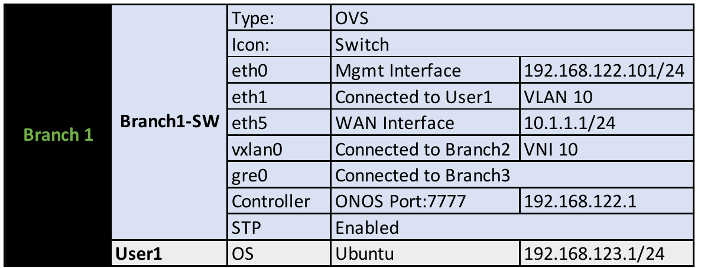


**Branch2 deployment parameters**

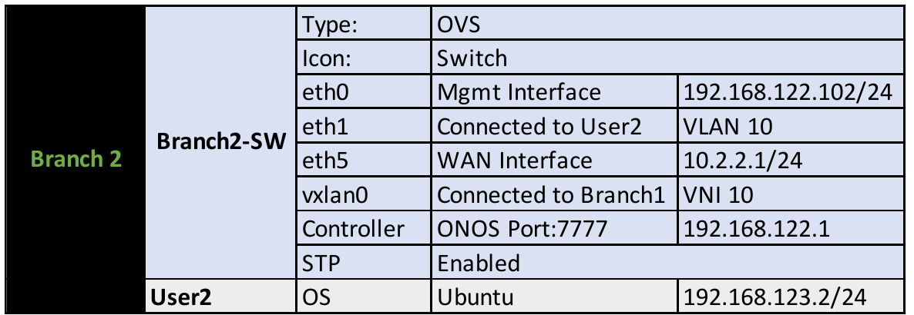


**Branch3 deployment parameters**

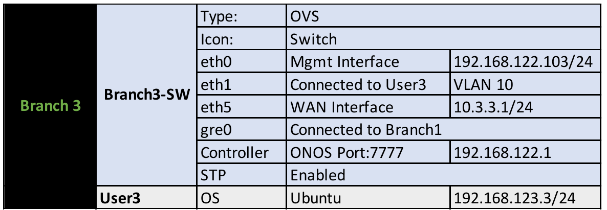


**WAN router deployment parameters**

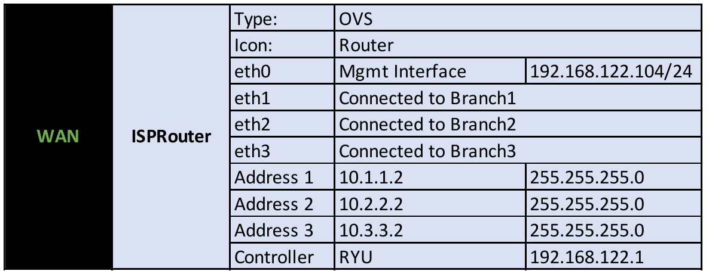


**Management access-switch and Cloud layout**

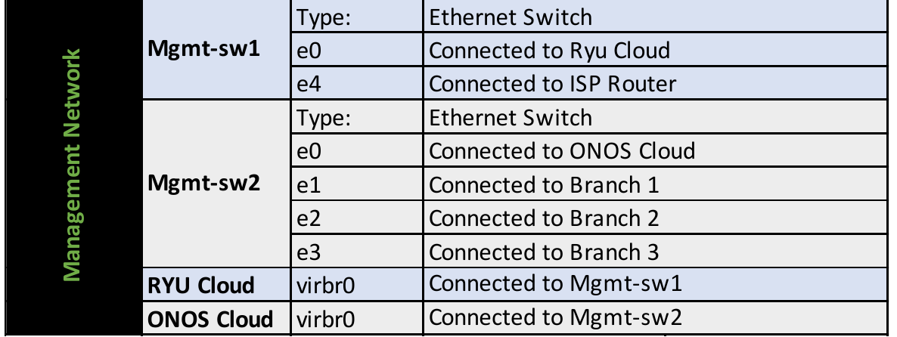

## Configuration Conventions

| Configuration detail | Setting used in this guide |
| --- | --- |
| ONOS OpenFlow negotiation issue with OpenFlow1.5 | Pin every project bridge to OpenFlow13, excluding1.5 and matching Ryu rest_router. |
| ONOS7777 and a stray6533 example | Use7777 consistently for branches;6653 for WAN/Ryu. |
| WAN eth3 shown once as10.3.3.3 | Use virtual gateway10.3.3.2/24, matching the REST commands and branch route. |
| Different automatically generated WAN switch ID | Use fixed DPID0000000000000104 consistently. |
| Bridge names br0, ovs0, xenbr1 | Use project-br; never delete every Ubuntu VM bridge. |
| STP enabled | Enable STP on branch/WAN bridges and exclude overlay ports to keep the two tenant topologies independent. |
| GRE or VXLAN server-overlay choice | VXLAN is the default; step8 provides the GRE alternative on both peers. |
| Stateless firewall ACL | Preserve a corrected ACL-only helper for comparison; the main helper adds conntrack so outbound replies remain usable. |
| Service-port translation addresses and matches | Use the project’s Server2 .2 and Server3 .3; match ingress, both IPs, protocol, and service300↔500. |
| Monitoring additional switches | Branch3 eth10 is the baseline; step13 explains adding independent monitors for Branch1/2. |
| VM internet/NAT appendix | Use GNS3 NAT and DHCP; do not assume its subnet or require changing the VM to bridged mode. |

## 1 Prepare Files, Resources, and a Clean Workspace

Stop earlier GNS3 projects and controllers. In the **Ubuntu VM**, from your repository root:

```bash
cd SDN_11_Project_SDN_Branch_Network_Automation
mkdir -p config_backup
source "$HOME/sdn-controller.env"
"$RYU_MANAGER" --version
java -version
python3 -m py_compile Project_*.py
for script in Project_*.sh; do bash -n "$script"; done
ss -ltn | grep -E ':(6653|7777|8080|8181|3000)\b' || true
free -h
df -h .
```

### Verification

Files compile, controller paths exist, ports are free, and the VM has resources for six OVS nodes plus five hosts.32 GB RAM and4 vCPUs are a practical starting allocation for this larger project; monitor actual use. Start with the baseline phase if resources are constrained. Snapshot the working VM before changes and keep exports outside its virtual disk.

## 2 Build the GNS3 Topology

Create project `Project_SDN_Branch_Network`. Add Branch1/2/3 and WAN OVS, User1/2/3 Docker hosts, two management Ethernet switches (Mgmt-ONOS and Mgmt-Ryu), and two local Cloud objects (Cloud-ONOS and Cloud-Ryu), both exposing virbr0. Initially connect User1 directly to Branch1 eth1; add firewall, translator, servers, and monitoring in their later steps.

Wire Branch1/2/3 eth5→WAN eth1/2/3 respectively. Connect branch eth0 ports→Mgmt-ONOS→Cloud-ONOS virbr0, and WAN eth0→Mgmt-Ryu→Cloud-Ryu virbr0. Start nodes. Remove only unused sample bridges **inside each appliance** after inspecting them as in Lab06.

### Verification

At every OVS:

```bash
hostname
ip -br link
ovs-vsctl show
```

Verify actual interface endpoints in GNS3. Management eth0 and branch transport eth5 stay outside `project-br`. Configure/persist the four management addresses from the table using Lab06's ifupdown method, then ping192.168.122.1 from each managed OVS.

## 3 Open Mouse Enabled Consoles

Read actual console TCP ports from GNS3. In the **Ubuntu VM** outside tmux, use them in place of these examples:

```bash
bash Lab11_Open_Terminals.sh Branch1:5000 Branch2:5001 Branch3:5002 WAN:5003 \
  User1:5004 User2:5005 User3:5006
```

The script opens seven connected device panes and one Ubuntu pane. Mouse selection is always enabled. Create extra Ubuntu controller windows with Ctrl+B then C, or use separate terminals. Add new appliances to a second console window as the project grows; avoid making a dozen unreadably small panes.

### Verification

```bash
tmux list-panes -t sdn11:lab
tmux show -gv mouse
```

Expect eight panes and `on`. Detach with Ctrl+B then D; reconnect with `tmux attach -t sdn11`.

## 4 Start Controllers with Separate Ownership

In an **Ubuntu controller pane**:

```bash
source "$HOME/sdn-controller.env"
"$RYU_MANAGER" --observe-links --ofp-tcp-listen-port 6653 \
  ryu.app.rest_router ryu.app.gui_topology.gui_topology
```

In another Ubuntu pane, start ONOS using Lab04's foreground command or the VM's configured service. At the **ONOS CLI**:

```text
app activate org.onosproject.openflow
app deactivate org.onosproject.fwd
cfg set org.onosproject.openflow.controller.impl.OpenFlowControllerImpl openflowPorts 7777
cfg get org.onosproject.openflow.controller.impl.OpenFlowControllerImpl
```

### Verification — Ubuntu

```bash
ss -ltn | grep -E ':(6653|7777|8080|8181)\b'
curl -fsS http://127.0.0.1:8080/router/all | python3 -m json.tool
```

Ryu owns WAN routing; ONOS observes branch devices. Branch NORMAL rules preserve VLAN-aware forwarding. Generic ONOS Reactive Forwarding remains disabled because explicit output/flood rules must not be assumed to respect OVSDB access tags. This choice prevents the source scenario's unsafe assumption that different IP subnets alone enforce VLAN isolation.

### OpenFlow Compatibility and Ryu GUI Verification

The noted `WAIT_METER_FEATURES_REPLY` error is a controller/switch negotiation symptom. This guide already avoids advertising OpenFlow1.5 by explicitly selecting OpenFlow13. On **each project OVS appliance**, verify after its role script runs:

```bash
ovs-vsctl get Bridge project-br protocols
ovs-vsctl list Controller
```

Expect `[OpenFlow13]` and the intended controller connection. If repairing an older bridge before reapplying its role:

```bash
ovs-vsctl set Bridge project-br protocols=OpenFlow13
```

The wider OpenFlow1.0–1.4 allow-list in the notes excludes1.5 too, but is unnecessary for this project’s single OF13 pipeline. Do not change unrelated bridges or enable all protocol versions as a workaround.

Open Ryu at `http://127.0.0.1:8080`; select the WAN device to inspect its flows. Independently verify discovery and flow visibility:

```bash
curl -fsS http://127.0.0.1:8080/v1.0/topology/switches | python3 -m json.tool
curl -fsS http://127.0.0.1:8080/stats/switches | python3 -m json.tool
curl -fsS http://127.0.0.1:8080/stats/flow/260 | python3 -m json.tool
```

260 is the decimal form of fixed hexadecimal DPID0104. Run these checks after step5 registers the WAN switch; before that the device lists can be empty. The [Ryu topology GUI](https://github.com/faucetsdn/ryu/blob/master/doc/source/gui.rst) includes topology and flow-inspection APIs alongside the router application.


### ONOS OpenFlow Controller Port

At the **ONOS CLI**, use these commands to activate the OpenFlow provider, keep generic reactive forwarding inactive, and listen on7777:

```text
app activate org.onosproject.openflow
app deactivate org.onosproject.fwd
cfg set org.onosproject.openflow.controller.impl.OpenFlowControllerImpl openflowPorts 7777
cfg get org.onosproject.openflow.controller.impl.OpenFlowControllerImpl
```

In Ubuntu, verify `ss -ltn` shows7777. Branches connect to this port; the WAN router connects to Ryu6653.


## 5 Configure the WAN Router

Copy `Project_Configure_OVS.sh` into each of the four managed OVS nodes using Lab06's `docker cp` method. Run at **WAN**:

```bash
bash /root/Project_Configure_OVS.sh wan
ovs-vsctl list Controller
```

In the **Ubuntu VM**, once DPID 0104 has joined Ryu:

```bash
python3 Project_Router_Config.py Project_WAN_Router.json
python3 Project_Router_Config.py Project_WAN_Router.json --verify
curl -fsS http://127.0.0.1:8080/router/0000000000000104 | python3 -m json.tool
```

### Verification

Expect three virtual router addresses, one in each WAN subnet. They belong to Ryu's virtual router, not Linux eth1/2/3 IP settings. The WAN bridge has no manually added NORMAL baseline; Ryu installs its routing pipeline. Connected networks need no static routes on the WAN router itself.


### Manual WAN Bridge and REST Configuration

Use this **manual alternative inside WAN** instead of its role-helper command. These commands affect only project-br:

```bash
ovs-vsctl --may-exist add-br project-br
ovs-vsctl set Bridge project-br protocols=OpenFlow13 stp_enable=true \
  other-config:datapath-id=0000000000000104
ovs-vsctl set-fail-mode project-br secure
for port in eth1 eth2 eth3; do
  ovs-vsctl --may-exist add-port project-br "$port"
  ip link set "$port" up
done
ovs-vsctl set-controller project-br tcp:192.168.122.1:6653
ovs-vsctl list Controller
```


### Manual WAN Virtual Addresses

In an **Ubuntu utility pane**, after Ryu reports WAN DPID0000000000000104, create the three virtual addresses. Use these POSTs instead of applying Project_WAN_Router.json to a fresh router; if it is already configured, inspect the GET result rather than adding duplicates:

```bash
curl -fsS http://127.0.0.1:8080/router/0000000000000104
curl -fsS -X POST -H 'Content-Type: application/json' \
  -d '{"address":"10.1.1.2/24"}' http://127.0.0.1:8080/router/0000000000000104
curl -fsS -X POST -H 'Content-Type: application/json' \
  -d '{"address":"10.2.2.2/24"}' http://127.0.0.1:8080/router/0000000000000104
curl -fsS -X POST -H 'Content-Type: application/json' \
  -d '{"address":"10.3.3.2/24"}' http://127.0.0.1:8080/router/0000000000000104
python3 Project_Router_Config.py Project_WAN_Router.json --verify
```

Inspect every response for success. These addresses belong to Ryu’s router application, not Linux eth1/2/3.


## 6 Configure Branch Transport and User Overlays

At **Branch1**:

```bash
bash /root/Project_Configure_OVS.sh branch1 base
```

At **Branch2**:

```bash
bash /root/Project_Configure_OVS.sh branch2 base
```

At **Branch3**:

```bash
bash /root/Project_Configure_OVS.sh branch3 base
```

The script sets Linux eth5 transport addresses, route10.0.0.0/8 via the local WAN router, access VLAN 10 on eth1, and keyed tunnel ports. Branch1 has VXLAN to Branch2 and GRE to Branch3. Both sides of every tunnel agree on endpoint, type, and key. A default management route is not overwritten.

### Verification — Branch1

```bash
ip route get 10.2.2.1
ping -c 4 10.2.2.1
ping -c 4 10.3.3.1
ovs-vsctl show
ovs-vsctl list Controller
```

Repeat transport pings from other branches. At **ONOS CLI**, `devices` should list all three available branch DPIDs. Host discovery depends on active provider services and traffic; GUI visibility alone is not the forwarding test.

### Persist Transport Routes and Check STP

For the ifupdown-based appliances, keep each management eth0 stanza and add the matching transport stanza. At **Branch1**, use:

```text
auto eth5
iface eth5 inet static
    address 10.1.1.1
    netmask 255.255.255.0
    post-up ip route replace 10.0.0.0/8 via 10.1.1.2 dev eth5
    pre-down ip route del 10.0.0.0/8 via 10.1.1.2 dev eth5 || true
```

Branch2 uses10.2.2.1 and gateway10.2.2.2; Branch3 uses10.3.3.1 and gateway10.3.3.2. After stop/start, reapply the role script for runtime OVS flows and verify `ip route get` again. This implements the persistent route requirement in the notes using modern ip commands.

At **each branch and WAN**:

```bash
ovs-vsctl get Bridge project-br stp_enable
ovs-appctl stp/show project-br
```

Expect STP enabled on the bridge. Wait until the required physical data ports are forwarding before running host ping tests; classic STP startup can take around30 seconds. The role script sets `other-config:stp-enable=false` only on static overlay ports. OVS uses a bridge-wide spanning tree rather than a separate tree for every VLAN; letting one tree block a tunnel can disconnect the dedicated VLAN20 path after the third logical edge is added. The configured VLAN10 overlay is a tree and VLAN20 is a single peer link. Keep that deliberate layout and never add an unplanned same-VLAN loop. STP checks do not replace the tenant isolation tests. See the [OVS bridge and port STP settings](https://www.openvswitch.org/support/dist-docs/ovs-vswitchd.conf.db.5.html).


### Branch1: Manual Management and Underlay

Run at the **Branch1 root console** as an alternative to its role helper. This prepares the bridge and Linux management/transport interfaces; configure its overlay using the blocks below. Persist the addresses with the interface-file instructions above.

```bash
ovs-vsctl --may-exist add-br project-br
ovs-vsctl set Bridge project-br protocols=OpenFlow13 stp_enable=true \
  other-config:datapath-id=0000000000000101
ovs-vsctl set-fail-mode project-br secure
ip addr replace 192.168.122.101/24 dev eth0
ip link set eth0 up
ip addr replace 10.1.1.1/24 dev eth5
ip link set eth5 up
ip route replace 10.0.0.0/8 via 10.1.1.2 dev eth5
ip route get 10.2.2.1
ping -c 3 192.168.122.1
```


### Branch2: Manual Management and Underlay

Run at the **Branch2 root console** as an alternative to its role helper. This prepares the bridge and Linux management/transport interfaces; configure its overlay using the blocks below. Persist the addresses with the interface-file instructions above.

```bash
ovs-vsctl --may-exist add-br project-br
ovs-vsctl set Bridge project-br protocols=OpenFlow13 stp_enable=true \
  other-config:datapath-id=0000000000000102
ovs-vsctl set-fail-mode project-br secure
ip addr replace 192.168.122.102/24 dev eth0
ip link set eth0 up
ip addr replace 10.2.2.1/24 dev eth5
ip link set eth5 up
ip route replace 10.0.0.0/8 via 10.2.2.2 dev eth5
ip route get 10.1.1.1
ping -c 3 192.168.122.1
```


### Branch3: Manual Management and Underlay

Run at the **Branch3 root console** as an alternative to its role helper. This prepares the bridge and Linux management/transport interfaces; configure its overlay using the blocks below. Persist the addresses with the interface-file instructions above.

```bash
ovs-vsctl --may-exist add-br project-br
ovs-vsctl set Bridge project-br protocols=OpenFlow13 stp_enable=true \
  other-config:datapath-id=0000000000000103
ovs-vsctl set-fail-mode project-br secure
ip addr replace 192.168.122.103/24 dev eth0
ip link set eth0 up
ip addr replace 10.3.3.1/24 dev eth5
ip link set eth5 up
ip route replace 10.0.0.0/8 via 10.3.3.2 dev eth5
ip route get 10.1.1.1
ping -c 3 192.168.122.1
```


### Branch1: Manual VXLAN/GRE Overlay

At **Branch1**, use this block after its manual underlay preparation, instead of the role helper:

```bash
ovs-vsctl --may-exist add-port project-br eth1
ovs-vsctl set Port eth1 vlan_mode=access tag=10
ip link set eth1 up
ovs-vsctl --may-exist add-port project-br vxlan12
ovs-vsctl set Port vxlan12 vlan_mode=access tag=10 other-config:stp-enable=false
ovs-vsctl set Interface vxlan12 type=vxlan \
  options:local_ip=10.1.1.1 options:remote_ip=10.2.2.1 options:key=10
ovs-vsctl set Interface vxlan12 options:dst_port=4789
ovs-vsctl --may-exist add-port project-br gre13
ovs-vsctl set Port gre13 vlan_mode=access tag=10 other-config:stp-enable=false
ovs-vsctl set Interface gre13 type=gre \
  options:local_ip=10.1.1.1 options:remote_ip=10.3.3.1 options:key=10
ovs-ofctl -O OpenFlow13 add-flow project-br 'cookie=0xb000,priority=0,actions=NORMAL'
ovs-ofctl -O OpenFlow13 add-flow project-br 'cookie=0xb000,priority=100,arp,actions=CONTROLLER:128,NORMAL'
ovs-vsctl set-controller project-br tcp:192.168.122.1:7777
ovs-vsctl show
```


### Branch2: Manual VXLAN/GRE Overlay

At **Branch2**, use this block after its manual underlay preparation, instead of the role helper:

```bash
ovs-vsctl --may-exist add-port project-br eth1
ovs-vsctl set Port eth1 vlan_mode=access tag=10
ip link set eth1 up
ovs-vsctl --may-exist add-port project-br vxlan12
ovs-vsctl set Port vxlan12 vlan_mode=access tag=10 other-config:stp-enable=false
ovs-vsctl set Interface vxlan12 type=vxlan \
  options:local_ip=10.2.2.1 options:remote_ip=10.1.1.1 options:key=10
ovs-vsctl set Interface vxlan12 options:dst_port=4789
ovs-ofctl -O OpenFlow13 add-flow project-br 'cookie=0xb000,priority=0,actions=NORMAL'
ovs-ofctl -O OpenFlow13 add-flow project-br 'cookie=0xb000,priority=100,arp,actions=CONTROLLER:128,NORMAL'
ovs-vsctl set-controller project-br tcp:192.168.122.1:7777
ovs-vsctl show
```


### Branch3: Manual VXLAN/GRE Overlay

At **Branch3**, use this block after its manual underlay preparation, instead of the role helper:

```bash
ovs-vsctl --may-exist add-port project-br eth1
ovs-vsctl set Port eth1 vlan_mode=access tag=10
ip link set eth1 up
ovs-vsctl --may-exist add-port project-br gre13
ovs-vsctl set Port gre13 vlan_mode=access tag=10 other-config:stp-enable=false
ovs-vsctl set Interface gre13 type=gre \
  options:local_ip=10.3.3.1 options:remote_ip=10.1.1.1 options:key=10
ovs-ofctl -O OpenFlow13 add-flow project-br 'cookie=0xb000,priority=0,actions=NORMAL'
ovs-ofctl -O OpenFlow13 add-flow project-br 'cookie=0xb000,priority=100,arp,actions=CONTROLLER:128,NORMAL'
ovs-vsctl set-controller project-br tcp:192.168.122.1:7777
ovs-vsctl show
```


## 7 Configure User Hosts and Verify Baseline Connectivity

At **User1**:

```bash
ip addr flush dev eth0
ip addr add 192.168.123.1/24 dev eth0
ip link set eth0 mtu 1450 up
```

Repeat for User2 .2 and User3 .3. Persist IP/mask/MTU using Lab06. No gateway is needed. Run at **User1**:

```bash
ping -c 5 192.168.123.2
ping -c 5 192.168.123.3
ping -c 4 -M do -s 1422 192.168.123.3
```

### Verification

Test all user pairs in both directions. Capture branch WAN links: B1↔B2 uses UDP 4789/VNI 10, B1↔B3 uses GRE key10, and User2↔User3 traverses Branch1 as the VLAN 10 overlay hub. Inner user addresses remain unchanged. No VLAN 10 full-mesh tunnel is added, avoiding a tenant L2 loop. Save captures before adding policy restrictions.

## 8 Add Layer 2 Server Stretch over GRE or VXLAN

Stop Branch2/3, add Server2/Server3 Docker nodes, and connect each host eth0 to its local branch eth2. Start nodes and recheck container IDs if copying scripts again. At **Branch2**:

```bash
bash /root/Project_Configure_OVS.sh branch2 servers
```

At **Branch3**:

```bash
bash /root/Project_Configure_OVS.sh branch3 servers
```

At **Server2**:

```bash
ip addr flush dev eth0
ip addr add 172.16.123.2/24 dev eth0
ip link set eth0 mtu 1450 up
```

At **Server3**, use172.16.123.3/24 and the same MTU. Persist addresses. The new direct VXLAN tunnel uses VNI 20 and local access VLAN 20; it is separate from the user tunnels.

### Verification

Server2↔Server3 ping must work. Users remain reachable. Prove L2 isolation: temporarily add192.168.123.99/24 to **Server2** eth0 and pingUser2:

```bash
ip addr add 192.168.123.99/24 dev eth0
ping -c 4 192.168.123.2
ip addr del 192.168.123.99/24 dev eth0
```

That same-subnet probe must fail. Capture server traffic on WAN and confirm VNI 20, rather than VLAN 10 encapsulation. The different normal IP subnets are not themselves the isolation mechanism.

### Optional GRE Server Overlay Instead of VXLAN

Either encapsulation satisfies the direct server-path objective. To switch **both** peers to GRE, run at Branch2:

```bash
bash /root/Project_Configure_OVS.sh branch2 servers gre
```

At Branch3:

```bash
bash /root/Project_Configure_OVS.sh branch3 servers gre
```

The helper removes vxlan23, adds gre23 with key20, and leaves the user tunnels unchanged. Repeat the server ping, MTU, and VLAN-isolation checks. WAN captures must show GRE key20 rather than VXLAN VNI20 for server traffic. To return to VXLAN, run the two commands with `vxlan` as their final argument; changing only one peer is expected to break the server path.


**Layer 2 Server Stretch in VLAN20**

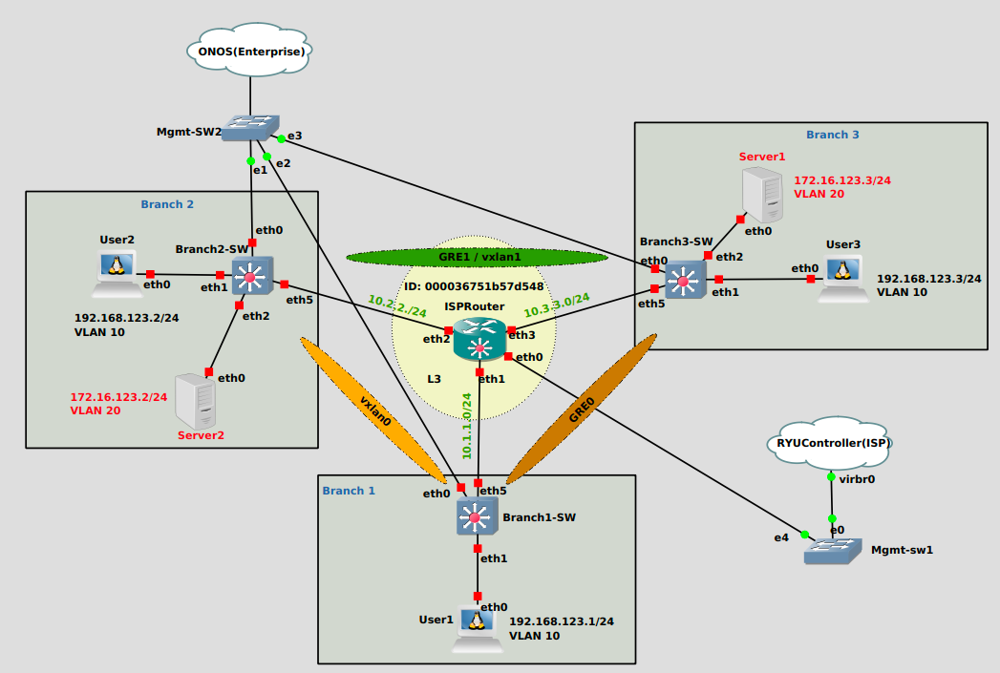

*Server2 and Server3 communicate directly between Branch2 and Branch3, without crossing Branch1.*


### Branch2: Manual Layer 2 Stretch over GRE

At **Branch2**, this is the manual equivalent of `branch2 servers gre`. Configure both peers and remove the alternate VXLAN server tunnel:

```bash
ovs-vsctl --may-exist add-port project-br eth2
ovs-vsctl set Port eth2 vlan_mode=access tag=20
ip link set eth2 up
ovs-vsctl --if-exists del-port project-br vxlan23
ovs-vsctl --may-exist add-port project-br gre23
ovs-vsctl set Port gre23 vlan_mode=access tag=20 other-config:stp-enable=false
ovs-vsctl set Interface gre23 type=gre options:local_ip=10.2.2.1 \
  options:remote_ip=10.3.3.1 options:key=20
ovs-vsctl list Interface gre23
```


### Branch3: Manual Layer 2 Stretch over GRE

At **Branch3**, this is the manual equivalent of `branch3 servers gre`. Configure both peers and remove the alternate VXLAN server tunnel:

```bash
ovs-vsctl --may-exist add-port project-br eth2
ovs-vsctl set Port eth2 vlan_mode=access tag=20
ip link set eth2 up
ovs-vsctl --if-exists del-port project-br vxlan23
ovs-vsctl --may-exist add-port project-br gre23
ovs-vsctl set Port gre23 vlan_mode=access tag=20 other-config:stp-enable=false
ovs-vsctl set Interface gre23 type=gre options:local_ip=10.3.3.1 \
  options:remote_ip=10.2.2.1 options:key=20
ovs-vsctl list Interface gre23
```


## 9 Insert and Configure the Branch1 Firewall

Stop User1 and Branch1. Insert a dedicated OVS named Firewall: User1 eth0→Firewall eth1; Firewall eth2→Branch1 eth1. Start nodes, inspect/remove unused sample bridges on Firewall, copy both project configuration and firewall scripts into it, then run at **Firewall**:

```bash
bash /root/Project_Configure_OVS.sh firewall
bash /root/Project_Firewall.sh
ovs-ofctl -O OpenFlow13 dump-flows project-br
```

### Verification

Actual ofports must be1 user-side and2 branch-side. The script replaces the flow table **only on this dedicated firewall**. It uses OVS conntrack zone11 and two tables. Require a Linux OVS datapath with conntrack support; if `ct` actions are rejected, resolve VM/kernel compatibility before continuing. See [OVS conntrack tutorial](https://docs.openvswitch.org/en/stable/tutorials/ovs-conntrack/).

The policy applies to **new IPv4 conversations** toward User1; established/related replies are allowed. ARP passes in both directions. IPv6 and other EtherTypes are outside this IPv4 exercise and dropped. New outbound IPv4 from User1 is allowed. User2 can initiate TCP and ICMP, while User3 can initiate IPv4 except ICMP/UDP. This session-based interpretation preserves legitimate replies to User1-initiated traffic.


**Inline Branch1 Firewall**

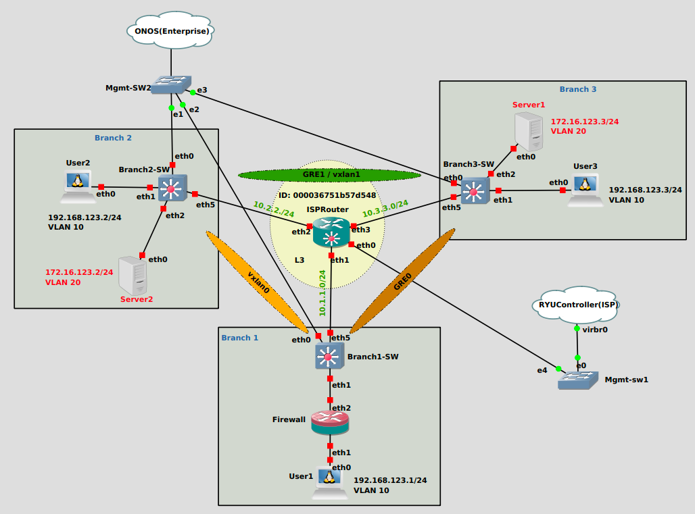


### Copyable Stateless Firewall ACL

This **optional comparison** runs only inside the dedicated Firewall appliance, with eth1 toward User1 and eth2 toward Branch1. It is the inline equivalent of Project_Firewall_ACL.sh. Use it during the ACL comparison in step10, rather than replacing the main stateful pipeline before its tests:

```bash
#!/usr/bin/env bash
# Optional stateless ACL baseline. eth1=User1; eth2=Branch1.
# Use Project_Firewall.sh for stateful reply handling in the main guide.
set -euo pipefail
bridge=project-br
for number in 1 2; do
  [[ $(ovs-vsctl get Interface "eth$number" ofport) == "$number" ]] || exit 1
done
ovs-ofctl -O OpenFlow13 del-flows "$bridge"
cat > /tmp/project-firewall-acl.flows <<'EOF'
cookie=0xbf10,priority=1000,in_port=1,actions=NORMAL
cookie=0xbf10,priority=900,arp,actions=NORMAL
cookie=0xbf10,priority=400,in_port=2,icmp,nw_src=192.168.123.3,nw_dst=192.168.123.1,actions=drop
cookie=0xbf10,priority=400,in_port=2,udp,nw_src=192.168.123.3,nw_dst=192.168.123.1,actions=drop
cookie=0xbf10,priority=300,in_port=2,ip,nw_src=192.168.123.3,nw_dst=192.168.123.1,actions=NORMAL
cookie=0xbf10,priority=400,in_port=2,tcp,nw_src=192.168.123.2,nw_dst=192.168.123.1,actions=NORMAL
cookie=0xbf10,priority=400,in_port=2,icmp,nw_src=192.168.123.2,nw_dst=192.168.123.1,actions=NORMAL
cookie=0xbf10,priority=0,actions=drop
EOF
ovs-ofctl -O OpenFlow13 add-flows "$bridge" /tmp/project-firewall-acl.flows
```

The block verifies port numbering, replaces only the firewall’s project-br flow table, permits ARP, and applies the IPv4 ACL. Stateless rules also filter matching reply packets. Restore `bash /root/Project_Firewall.sh` for the main guide’s stateful outbound-and-reply tests.


## 10 Test Firewall Policy with Positive and Negative Cases

Copy `Project_UDP_Probe.py` into User1/2/3. In a **User1** terminal start a bounded UDP echo service:

```bash
python3 /root/Project_UDP_Probe.py server --port 9000 --seconds 180
```

In another User1 console, start a TCP listener:

```bash
iperf3 -s -D -I /tmp/project-user1-iperf.pid
```

From **User2**, before making outbound tests from User1:

```bash
ping -c 4 192.168.123.1
iperf3 -c 192.168.123.1 -t 5
python3 /root/Project_UDP_Probe.py client --peer 192.168.123.1 --port 9000
```

Expect ping/TCP success and UDP failure. From **User3**:

```bash
ping -c 4 192.168.123.1
iperf3 -c 192.168.123.1 -t 5
python3 /root/Project_UDP_Probe.py client --peer 192.168.123.1 --port 9000
```

Expect ICMP/UDP failure and TCP success. A failed probe intentionally exits nonzero; do not treat its output as a script defect.

### Verification — Firewall

```bash
ovs-ofctl -O OpenFlow13 dump-flows project-br
ovs-appctl dpctl/dump-conntrack
```

Counters must increment on the intended allow/drop rules. Now start bounded UDP echo servers on9000 at **User2 andUser3**, then initiate UDP probes and pings from **User1** to both. These outbound conversations and their replies should work. Test new incoming flows with new source ports; established sessions are deliberately allowed and do not prove a deny rule is broken.

Stop the bounded UDP servers when finished; they exit automatically after their duration. Document source, destination, protocol, expected result, actual result, and matching rule counter in `config_backup/firewall-results.txt`.

### Optional Comparison: Stateless ACL and Stateful Firewall

Copy `Project_Firewall_ACL.sh` into the dedicated Firewall node. It implements the packet-based ACL with corrected TCP/ARP permits and the actual port mapping: **eth1 is internal/User1**, and **eth2 is branch-facing**. Verify the physical cabling and actual OpenFlow port numbers before applying rules.

```bash
bash /root/Project_Firewall_ACL.sh
ovs-ofctl -O OpenFlow13 dump-flows project-br
```

Repeat new inbound User2/User3 tests: User2 TCP/ICMP pass, both users’ disallowed UDP fails, and User3 ICMP fails. Unlike conntrack, a stateless deny also catches matching replies: User1’s ping to User3 cannot complete when its returning echo reply is dropped. That distinction is why the main guide uses the stateful helper to satisfy outbound initiation and return traffic together.

Restore the main stateful pipeline before continuing:

```bash
bash /root/Project_Firewall.sh
```

Verify its two tables and repeat an outbound User1→User3 test. Start fresh flows for each policy test; old conntrack sessions are not evidence that a new-connection deny is ineffective.

## 11 Insert Selective TCP and UDP Port Translation

Stop Server2/Branch2 and insert a dedicated OVS Translator: Server2 eth0→Translator eth1; Translator eth2→Branch2 eth2. Start nodes, remove unused sample bridges on Translator, and copy the project configuration and translation scripts into it. At **Translator**:

```bash
bash /root/Project_Configure_OVS.sh translator
bash /root/Project_Translation.sh
ovs-ofctl -O OpenFlow13 dump-flows project-br
```

Copy `Project_UDP_Probe.py` into Server2/3. At **Server3**:

```bash
python3 /root/Project_UDP_Probe.py server --port 500 --seconds 120
```

At **Server2**:

```bash
python3 /root/Project_UDP_Probe.py client --peer 172.16.123.3 --port 300
```

### Verification

Expect5/5 replies. Server3 logs destination service500, while the connected client accepts replies from300. Capture both translator links: requests change UDP destination300→500 and replies source500→300. IPs remain172.16.123.2↔.3. Both in_port and both host IPs scope the rules. This raw UDP probe verifies UDP independently. The updated helper also translates TCP300↔500 for the same two hosts.

### Verify TCP Translation Too

The helper installs four rules: forward/reverse UDP and forward/reverse TCP. At **Server3**, in a separate console from the UDP echo process:

```bash
iperf3 -s -p 500 -D -I /tmp/project-server3-iperf.pid
```

At **Server2**:

```bash
iperf3 -c 172.16.123.3 -p 300 -t 10
iperf3 -c 172.16.123.3 -p 300 -u -b 2M -t 10
```

Both should succeed: TCP300 reaches TCP500, and iperf3 UDP uses the translated TCP control connection plus translated UDP data. Stop the raw UDP500 echo process before running the iperf3 UDP test, because both need UDP500. The connected raw UDP probe remains the independent test of reverse source-port translation. Inspect both access-link captures and rule counters; unrelated ports and other source IPs must remain unchanged.


**Service-translation stage: inline device at Branch2**

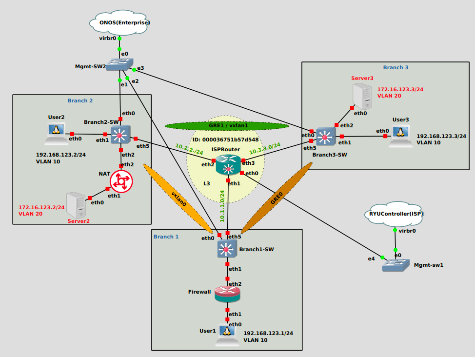


### Copyable TCP and UDP Service-Port Translation

Run **inside Translator**, with eth1 toward Server2 and eth2 toward Branch2. This block is the manual equivalent of Project_Translation.sh; use either the helper or this block:

```bash
#!/usr/bin/env bash
# Run INSIDE the inline translator: eth1 Server2, eth2 Branch2.
set -euo pipefail
bridge=project-br
for number in 1 2; do
  [[ $(ovs-vsctl get Interface "eth$number" ofport) == "$number" ]] || exit 1
done
for protocol in udp tcp; do
  ovs-ofctl -O OpenFlow13 add-flow "$bridge" \
    "cookie=0xbd00,priority=300,in_port=1,$protocol,nw_src=172.16.123.2,nw_dst=172.16.123.3,tp_dst=300,actions=mod_tp_dst:500,NORMAL"
  ovs-ofctl -O OpenFlow13 add-flow "$bridge" \
    "cookie=0xbd00,priority=300,in_port=2,$protocol,nw_src=172.16.123.3,nw_dst=172.16.123.2,tp_src=500,actions=mod_tp_src:300,NORMAL"
done
```

Verify with `ovs-ofctl -O OpenFlow13 dump-flows project-br`. Four rules match the intended ingress port, both server IPs, protocol, and300↔500 service ports.


## 12 Prove Translation Does Not Affect Other Traffic

Keep the500 server running. At **Server2**, temporarily add a second identity and test the same destination port:

```bash
ip addr add 172.16.123.22/24 dev eth0
python3 /root/Project_UDP_Probe.py client --bind 172.16.123.22 --peer 172.16.123.3 --port 300
ip addr del 172.16.123.22/24 dev eth0
```

Expect failure because only source172.16.123.2 is translated and no300 service is running. Start a separate bounded echo service on4000 at **Server3**, then test at **Server2**:

```bash
python3 /root/Project_UDP_Probe.py client --peer 172.16.123.3 --port 4000
ping -c 4 172.16.123.3
```

### Verification

Unrelated4000 and ICMP pass unchanged. Reserve Server3’s TCP/UDP500 service for the translated Server2 traffic; this fixed packet-rewrite example does not track separate direct-to500 sessions from that same client IP. Translation counters should increase only for the selected300↔500 flow. Save captures and results. If the reverse rule is removed, the connected300 client cannot accept a reply sourced from500; restore the script after this optional negative test.

## 13 Configure Branch3 Monitoring

In the **Ubuntu VM**, create a dedicated unnumbered monitor bridge after checking the name is unused:

```bash
ip link show projmon
```

If absent:

```bash
sudo ip link add projmon type bridge
sudo ip link set projmon up
```

In GNS3 add a local Cloud exposing `projmon`; connect Branch3 eth10→Cloud projmon. Copy `Project_Mirror.sh` into Branch3, then at **Branch3**:

```bash
bash /root/Project_Mirror.sh
ovs-vsctl list Mirror
```

In the **Ubuntu VM**:

```bash
sudo tcpdump -ni projmon -e -s 0 -w config_backup/project-monitor.pcap
```

### Verification

Generate allowed user and server traffic, stop capture, and open it in Wireshark. Inspect host IPs, ICMP/UDP, and the VLAN 10/20 context. Monitor copies do not give the VM an IP route into either tenant subnet. Clear/re-enable the mirror as in Lab10 and prove copied traffic stops/returns while forwarding continues.

### Optional Monitoring of Additional Branches

Branch3 eth10 is the required baseline. To monitor Branch1 and Branch2 as well, apply the same mirror helper inside each additional branch and connect each eth10 to its own isolated Ubuntu capture bridge/Cloud, for example projmon1 and projmon2. Reuse the create-bridge, Cloud, capture, and cleanup procedure for each distinct name. Do not feed three copies of the same inter-branch conversation into one monitor and interpret their combined byte counters as unique traffic.

Verify each extra mirror independently by generating traffic involving that branch, checking the Mirror output-port UUID, and capturing on its assigned monitor interface. Keep each monitoring link outside the forwarding path and never use it as a management uplink.


**Monitoring stage: Branch3 mirror to ntopng**

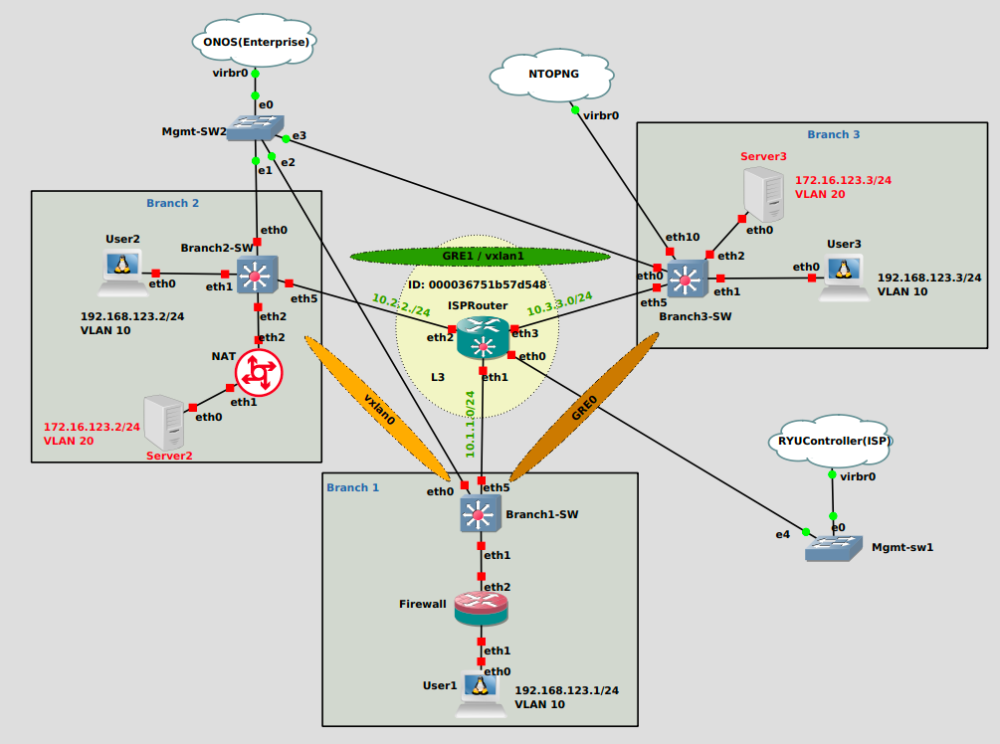

*This guide uses the dedicated projmon bridge instead of sharing virbr0 with the mirrored data.*


**Completed Traffic Monitoring Topology**

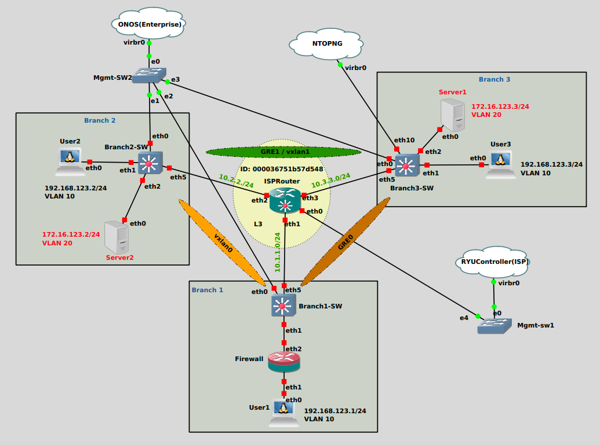

## 14 View Traffic with ntopng

Use the VM's preinstalled ntopng if available. If missing and the Ubuntu release provides these packages, run in the **Ubuntu VM**:

```bash
sudo apt update
sudo apt install -y ntopng redis-server
ntopng --version
ntopng --help
sudo systemctl start redis-server
```

If a packaged ntopng service occupies3000, stop it before a dedicated foreground lab instance. Then:

```bash
sudo systemctl stop ntopng
sudo ntopng -i projmon -w :3000 -m "192.168.123.0/24,172.16.123.0/24"
```

The packaged data directory is used so ntopng can write after dropping privileges. Run in its own Ubuntu pane and open `http://127.0.0.1:3000` inside the VM. Use the first-run login/password workflow of the installed version. Do not publish monitoring credentials or expose this UI to the internet.

### Verification

Select projmon, generate20–30 seconds of allowed iperf3 traffic at a bounded2 Mbit/s rate between User2 andUser3, and compare host/flow counters in ntopng with Wireshark. Use a server on User3 and a client on User2 as in Lab09. ntopng feature availability varies by edition; packet/host visibility is sufficient here. Stop the foreground instance with Ctrl+C after recording results.


### Copyable Mirror Configuration

Run **inside Branch3** as the manual equivalent of Project_Mirror.sh. Its eth10 must connect only to the projmon monitoring Cloud:

```bash
#!/usr/bin/env bash
# Run INSIDE Branch3; eth10 connects only to the monitoring Cloud.
set -euo pipefail
ovs-vsctl --may-exist add-port project-br eth10
ip link set eth10 up
ovs-vsctl clear Bridge project-br mirrors
ovs-vsctl -- --id=@p get Port eth10 \
  -- --id=@m create Mirror name=project-monitor select-all=true output-port=@p \
  -- set Bridge project-br mirrors=@m
```

Verify with `ovs-vsctl list Mirror`, then capture on projmon from Ubuntu as described in step13.


### Start the Traffic Monitor

In an **Ubuntu pane**, after ntopng and Redis are installed, run one foreground monitoring instance. Use this instead of starting another instance with the command above:

```bash
sudo systemctl start redis-server
sudo systemctl stop ntopng
sudo ntopng -i projmon -w :3000 -m "192.168.123.0/24,172.16.123.0/24"
```

Open http://127.0.0.1:3000 inside Ubuntu. Stop this foreground instance with Ctrl+C when finished.


## 15 Prepare Controller Automation

The supplied Python script automates **controller lifecycle, readiness checks, WAN REST configuration, and ONOS device verification**. It does not launch GNS3 or configure appliances remotely; the saved project and node scripts handle those steps.

Before its first use, complete step4 once so ONOS persists its provider/7777 settings. Stop the manually started Ryu and ONOS using their original launch methods. In the **Ubuntu VM**:

```bash
source "$HOME/sdn-controller.env"
python3 -m json.tool Project_Automation.json
python3 -m json.tool Project_WAN_Router.json
sudo -v
export ONOS_USER=onos
read -r -s -p 'ONOS password from the VM credentials: ' ONOS_PASSWORD
printf '\n'
export ONOS_PASSWORD
```

Review `Project_Automation.json`: use the actual Ryu executable and ONOS directory from Lab00. Exported `RYU_MANAGER` and `ONOS_HOME` override the source-image defaults. Do not put passwords in JSON or commit them.

### Verification

```bash
python3 Project_Automation.py --help
ss -ltn | grep -E ':(6653|7777|8080|8181)\b' || true
```

Start from stopped controllers for the first automation ownership test. The script uses foreground launch commands, writes controller logs under `config_backup`, and waits up to180 seconds. If your VM uses an ONOS service instead, start that service separately; automation can reuse it, but will not own or stop it.

## 16 Start, Configure, and Verify Automatically

With the GNS3 project nodes running and bridge/controller settings already applied, run in the **Ubuntu VM**:

```bash
python3 Project_Automation.py start
python3 Project_Automation.py configure
python3 Project_Automation.py verify
python3 Project_Automation.py configure
```

### Verification

Expect READY messages, WAN router read-back, and three available ONOS branch DPIDs. The second configure should produce no duplicate ADD operations. The router helper rejects conflicting routes and API-level failures, not just HTTP errors. Saved evidence includes `wan-router-state.json`, `onos-devices.json`, and controller logs.

Repeat host connectivity, firewall policy, server translation, and capture tests. Controller API success does not prove the data plane. If startup fails, inspect the named log and listeners before retrying; a partial existing listener is reported rather than overwritten. Existing reachable controllers are reused without new shutdown ownership.


### Copyable Controller Automation Script

Run this **Ubuntu shell block from the project directory** to write Project_Automation.py. Keep Project_Router_Config.py, Project_Automation.json, and Project_WAN_Router.json beside it. The implementation matches the supplied automation file; it starts or reuses controllers, waits for readiness, applies/verifies configuration, and stops only owned processes:

```bash
cat > Project_Automation.py <<'PYTHON'
#!/usr/bin/env python3
"""Start foreground controllers, configure WAN, verify visibility, stop owned processes."""
import argparse
import base64
import json
import os
from pathlib import Path
import signal
import socket
import subprocess
import sys
import time
from urllib.error import HTTPError
from urllib.request import Request, urlopen
from Project_Router_Config import apply

HERE = Path(__file__).resolve().parent
BACKUP = HERE / 'config_backup'
STATE = BACKUP / 'automation-processes.json'

def http_json(url, auth=False):
    headers = {}
    if auth:
        user = os.environ.get('ONOS_USER', 'onos')
        password = os.environ.get('ONOS_PASSWORD')
        if not password:
            raise RuntimeError('Set ONOS_PASSWORD in the shell; do not commit credentials')
        token = base64.b64encode((user + ':' + password).encode()).decode()
        headers['Authorization'] = 'Basic ' + token
    with urlopen(Request(url, headers=headers), timeout=5) as response:
        return json.load(response)

def reachable(url):
    try:
        with urlopen(url, timeout=3):
            return True
    except HTTPError as exc:
        return exc.code in (401, 403)
    except OSError:
        return False

def listening(port):
    try:
        with socket.create_connection(('127.0.0.1', port), timeout=1):
            return True
    except OSError:
        return False

def wait_for(label, predicate, timeout):
    end = time.monotonic() + timeout
    while time.monotonic() < end:
        if predicate():
            print('READY', label, flush=True)
            return
        time.sleep(1)
    raise RuntimeError('Timed out waiting for ' + label + '; inspect config_backup logs')

def birth(pid):
    # Linux process creation tick protects against stale PID reuse.
    data = Path('/proc/%d/stat' % pid).read_text()
    return data.rsplit(')', 1)[1].split()[19]

def start(config):
    state = json.loads(STATE.read_text()) if STATE.exists() else {}
    for name, url, ports in [
            ('onos', config['onos_url'] + '/onos/ui/', (8181, 7777)),
            ('ryu', config['ryu_url'] + '/router/all', (8080, 6653))]:
        if reachable(url):
            print('REUSE', name, '(will not add shutdown ownership)')
            continue
        if any(listening(port) for port in ports):
            raise RuntimeError('Partial/conflicting %s listener; inspect and stop it manually' % name)
        command = list(config[name + '_command'])
        if name == 'ryu' and os.environ.get('RYU_MANAGER'):
            command[0] = os.environ['RYU_MANAGER']
        if name == 'onos' and os.environ.get('ONOS_HOME'):
            command[2] = os.environ['ONOS_HOME'].rstrip('/') + '/bin/onos-service'
        with (BACKUP / (name + '.log')).open('ab') as log:
            process = subprocess.Popen(command, cwd=str(HERE), stdout=log,
                                       stderr=subprocess.STDOUT, start_new_session=True)
        state[name] = {'pid': process.pid, 'birth': birth(process.pid), 'command': command}
        STATE.write_text(json.dumps(state, indent=2) + '\n')
        wait_for(name, lambda: reachable(url), config['timeout_seconds'])
    wait_for('Ryu OpenFlow6653', lambda: listening(6653), config['timeout_seconds'])
    wait_for('ONOS OpenFlow7777', lambda: listening(7777), config['timeout_seconds'])

def verify(config):
    with (HERE / config['router_config']).open() as stream:
        desired = json.load(stream)
    apply(config['ryu_url'], desired, verify=True)
    devices = http_json(config['onos_url'] + '/onos/v1/devices', auth=True)
    available = {d['id'] for d in devices.get('devices', []) if d.get('available') is True}
    missing = set(config['expected_onos_devices']) - available
    if missing:
        raise RuntimeError('Missing/unavailable ONOS devices: ' + ', '.join(sorted(missing)))
    (BACKUP / 'onos-devices.json').write_text(json.dumps(devices, indent=2) + '\n')
    (BACKUP / 'wan-router-state.json').write_text(json.dumps(
        http_json(config['ryu_url'] + '/router/all'), indent=2) + '\n')
    print('VERIFIED expected router state and all three ONOS devices')

def stop():
    if not STATE.exists():
        print('No controllers started by this script')
        return
    state = json.loads(STATE.read_text())
    remaining = {}
    for name, item in state.items():
        pid = item['pid']
        try:
            if birth(pid) != item['birth'] or os.getpgid(pid) != pid:
                print('SKIP stale ownership record', name)
                continue
        except FileNotFoundError:
            continue
        try:
            os.killpg(pid, signal.SIGTERM)
        except PermissionError:
            subprocess.run(['sudo', '-n', 'kill', '-TERM', '--', '-%d' % pid], check=True)
        for _ in range(50):
            try:
                os.killpg(pid, 0)
            except ProcessLookupError:
                break
            except PermissionError:
                pass
            time.sleep(0.1)
        else:
            print('Still stopping; inspect controller log/process group:', name, pid)
            remaining[name] = item
        print('STOP requested for owned process group', name, pid)
    STATE.write_text(json.dumps(remaining, indent=2) + '\n')

def main():
    p = argparse.ArgumentParser(description=__doc__)
    p.add_argument('action', choices=['start', 'configure', 'verify', 'stop'])
    p.add_argument('--config', default='Project_Automation.json')
    args = p.parse_args()
    BACKUP.mkdir(exist_ok=True)
    with (HERE / args.config).open() as stream:
        config = json.load(stream)
    if args.action == 'start':
        start(config)
    elif args.action == 'configure':
        wait_for('WAN DPID', lambda: any(
            d.get('switch_id') == '0000000000000104'
            for d in http_json(config['ryu_url'] + '/router/all')), config['timeout_seconds'])
        with (HERE / config['router_config']).open() as stream:
            apply(config['ryu_url'], json.load(stream))
    elif args.action == 'verify':
        verify(config)
    else:
        stop()

if __name__ == '__main__':
    try:
        main()
    except Exception as exc:
        print('ERROR:', exc, file=sys.stderr)
        sys.exit(1)
PYTHON
```

After the credential/environment preparation in step15, use the start/configure/verify commands above. Run `python3 Project_Automation.py stop` during cleanup.


## 17 Save the Complete Build and Redeploy

In the **Ubuntu VM**:

```bash
cp Project_Configure_OVS.sh Project_Firewall.sh Project_Firewall_ACL.sh Project_Translation.sh Project_Mirror.sh config_backup/
cp Project_WAN_Router.json Project_Automation.json Project_Router_Config.py config_backup/
python3 Project_Automation.py verify
ls -lh config_backup
```

Export the GNS3 portable project. Copy each node's persisted interface file using Lab06. Save actual ofport mappings, controller settings, flow dumps, policy results, and both positive/negative captures. Add screenshots under this project's `images/image.png`, `image-1.png`, etc. Include the images when publishing the README.

To redeploy:

1. Recreate projmon and reopen the exported GNS3 project.
2. Restore management and endpoint addresses/MTU.
3. Reapply the WAN role and each branch's `base`/`servers` role; retain the same DPIDs.
4. Reapply firewall/translator base roles, then their dedicated policy scripts; reapply Branch3 mirror.
5. Run automation `start`, `configure`, and `verify`.
6. Repeat transport, tenant isolation, policy, translation, and mirror tests in that order.

### Verification

The same expected results must hold after a complete node/controller stop/start. Runtime OpenFlow rules and Ryu REST state may not survive restart even when OVSDB does. The scripts and desired-state JSON are the replayable configuration; dumps and screenshots are supporting evidence.

## 18 Terminate and Clean Up

Stop tracked iperf3 servers on their host nodes, using their PID files; bounded UDP servers exit automatically. Stop foreground ntopng and captures. In the **Ubuntu VM**:

```bash
python3 Project_Automation.py stop
unset ONOS_PASSWORD
```

The script sends TERM only to process groups it started and whose Linux creation identity still matches its saved record. Reused/manual/service controllers are not automatically stopped; stop those with their original lifecycle method. If a log reports a group still stopping, inspect it and retry `stop`; no blanket Java/Python kill is used.

Stop all GNS3 project nodes and detach the monitoring Cloud. If projmon was created solely for this project:

```bash
bridge link show master projmon
sudo ip link set projmon down
sudo ip link delete projmon type bridge
tmux kill-session -t sdn11 2>/dev/null || true
ss -ltn | grep -E ':(6653|7777|8080|8181|3000)\b' || true
```

### Verification

No project listeners or running nodes remain, projmon is gone, and virbr0 still exists. Keep exports, scripts, PCAPs, and results. ntopng/Redis installed services may remain available for future use; stop any lab-specific instance you started.

### Additional Server and Monitor Cleanup

At **Server3**, if its translated iperf3 service was started:

```bash
if [ -f /tmp/project-server3-iperf.pid ]; then
  kill "$(cat /tmp/project-server3-iperf.pid)"
  rm -f /tmp/project-server3-iperf.pid
fi
ss -ltn 'sport = :500'
```

After stopping/disconnecting the GNS3 monitor links, remove projmon1/projmon2 only if you created them for the optional monitoring extension and have checked that no other project uses them. Keep virbr0.


## Appendix: Internet Access for a GNS3 Node

Follow the NAT phase in [Lab06](../SDN_06_Lab06_GNS3_OVS_Foundations/README.md) when an appliance needs package downloads. Add a GNS3 NAT node and connect a spare management interface, or temporarily replace the node’s management Cloud connection after saving its static settings. Enable DHCP on that interface using its supported network manager, restart it, and inspect:

```bash
ip -4 address
ip route
cat /etc/resolv.conf
getent hosts ubuntu.com
```

Use the address, gateway, and DNS actually leased by the NAT node. They need not be192.168.122.0/24 or192.168.122.1. The outer Ubuntu VM can normally retain VirtualBox NAT for internet access; bridged mode is not an inherent GNS3 NAT requirement. Restore the project’s static management wiring and addresses before resuming controller tests.

## Troubleshooting

| Symptom | Check in order |
| --- | --- |
| No routed transport | Management, Ryu listener, WAN DPID 0104, API addresses, eth5 routes. |
| User overlay fails | Underlay ping, matching tunnel type/key/peer, VLAN 10, endpoint MTU. |
| Server traffic leaks into user network | Actual access tags, NORMAL baseline, inactive ONOS fwd, precise tunnel VLAN mapping. |
| Firewall blocks outbound replies | Conntrack support/state and both table0/table1 rules; test a fresh flow. |
| UDP translation appears one-way | Exact IP/port/ingress matches and reverse source-port rewrite. |
| Automation times out | Controller log, sudo credentials, executable paths, persisted ONOS 7777 setting, expected DPIDs. |
| Monitoring empty | Mirror association, eth10 cable, local Cloud projmon, active packet generation. |

## Completion Checklist

- All three branch WAN endpoints route successfully.
- VLAN 10 user traffic crosses VXLAN/GRE; VLAN 20 servers use a separate direct tunnel.
- Same-subnet negative tests prove VLAN separation.
- Firewall positive/negative tests and legitimate reply paths match the policy.
- Only the selected UDP 300↔500 service is translated.
- Mirror and ntopng results agree with generated traffic.
- Automation starts/reuses controllers safely, applies idempotently, verifies, logs, and stops owned processes.
- A full redeployment reproduces the results, and cleanup is complete.

References: [Ryu router API](https://osrg.github.io/ryu-book/en/html/rest_router.html), [OVS conntrack](https://docs.openvswitch.org/en/stable/tutorials/ovs-conntrack/), [OVS mirroring](https://docs.openvswitch.org/en/stable/faq/configuration/), [ntopng command-line options](https://www.ntop.org/guides/ntopng/cli_options/cli_options.html).
